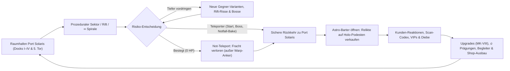

# Game Design Document (GDD): *STARLIGHTER*

> **Stand:** Version 1.4 (nach Meilenstein 10-C — Bugfixes, HUD, Tag/Nacht-Schleife, Teleporter, eigene Bosse, Balancing; Save v11; Meilenstein 11 in Arbeit)  
> **Kurzpitch:** Ein **Cozy Retro-Sci-Fi Action-RPG & Shop-Management-Spiel** im Browser, inspiriert von *Moonlighter 1*. Tagsüber plünderst du prozedurale Raumschiff-Wracks, Kristall-Nebel, Solar-Gießereien, Ältesten-Monolithen und instabile Dimensions-Rifts nach wertvoller Technologie (Nacht-Runs möglich: +35 % Beute, dafür keine Ladenschicht) — nachts führst du deinen eigenen Bergungs- und Relikt-Shop (*Astro-Barter*) auf der Frontier-Raumstation *Port Solaris*.

---

## 1. Visuelle Vision, Kernregeln & Architektur-Prinzipien

- **Stil:** Warme, lebendige 16-Bit/32-Bit-HD-Pixel-Art (`960×540` Canvas-Buffer bei 2× über `480×270` Logik-Koordinaten, `image-rendering: pixelated`) im Stil von *Moonlighter* — gebürstetes Metall, warme Holzakzente, Holo-Anzeigen, Sternennebel und dynamischer Licht-/Glow-Layer.
- **Unverrückbare Gameplay-Regeln (Design-Invariants):**
  1. **Zero-Dungeon-Credits-Regel:** Spieler erhalten **niemals** direkt Credits aus Dungeons/Gegnern (`state.credits +=` ist in `DungeonScene.ts`, `enemyAi.ts` und `dungeonRenderer.ts` strikt verboten). Reichtum entsteht ausschließlich durch **Relikt-Verkäufe in *Astro-Barter***, Bounties und Handel.
  2. **Alles In-Game integriert:** Keine externen Menüs — Cloud-Save, Rangliste, Musik-Jukebox, Begleiter-Dock, Schmiede, Prägungen und Sektor-Wahl sind als begehbare Stationen/Terminals direkt in der Spielwelt verankert.
  3. **Extraktions-Risiko:** 20 Cargo-Slots im Rucksack (Verlust bei 0 HP, außer durch *Warp-Anker* gerettet), sichere Lagertruhen im Shop/Quartier (28 / 36 / 48 Slots) und richtungsabhängige Cargo-Synergien (`→`, `↑`, `▲`, `←`).
  4. **Saubere Plattform-Unterstützung:** Maus+Tastatur, Touch-Controls (Portrait & Landscape) und nativer HTML5-Gamepad-Support (`InputManager.pollGamepad()`).

---

## 2. Core Gameplay Loop



---

## 3. Welt, Sektoren & Modi (Alle Live)

| Bereich / Sektor | Thema & Zugang | Ebenen & Endboss | Status |
| :--- | :--- | :--- | :--- |
| **Astro-Barter & Kapitäns-Quartier** | Dein Laden (Stufe I–III, 4→6→8 Podeste, Sale-Box, Handels-Droide) + privates Hinterzimmer (Koje – nur nachts, Truhen, Jukebox, Drohnen-Dock, Anzug-Stile, Trophäen) | Shop-Management, VIP-Events, Diebe fangen, Bounties | ✅ **Live** |
| **Port Solaris Promenade** | Zentraler Hub: *Kael's Exo-Schmiede* (MK-VIII & 🔥 Prägungen), *Dr. Lyra's Med-Bay*, *Vex' Tech-Labor*, *Nyx' Schwarzmarkt* & **★ Galaktische Kapitäns-Tafel** (Firebase Scoreboard & Cloud-Save) | NPC-Upgrades, Cloud-Sync, Ranglisten | ✅ **Live** |
| **Port Solaris Raumhafen** | 4 angedockte Schiffe (Docks I–IV) + zentrales **5. Tiefenraum-Tor** mit 4 leuchtenden Sektor-Siegeln | Sektor-Wahl & 5.-Tor-Auswahl | ✅ **Live** |
| **Sektor 1: Verlassene Korvette** | Dock I · Überwucherte Metalldecks → Reaktor-Glut | 3 Ebenen: *Schrott-Sammler „Krall“* → *Kern-Wächter MK-IV* → **A.E.G.I.S. LEVIATHAN** | ✅ **Live** |
| **Sektor 2: Kristall-Nebel** | Dock II · Violett-Cyan Kristallkavernen | 3 Ebenen: *Quarz-Koloss* → *Prisma-Weberin* → **★ PRISMA-ARCHON** | ✅ **Live** |
| **Sektor 3: Solar-Gießerei** | Dock III · Lava-Schluchten & Schmelzöfen | 3 Ebenen: *Schlacken-Koloss* → *Gießerei-Meisterin* → **★ VULKAN-TITAN** | ✅ **Live** |
| **Sektor 4: Ältesten-Monolith** | Dock IV · Obsidian-Astral-Kammern | 3 Ebenen: *Chrono-Wächter* → *Monolith-Koloss* → **★ DER STERNEN-ARCHON** | ✅ **Live** |
| **5. Tor: Omega-Anomalie** | Zentrales 5. Tor (ab 4/4 Schlüsseln) | Elite-Prüfung → **★ OMEGA STERNEN-ARCHON** → Story-Finale & **New Game+** | ✅ **Live** |
| **5. Tor: ∞ Unendliche Spirale** | Zentrales 5. Tor (ab Omega-Sieg) | Endlos-Ebenen (`E1 → ∞`), wechselnde Sektor-Echos, 4 Rift-Mutatoren, Bosse alle 3 Ebenen, Singularitäts-Relikte | ✅ **Live** |
| **🌀 Instabile Rift-Risse** | Zufällige Portale in gesäuberten Kampfräumen (S1–S4) | 2-Wellen-Elite-Anomalie → garantierter **Rift-Katalysator**, Anomalie-Relikt & Schatztruhe | ✅ **Live** |

---

## 4. Aktueller Projekt- & Meilenstein-Status

### ✅ Abgeschlossene Meilensteine (Phase 1 + Start Phase 2)

- **✅ Meilenstein 1 — Kern-Prototyp & HD-Look:** 60-FPS-Canvas-Engine (`960×540`), Web-Audio-Synth, Mobile-Touch, *Astro-Barter* mit Holo-Podesten, 4 Kunden-Preisreaktionen, Scan-Codex, Port Solaris Promenade, erste 3 Waffenklassen.
- **✅ Meilenstein 2 — Shop-Tiefe, Tag/Nacht & Skill-Kampf:** 3 Shop-Ausbaustufen, Sale-Box, offener Tresenzugang, Weltraum-Diebe, Bounties, Tag/Nacht-Zyklus (+35 % Nacht-Loot), Cargo-Synergien & Hex-Aegis-Schild mit Perfekt-Parade.
- **✅ Meilenstein 3 — Vollständiger Sektor 1, Hinterzimmer & Tech-Labor:** `BackroomScene`, 3 Ebenen + 3 Bosse (inkl. *A.E.G.I.S. Leviathan*), 4. Waffe (*Ionen-Speer*), MK-V Upgrades & *Vex' Tech-Labor* (3 passive Module).
- **✅ Meilenstein 4 — Atmosphäre, 2 neue Waffen, Begleiter & Raumhafen:** Retro-Synth-Jukebox, *Kinetik-Fäuste* & *Phasen-Diskus*, 4 Begleiter-Drohnen (*Puck*, *Spark*, *Luma*, *Halo*), *Nyx' Schwarzmarkt*, Handels-Droide, VIP-Tagesevents, `HangarScene` mit 4 Docks & 5. Tor, Material-Merkliste (`📌`), ebenenspezifische Gegner-Varianten, interaktive 8-Slot-Truhen, Schluchten & geheime Fallgruben-Schatzkammern.
- **✅ Meilenstein 5 — Sektor 2 (*Kristall-Nebel*) & MK-VI:** Dock II (*Kristall-Kreuzer*), 5 neue Gegner, 3 Bosse (inkl. *Prisma-Archon*), 8 Sektor-2-Relikte & MK-VI Kristall-Meister-Ausrüstung.
- **✅ Meilenstein 6 — Sektoren 3 & 4, 5. Omega-Tor, Endgame & QoL:** *Solar-Gießerei* (MK-VII), *Ältesten-Monolith* (MK-VIII), *Omega-Anomalie* + Story-Finale + New Game+, 5 Anzug-Farbschemata & Auren, Logbuch-Erfolge, Savegame-JSON-Export/Import & Gamepad-Support.
- **✅ Firebase Cloud-Save & Galaktische Kapitäns-Tafel:** Direkt auf der Port-Solaris-Promenade (`prop_scoreboard.png`) mit Google- & E-Mail/Passwort-Login, automatischem Handy↔PC Cloud-Sync (Save v8, `starlighter-15b1f`, abgesichert via `firestore.rules`), Live-Expeditionstimer (`⏱ mm:ss`), Tag/Nacht-Rekordtracking, Live-Aktivitäts-Feed & Rangliste.
- **✅ Meilenstein 10-B (vorgezogen) — Architektur-Split & Code-Splitting:** Aufspaltung von `DungeonScene.ts` in `src/dungeon/dungeonTypes.ts`, `src/dungeon/enemyAi.ts` und `src/dungeon/dungeonRenderer.ts` + Vite-Chunk-Splitting (`index`, `dungeon`, `firebase`) in `vite.config.ts`.
- **✅ Meilenstein 7 — Rift-Endgame, Elementar-Prägungen & ∞ Unendliche Spirale:**
  - 4 aktive Waffen-Prägungen bei Kael (`🔥 Solar-Brand`, `❄️ Kryo-Stasis`, `⚡ Ionen-Kette`, `🟣 Leeren-Siphon`) für alle 6 Waffenklassen.
  - 4 neue HD-Rift-Relikte (*Rift-Katalysator*, *Phasen-Geode*, *Äther-Prismakern*, *Singularitäts-Relikt*).
  - Instabile `🌀 RIFT-RISS`-Portale in regulären Sektoren (2 Elite-Wellen + garantierter Katalysator).
  - Endlos-Modus **∞ Die Unendliche Spirale** am 5. Tor mit 4 Rift-Mutatoren (`⚡ Überladen`, `🛡 Gepanzert`, `🩸 Vampirisch`, `💨 Beschleunigt`), skalierenden Bossen alle 3 Ebenen, eigenem Ranglisten-Filter (`🌀 Tiefster Rift`) & 2 neuen Erfolgen (*Elementar-Schmied* & *Spiral-Läufer*).
- **✅ Meilenstein 8 — Händler-Gilde, Verhandeln & Port-Solaris-Marktplatz (Save v9):**
  - **2-Runden-Verhandlungssystem („Feilschen“):** Optional beim Kassieren von VIPs, Stammkunden & seltenen/epischen Relikten (+15 % bis +40 % Bonus-Profit, Geduldsleiste, kein Item-Verlust bei Abbruch) via `src/systems/haggle.ts`.
  - **Stammkunden-Ruf (4 Named NPCs):** *Admiral Vance*, *Kuratorin Zora*, *Schmuggler Rix* und *Ingenieurin Tala* mit 3 Rufstufen, eigenen Shop-Auren & Dialogen, **4 sichtbaren Shop-Deko-Objekten** ab Stufe 2 und **Großaufträgen mit permanenten Gilden-Perks** ab Stufe 3 (`src/data/guildMarket.ts`).
  - **Marktplatz-Terrasse (`MarketTerraceScene.ts`):** Begehbarer Bereich südlich der Promenade mit **Milo's Alchemie-Bar** (5 Run-Elixiere aus Sektor-Materialien), **Händler-Gilden-Schaukasten** und **Solaris-Handelsbank** (4 Handelsrouten über 2–4 Tag/Nacht-Zyklen).
  - **Shop-Komfort (QoL) & 2 neue Erfolge:** `[F]` Schnell-Nachfüllen an Holo-Podesten zum Scan-Codex-Optimalpreis, **Schicht-Bilanz-Abschlusskarte** am Schichtende & Erfolge *Meister-Feilscher* + *Gilden-Ehrengast* (gesamt 14).

- **✅ Meilenstein 9 — Galaktisches Netzwerk & Lebendige Community (Save v10):** *(Spezifikation: [MILESTONE_9_ARCHITECTURE.md](MILESTONE_9_ARCHITECTURE.md))*
  - **Klickbare Kapitäns-Akten:** Klick auf einen Eintrag der Kapitäns-Tafel öffnet das Detailprofil (Waffe + Prägung, 5 Sektor-Bestzeiten, Tage-Rekorde, Rift, Erfolge, Prüfungs-Abzeichen, Holo-Gruß).
  - **Globale Markt-Konjunktur:** Deterministischer Tages-Trend (UTC-Datum, 8 Trends, offline) wirkt auf `getEffectiveFairPrice()`; sichtbar an Tafel, HUD, Scan-Codex & Podest-Modal.
  - **Geister-Kapitäne:** Echte Spieler aus `leaderboard` besuchen den Laden als Holo-Kunden (12 % Spawn-Chance, +10 % Gilden-Trinkgeld, eigener Holo-Gruß im Konto-Tab).
  - **Wöchentliche Galaktische Prüfung:** Wochen-Seed (`YYYY-Www`) am 5. Tor — identisches Layout, normierte MK-V-Ausrüstung, kein NG+/Prägung/Drohne/Elixier, **keine Beute & keine Progression**; Wochen-Rangliste (`weeklyTrials/{weekId}/entries/{uid}`), Gold/Silber/Bronze-Abzeichen & 2 neue Erfolge (gesamt 16). Das 5. Tor ist jetzt ein 3-Wege-Modal (Omega · Spirale · Prüfung).

- **✅ Meilenstein 10-A — Story, lebendige Station, Sektor-Mechaniken & Feinschliff (Save v11):** *(Spezifikation & Umsetzungsnotizen: [MILESTONE_10_ARCHITECTURE.md](MILESTONE_10_ARCHITECTURE.md))*
  - **Story mit Entscheidungen:** 7 Kapitel (Prolog → S1–S4 → Omega → NG+), 28 Gesprächsszenen mit Kael, Lyra, Nyx & Vex (4–8 Textboxen, Antwortwahl mit Ton 💛⚡🔍🛡), **Vertrauen 0–10**, 13 Story-Flags, 4 **Vertrauens-Boni** ab Stufe 7, einmaliges **Omega-Fest**, **📜 Chronik** im Logbuch (Wiederholen ohne Auswirkung). Immer überspringbar („Später ▸ Station“).
  - **Lebendige Raumstation:** Port Solaris verändert sich je Kapitel (Lichterketten, Kristall-Laternen, Solar-Wimpel, Holo-Obelisk, Omega-Fest-Banner & Feuerwerk, Zyklus-Hologramm) und je Entscheidung (Denkmal, heißere Esse, Echo-Station, Freihandels-Laterne, Leuchtfeuer/Lehrtafel); mehr Passanten und kurze Sprechblasen. 12 optionale Sprite-Slots mit prozeduralen Fallbacks.
  - **Sektor-Raum-Mechaniken:** S2 Kristall-Prismen (spiegeln/teilen Projektile), S3 Schmelz-Düsen & Magnetplatten, S4 Astral-Teleporter-Paare — deterministisch platziert (lokaler PRNG), auch in der ∞ Spirale; in der Wochen-Prüfung erst ab `2026-W49`.
  - **Boss-Phase-2-Musik** (Tempo +18 %, Hi-Hat, Oktav-Lead, Sting), **Touch-Größe 85–130 %**, **Zielhilfe Aus/Standard/Smart**, **Textgeschwindigkeit** — als Geräte-Einstellungen im Hilfe-Tab (nur `localStorage`, nicht im Cloud-Save). Erfolge: 18.

- **✅ Meilenstein 10-C — Bugs, Mobile-HUD, Spielschleife, Bosse & Balancing (Save v11):** *(Spezifikation & Umsetzungsnotizen: [MILESTONE_10C_ARCHITECTURE.md](MILESTONE_10C_ARCHITECTURE.md))*
  - **Gegner-Navigation:** Bodenläufer (u. a. Slimes) umgehen Hindernisse per Fluss-Feld + Anti-Hänger; **Rift-Portal** und Notfall-Bake spawnen nur auf freien Feldern.
  - **HUD:** Kampfwerte nur im Dungeon (sonst kompakte Status-Pille); Dungeon-Buttons liegen unter der Minimap, ein Ton-Button; **Waffenschrank** mit Slots ①/②, Tauschen und „→①/→②“ (auch in Fracht & Schmiede).
  - **Tag/Nacht-Schleife:** Laden nur nachts · Run am Tag → danach Nacht · Nacht-Run (+35 % Rar-Loot) → danach Tag, die Ladenschicht fällt aus · Koje nur nachts („Schicht überspringen“).
  - **Heim-Teleport entfernt:** Rückkehr nur über Start-Raum, Boss-Teleporter und die **Notfall-Bake** (ab Ebene II, einmalig).
  - **Eigene Bosse:** Krall (S1 E1), Schlacken-Koloss, Gießerei-Meisterin, Vulkan-Titan, Chrono-Wächter, Monolith-Koloss, Sternen-Archon — je 3–5 telegrafierte Angriffe + Phase 2; **Gegner-Schilde** mit Counterplay (Angriffs-Fenster, Überhitzung).
  - **Balancing:** Verkaufspreise ×0,65, Kopfgelder ×0,75, flachere frühe Waffenstufen + Fortschritts-Sperren, Boss-HP über Kampfdauer kalibriert (`src/data/balance.ts`), Bots deutlich später, Rift-Kammern härter (HP-/Schadensfaktor, 3. Welle, Elite).

- **🚧 Meilenstein 11 — Lebendige Gegner & Bosse (in Arbeit):** Cut-out-Rigs (`src/engine/rig.ts`, `src/data/rigs/<rig-id>.json`), Sprite-Pipeline (`npm run art:import`/`art:check`), **Kern-Wächter** komplett animiert (Pose-Sets für Arme/Kopf/Rumpf, weiche Übergänge, Laser-Brust, Phase-2-Verwandlung mit wegfliegenden Platten und kreisenden, abgefeuerten Fäusten), **Krall** teilweise (Greifzange, Panzer-Abwurf), **Teilen** von Quarz-Koloss und Sternen-Archon (gemeinsamer HP-Pool). Prozedurale Code-Beine wurden verworfen. Offen: weitere Boss-/Gegner-Rigs (warten auf Sprites). Details: `MILESTONE_11_ARCHITECTURE.md` §11, `RIGGING_GUIDE.md`, `BOSS_ANIMATION_PLAN.md`, `HANDOFF.md`.

---

## 4b. Story & Figuren (Kurzfassung)

**Setting:** Port Solaris ist eine Handelsstation am Rand der Galaxis. Aus den Wracks der vier Sektoren kommt das **Echo** — ein wiederkehrendes Signal. Es ist der Gesang der **vier Siegel**, die die Ältesten bauten, um die **Omega-Anomalie** hinter dem 5. Tor einzusperren; jeder Wächter (die Sektor-Endbosse) wurde von der Anomalie verdorben. Mit jedem Sieg wird das Echo klarer — nach dem Omega-Sieg verstummt es. Im Hintergrund will das **Helion-Konsortium** (goldener Sonnenring) die Anomalie als Energiequelle ausbeuten.

| Kapitel | Titel | Auslöser | Sichtbare Änderung auf Port Solaris |
| :--- | :--- | :--- | :--- |
| 0 | Prolog · Ankunft auf Port Solaris | Spielstart | Grundzustand |
| 1 | Kapitel I · Junos Zeichen | A.E.G.I.S. LEVIATHAN besiegt | Lichterketten leuchten wieder |
| 2 | Kapitel II · Das Lied der Kristalle | ★ PRISMA-ARCHON besiegt | Kristall-Laternen, Kristall-Pilger |
| 3 | Kapitel III · Funken der Sonnenschmiede | ★ VULKAN-TITAN besiegt | Solar-Wimpel, Gießerei-Arbeiter |
| 4 | Kapitel IV · Das Erbe der Ältesten | ★ DER STERNEN-ARCHON besiegt | Holo-Obelisk, Ältesten-Gelehrte |
| 5 | Kapitel V · Licht jenseits des 5. Tors | ★ OMEGA STERNEN-ARCHON besiegt | Omega-Fest: Banner & Feuerwerk |
| 6 | Epilog · Ein neuer Zyklus | New Game+ gestartet | Zyklus-Hologramm |

| Figur | Ton, den sie schätzt | Bogen | Vertrauens-Bonus (≥ 7) |
| :--- | :--- | :--- | :--- |
| **Kael** (Schmied) | ⚡ direkt | Trauert um seine Schülerin Juno, die den Korvetten-Reaktor von innen versiegelte | *Meisterhand:* Schmiede-Upgrades & Waffen-Fertigung −5 % Credits |
| **Dr. Lyra** (Ärztin) | 💛 warm | Behandelt das Echo-Fieber; Schuld aus der ersten Monolith-Expedition | *Notfallset:* +1 Stimpack |
| **Nyx** (Schwarzmarkt) | 🛡 vorsichtig | Ex-Helion-Schmugglerin: Verrat oder Wende | *Hinterzimmer-Ware:* +1 seltenes Schwarzmarkt-Angebot |
| **Vex** (Ingenieurin) | 🔍 neugierig | Entschlüsselt das Echo, erforscht danach die Spirale | *Sektor-Scanner:* Schatz-/Bossraum auf der Minimap |

Boni wirken **nicht** in der Galaktischen Prüfung (Lyra, Vex) und geben **nie Credits** (Zero-Dungeon-Credits-Regel).

---

## 5. Offene Punkte & Ideen (nach Meilenstein 10-C)

1. **Sprites (optional, Fallbacks vorhanden):** 12 Promenaden-Sprites (Art-Guide §7) und 5 Boss-Sprites (Art-Guide §8; `boss_scrap_collector` = Krall hat inzwischen ein Rig und ist nur noch Rückfall → niedrige Priorität). `npm run check:sprites` listet den Stand.
2. **Ökonomie laufend beobachten:** `tests/out/economy.json` (Preise, Upgrade-Kosten, Kopfgelder) und `tests/out/ttk.json` (Boss-Kampfdauer) nach Spielgefühl nachjustieren — alle Werte in `src/data/balance.ts`.
3. **Balancing nach echten Spieldaten:** Par-Zeiten der Wochen-Prüfung (M10-C neu: +180 s), Mechanik-Häufigkeiten, Vertrauens-Schwellen, Boss-Angriffe.
4. **Story-Erweiterung:** weitere Szenen pro Kapitel, vertonte Jingles.
5. **Wöchentliche Prüfung:** zusätzliche Wochen-Modifikatoren (z. B. „nur Nahkampf“).

---

## 6. Codebase- & Dateikarte (für schnelle Orientierung)

```text
src/
├── main.ts                     # Haupt-Game-Loop, Szenenwechsel, Firebase Auto-Sync-Hook
├── types.ts                    # Zentrale Typen (SaveData v11, CaptainRecords, InfusionId, RiftMutatorId …)
├── assets/
│   ├── artLoader.ts            # HD-Pixel-Art Preloader (public/art/**)
│   └── pixelArt.ts / sprites.ts
├── data/
│   ├── balance.ts              # M10-C: zentrales Balancing (Preise, Boss-HP, Rift-Faktoren, Waffen-Sperren, Schilde)
│   ├── rigs.ts / rigs.json     # M11: Rig-Definitionen (Teile-Baum, Pose-Sets) + Zuordnung kind → Rig
│   ├── items.ts                # 46 Relikte (S1–S4 + 4 Rift-Relikte) & Loot-Tables
│   ├── upgrades.ts             # 6 Waffenklassen bis MK-VIII, Suit, Med-Bay, Shop, Tech-Labor
│   ├── infusions.ts            # 4 Elementar-Prägungen & 4 Rift-Mutatoren
│   ├── marketTrends.ts         # M9: 8 globale Tages-Markttrends (UTC-deterministisch)
│   ├── ghostGreetings.ts       # M9: Holo-Gruß-Presets & sanitizeGreeting()
│   ├── guildMarket.ts          # 4 Stammkunden, Shop-Deko, Großaufträge, 5 Elixiere & 4 Bank-Routen
│   ├── companions.ts           # 4 Begleiter-Drohnen, 5 Anzug-Stile, 18 Erfolge, Events, Jukebox
│   └── story/
│       ├── storyChapters.ts    # M10: 7 Kapitel, NPC-Meta, Vertrauens-Boni, Passanten-Plan & -Sprüche
│       ├── storyTypes.ts       # M10: Dialog-Graph-Typen (StoryScene, StoryNode, StoryChoice)
│       └── storyScenes.ts      # M10: 28 NPC-Szenen + Omega-Fest als Dialog-Graphen
├── dev/
│   └── bossLab.ts              # M11: Boss-Labor (`?bosslab`, nur Dev/Ansicht)
├── dungeon/
│   ├── dungeonTypes.ts         # Enemy, BossState, Projectile (+splitGen), LightningArcFx, SiphonOrbFx …
│   ├── navGrid.ts              # M10-C: Fluss-Feld-Navigation für Bodenläufer
│   ├── mechanicsGen.ts         # M10: Platzierung der Sektor-Mechaniken (lokaler PRNG, Freihalte-Zonen)
│   ├── roomMechanics.ts        # M10: RoomMechanicsSystem (Prismen, Düsen, Magnetplatten, Teleporter)
│   ├── roomMechanicsRenderer.ts # M10: Boden-Layer & y-sortierte Mechanik-Objekte
│   ├── enemyAi.ts              # DungeonEnemyAi (inkl. Burn-DoT, Kryo-Slow, Hasted & alle Bosse)
│   ├── bosses/                 # M10-C: BossDef/Engine/Telegraph-FX/Looks (defs.ts, bossEngine.ts, bossFx.ts, bossLooks.ts)
│   ├── anim/                   # M11: bossAnims.ts (Posen je Zustand, Glättung), detached.ts (abgelöste Teile), motion.ts (Gegner-Bewegung)
│   └── dungeonRenderer.ts      # DungeonRenderer (S1–S4, Rift-Risse, Blitze, Orbs, Minimap, Timer)
├── engine/
│   ├── input.ts                # Tastatur, Maus, Touch & Gamepad (btnMap)
│   ├── audio.ts                # Web-Audio-Synth (SFX, Musik, Boss-Phase-2-Musik)
│   └── rig.ts                  # M11: Cut-out-Rig (Teile, Gelenke, Pose-Varianten) — Daten in data/rigs.json
├── scenes/
│   ├── DungeonScene.ts         # Kampf, Waffen-Combos, Prägungen, Rift-Kammern, ∞ Spirale
│   ├── ShopScene.ts            # Astro-Barter Verkauf, Feilschen, Stammkunden, Deko, [F] Refill
│   ├── BackroomScene.ts        # Kapitäns-Quartier (Schlaf, Truhen, Jukebox, Drohnen, Stile)
│   ├── HubScene.ts             # Port Solaris Promenade (NPCs, !-Marker, Passanten, Sprechblasen)
│   ├── hubEvolution.ts         # M10: Stations-Entwicklung je Kapitel/Flag (Sprite + prozeduraler Fallback)
│   ├── MarketTerraceScene.ts   # Marktplatz-Terrasse (Milo's Alchemie-Bar, Gilde, Handelsbank)
│   └── HangarScene.ts          # Raumhafen (Docks I–IV & 5. Tiefenraum-Tor)
├── services/
│   ├── firebaseConfig.ts       # Öffentliche Web-App-Config (starlighter-15b1f)
│   ├── firebaseService.ts      # Auth (Google + E-Mail), Cloud-Save, Leaderboard, Activity Feed & Prüfungs-Einträge
│   └── galacticNetwork.ts      # M9: Geister-Kapitäne-Pool & Wochen-Rangliste (Cache)
├── systems/
│   ├── gameState.ts            # Zentraler State, Save/Load v11, Rekorde, Prägungen, Bank, Ruf, Prüfung & Story
│   ├── economy.ts              # Scan-Codex, Preisreaktionen, Optimalpreis & Nachfrage-Decay
│   ├── haggle.ts               # 2-Runden-Feilschen State Machine
│   ├── seededRng.ts            # M9: FNV-1a/Mulberry32, withSeededRandom, ISO-Wochen-/UTC-Tages-IDs
│   ├── storyEngine.ts          # M10: reine Story-Logik (Szene wählen, Varianten, Antworten, Validierung)
│   ├── deviceSettings.ts       # M10: Touch-Größe, Zielhilfe, Textgeschwindigkeit (nur localStorage)
│   ├── weeklyTrial.ts          # M9: Prüfungs-Rotation, normierte Stufen, Score, Abzeichen
│   └── inventory.ts            # Cargo, Truhe & richtungsabhängige Synergien
├── ui/
│   ├── UIManager.ts            # HUD & In-Game-Modals (Inventar, Schmiede/Prägungen, Tafel …)
│   ├── MarketModals.ts         # M8-Modals (Feilschen, Schichtbilanz, Stammkunden, Alchemie, Bank)
│   ├── NetworkModals.ts        # M9: Kapitäns-Akte, Konjunktur-Banner, Prüfungs-Karte/-Ergebnis/-Rangliste
│   ├── TouchControls.ts        # Virtueller Stick & Buttons (Touch-Größe)
│   ├── LoadoutPanel.ts         # M10-C: Waffenschrank (Slots ①/②)
│   └── StoryModals.ts          # M10: Dialog-Controller (Schreibmaschine, Antworten, Später) & Chronik
└── world/
    └── dungeonGen.ts           # Prozedurale Sektor-Ebenen, Schluchten, Geheimkammern, Rifts & ∞ Spirale
```

- **Build & Deploy:** `npm run build` (`tsc && vite build`), Push auf `main` triggert automatisches Vercel-Deployment.
- **Meilenstein-11 (Rigs & Boss-Animation):** [MILESTONE_11_ARCHITECTURE.md](MILESTONE_11_ARCHITECTURE.md) (Plan + §11 Umsetzungsnotizen), [RIGGING_GUIDE.md](RIGGING_GUIDE.md) (Handbuch), [BOSS_ANIMATION_PLAN.md](BOSS_ANIMATION_PLAN.md) (Fertig-Definition & Aufgaben), [ART_BRIEF_M11.md](ART_BRIEF_M11.md) / [ART_BRIEF_M11_ENEMIES.md](ART_BRIEF_M11_ENEMIES.md) (Sprite-Briefings).
- **Meilenstein-10-Architektur:** [MILESTONE_10_ARCHITECTURE.md](MILESTONE_10_ARCHITECTURE.md) (Story mit Entscheidungen, lebendige Station, Sektor-Mechaniken, Musik, Steuerung & Save v11 — inkl. Umsetzungsnotizen §11).
- **Meilenstein-9-Architektur:** [MILESTONE_9_ARCHITECTURE.md](MILESTONE_9_ARCHITECTURE.md) (Akten, Konjunktur, Geister-Kapitäne, Wöchentliche Prüfung & Save v10).
- **Meilenstein-8-Architektur:** [MILESTONE_8_ARCHITECTURE.md](MILESTONE_8_ARCHITECTURE.md) (Detail-Spezifikation zu Feilschen, Stammkunden-Ruf, Marktplatz-Terrasse, Alchemie-Bar, Handelsbank & Save v9).
- **Art-, Sprite- & UI-Design-Guide:** [ART_AND_DESIGN_GUIDE.md](ART_AND_DESIGN_GUIDE.md) (Prompt-Formeln, Flood-Fill-Freistellung, Farbpaletten & UI-Regeln für gleichbleibende HD-Pixel-Art-Qualität).
- **Test- & Verifikations-Workflow:** [TESTING_AND_VERIFICATION.md](TESTING_AND_VERIFICATION.md) (Build-Checks, Design-Invarianten, Headless-Chrome-CDP-Harness, Screenshot-QA & bekannte Stolperfallen).
- **Firestore-Regeln:** [firestore.rules](firestore.rules) (Owner-only `saves/{uid}`, Public-Read/Owner-Write `leaderboard/{uid}`, Public-Read/Auth-Create `activities`, Public-Read/Owner-Write `weeklyTrials/{weekId}/entries/{uid}`).
