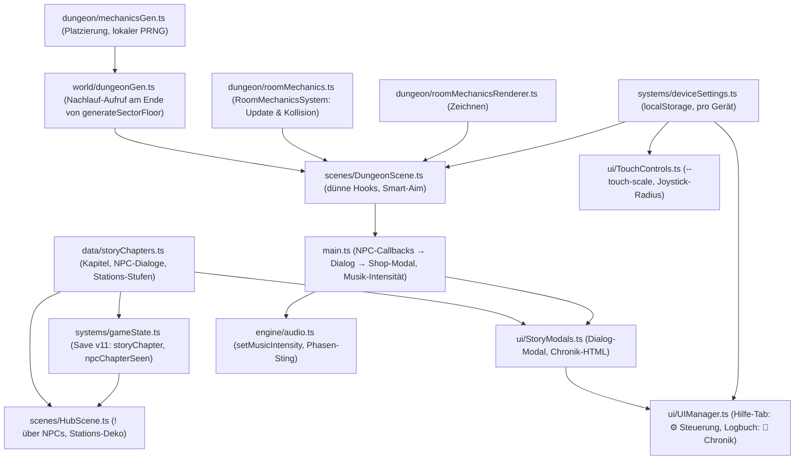

# Architektur- & Vorgehensplan: Meilenstein 10-A — Story-Tiefe, Sektor-Rätsel & Audio-/Mobile-Feinschliff

> **Status:** 🔜 Geplant — Umsetzungsvorlage für einen KI-Coding-Agent (z. B. Claude Sonnet)
> **Basis:** Stand nach Meilenstein 9 (`SaveData v10`, Galaktisches Netzwerk, Wöchentliche Prüfung)
> **Ziel-Save-Version:** `SAVE_VERSION = 11`
> **Quelle der Anforderungen:** [GAME_DESIGN_DOCUMENT.md §5](GAME_DESIGN_DOCUMENT.md) (Roadmap M10-A, Punkte 1–3)

**So benutzt du dieses Dokument:** Lies zuerst [AGENTS.md](AGENTS.md) und §2 (Invarianten). Arbeite dann die Phasen in §7 **strikt in Reihenfolge** ab. Jede Phase ist einzeln baubar, testbar und committbar (`feat(m10): …`). Zeilennummern sind Orientierung (Stand M9) — **immer per `grep` verifizieren**. Wo der Plan ein „Warum“ nennt, ist das eine bewusste Designentscheidung: nicht stillschweigend anders lösen, sondern Abweichungen in §11 notieren.

---

## 1. Scope (3 Feature-Blöcke, 6 Features)

| # | Feature | Kurzbeschreibung | Risiko |
| :--- | :--- | :--- | :--- |
| F1 | **NPC-Dialogkapitel** | 7 Story-Kapitel (Ankunft → S1–S4 → Omega → NG+). Kael, Lyra, Nyx & Vex haben pro Kapitel einen kurzen Dialog; ein „!“ über dem NPC zeigt Neues an. Nachlesbar als **📜 Chronik** im Logbuch. | niedrig |
| F2 | **Visuelle Stations-Entwicklung** | Port Solaris verändert sich sichtbar mit jedem Kapitel (Lichterketten, Kristall-Laternen, Solar-Banner, Holo-Obelisk, Omega-Festival, Zyklus-Hologramm). Rein prozedural gezeichnet, keine neuen Sprites. | niedrig |
| F3 | **Sektor-Raum-Mechaniken** | S2: reflektierende **Kristall-Prismen** · S3: periodische **Schmelz-Düsen** + **Magnetplatten** · S4: paarweise **Astral-Teleporter-Pads**. Gilt auch für die Spirale (über `visualSector`). | **hoch** |
| F4 | **Boss-Phase-2-Musik** | Musik-„Intensität“ in der Web-Audio-Engine: Tempo +18 %, Hi-Hat-Puls, Oktav-Lead und ein einmaliger Phasen-Sting, sobald ein Boss in Phase 2 geht. | niedrig |
| F5 | **Anpassbare Touch-Button-Größe** | 4 Stufen (85 % / 100 % / 115 % / 130 %) für Buttons **und** Joystick, gespeichert **pro Gerät**. | niedrig |
| F6 | **Optionaler Mobile-Aim-Assist** | 3 Modi: *Aus* (Laufrichtung), *Standard* (heutiges Verhalten), *Smart* (Blickrichtungs-Kegel, Ziel-Haftung, Ziel-Marker). | mittel |

**Nicht im Scope:** neue Sprites oder Gegner, neue Sektoren, Änderungen an Wirtschaft, Firebase oder Firestore-Regeln.

---

## 2. Design-Invarianten & Leitplanken (verbindlich)

1. **Zero-Dungeon-Credits:** Kein `state.credits +=` in `DungeonScene.ts`, `enemyAi.ts`, `dungeonRenderer.ts` **und auch nicht in den neuen Dateien unter `src/dungeon/`** (§3). Mechaniken geben weder Credits noch Beute.
2. **Alles In-Game:** Dialoge erscheinen beim Ansprechen der NPCs auf der Promenade; die Chronik steht im Logbuch; Geräte-Einstellungen liegen im Inventar-Tab **„Hilfe“** (Abschnitt „⚙ Steuerung“). Es gibt keine externen Menüs.
3. **Save-Abwärtskompatibilität (v10 → v11):** Neue `SaveData`-Felder sind optional (`?`) und werden in `GameState.load()` defensiv vorbelegt. **Geräte-Einstellungen (F5/F6) kommen NICHT in den Spielstand** (Begründung §4.6).
4. **Determinismus der Wochen-Prüfung (M9) bleibt unangetastet:**
   - Neue Mechaniken werden in einem **Nachlauf** am Ende von `generateSectorFloor()` platziert, mit einem **eigenen lokalen PRNG** (`mulberry32(hashString(...))`). Sie dürfen **kein globales `Math.random()`** verbrauchen. *Warum:* Jeder zusätzliche `Math.random()`-Aufruf im Generator verschiebt die Zufallsfolge. Dann ändern sich alle Layouts — auch die der laufenden Prüfungswoche.
   - Die Laufzeit-Zyklen der Mechaniken laufen über eine **raumlokale Uhr** (`mechanicsClock`, Reset bei `enterRoom`), nicht über `scene.time`. So startet jeder Spieler mit derselben Phase in einen Raum.
   - Prüfungs-Gate: Mechaniken erscheinen in der Prüfung erst ab `TRIAL_MECHANICS_FROM_WEEK` (§4.3.6). So ändert sich eine laufende Woche nicht mitten in der Wertung.
5. **Modularität wie in M8/M9:** Die Mechanik-Logik lebt in **eigenen Modulen** (Generator, Laufzeit, Renderer). `DungeonScene.ts` (~4,1k Zeilen) und `dungeonRenderer.ts` (~3,4k Zeilen) bekommen nur dünne Aufrufe.
6. **Chunk-Splitting:** Neue Dungeon-Module liegen unter `src/dungeon/` und landen damit automatisch im `dungeon`-Chunk (Regex in `vite.config.ts`).
7. **Strict TS:** `import type` für Typ-Importe; kein `enum`, `namespace` und keine Parameter-Properties (`erasableSyntaxOnly`); keine ungenutzten Variablen.
8. **Deutsch:** Alle UI-Texte, Toasts und Dialoge sind auf Deutsch.
9. **Input-Parität:** Jede neue Interaktion funktioniert mit Maus/Tastatur, Touch und Gamepad. Teleporter und Prismen brauchen keine eigene Taste (Betreten bzw. Treffen).

---

## 3. Ziel-Architektur & Dateikarte



### 3.1 Neue Module (6 Dateien)

| Datei | Verantwortung | Abhängigkeiten |
| :--- | :--- | :--- |
| `src/data/storyChapters.ts` | `StoryNpcId`, `STORY_CHAPTERS` (7 Kapitel inkl. Stations-Beschreibung), `NPC_DIALOGS[npc][chapter]`, `computeStoryChapter(state-like)` (rein). | Typen |
| `src/ui/StoryModals.ts` | Reine HTML-Renderer: `renderNpcDialogHtml(npc, chapter)` und `renderChronicleHtml(storyChapter, seen)`. `escapeHtml` aus `NetworkModals.ts` wiederverwenden. | `storyChapters` |
| `src/systems/deviceSettings.ts` | `DeviceSettings { touchScale, aimAssist }`, `loadDeviceSettings()`, `saveDeviceSettings()`, `applyTouchScale()`, Listener. **Nur `localStorage`**, mit `try/catch`. | — |
| `src/dungeon/mechanicsGen.ts` | Rein und deterministisch: `applySectorMechanics(rooms, sector, floorIndex)` platziert Prismen, Düsen, Magnetplatten und Teleporter mit lokalem PRNG pro Raum. | `seededRng`, `dungeonGen`-Konstanten |
| `src/dungeon/roomMechanics.ts` | `RoomMechanicsSystem` (Muster wie `DungeonEnemyAi`): `update(dt)`, `collides(x,y,r)`, `handleProjectile(p)` → `'pass' \| 'reflected' \| 'split' \| 'absorbed'`, `onMeleeHit(x,y,r)`, `resetForRoom()`. | `dungeonTypes`, `audio` |
| `src/dungeon/roomMechanicsRenderer.ts` | `renderRoomMechanics(ctx, scene)` für Boden-Layer (Düsen, Platten, Pads) und `renderMechanicsOverlay(ctx, scene)` für Prismen-Glanz und Teleport-Blitz. | `pixelArt` (`drawGlow`, `drawPixelShadow`) |

### 3.2 Erweiterte Bestandsdateien

| Datei | Änderung |
| :--- | :--- |
| `src/types.ts` | `StoryNpcId`, `AimAssistMode`; `SaveData` + `storyChapter?`, `npcChapterSeen?`. |
| `src/world/dungeonGen.ts` | `DungeonRoom` + optionale Arrays `prisms?`, `flameJets?`, `magnetPlates?`, `teleporters?` (Typen §4.3.1); die lokale Hilfsfunktion `hitsAnyRect` (heute eine `const` **innerhalb** von `generateSectorFloor`, ~Zeile 303) unverändert auf Modulebene verschieben und exportieren; **ein** Aufruf `applySectorMechanics(...)` direkt vor `return` in `generateSectorFloor`. |
| `src/systems/gameState.ts` | `SAVE_VERSION = 11`; `storyChapter`, `npcChapterSeen` (Init, Reset, Payload, Load); `refreshStoryChapter()`, `hasUnseenDialog(npc)`, `markDialogSeen(npc)`; 1 neuer Erfolg. |
| `src/data/companions.ts` | Erfolg `chronicler` (📜 „Chronist von Port Solaris“) → **17 Erfolge**. |
| `src/scenes/HubScene.ts` | „!“-Sprechblase über NPCs mit ungelesenem Kapitel; `renderStationEvolution(ctx)` mit Deko je Kapitel; Prompt-Text „[E] Kael sprechen (Neu!)“. |
| `src/main.ts` | Hub-Callbacks laufen durch `withNpcDialog(npc, open)`; in `syncMusic()` `sound.setMusicIntensity(...)` plus Sting bei Phasenwechsel; `refreshStoryChapter()` nach Dungeon-Rückkehr. |
| `src/scenes/DungeonScene.ts` | `mechanics: RoomMechanicsSystem`; `mechanicsClock`; Hooks in `update`, `enterRoom`, `updateProjectiles`, `collidesRoomObstacle`, Nahkampf-Treffer; `isBossPhase2Active()`; Aim-Assist-Modi in `getAimAngle()`. |
| `src/dungeon/dungeonRenderer.ts` | 2 Aufrufe (Boden-Layer nach den Vents, Overlay nach den Entities) + Smart-Aim-Zielmarker. |
| `src/dungeon/enemyAi.ts` | Gegner reagieren auf Düsen und Magnetplatten über `scene.mechanics` (ein Aufruf pro Gegner-Update). |
| `src/engine/audio.ts` | `setMusicIntensity(0 \| 1)`, `playPhaseShiftSting()`, Intensität in `tickMusic`/`ensureMusicLoop`. |
| `src/ui/TouchControls.ts` | `joyMaxRadius` skaliert mit `touchScale`; `applyTouchScale()` beim Aktivieren. |
| `src/ui/UIManager.ts` | Hilfe-Tab: „⚙ Steuerung“ (Touch-Größe, Aim-Assist, Live-Vorschau); Logbuch: „📜 Chronik“; Modal `openNpcDialogModal(npc, onContinue)`. |
| `src/style.css` | `--touch-scale` in `.joy-base`, `.joy-knob`, `.touch-pad-grid.*`, `.tbtn-swap-strip`; `.m10-*`-Klassen (Dialog, Chronik, Einstellungen). |
| Doku | `GAME_DESIGN_DOCUMENT.md`, `AGENTS.md` (SAVE_VERSION 11, Doku-Map, How-to „neue Raum-Mechanik“ und „neues Story-Kapitel“), `README.md`, `TESTING_AND_VERIFICATION.md` (Test-Hooks, Invarianten-`rg` um neue Dateien erweitert). |

---

## 4. Subsystem-Spezifikationen

### 4.1 F1 — NPC-Dialogkapitel

#### 4.1.1 Kapitel-Logik (`src/data/storyChapters.ts`)

```ts
export type StoryNpcId = 'kael' | 'lyra' | 'nyx' | 'vex';
export const STORY_NPCS: StoryNpcId[] = ['kael', 'lyra', 'nyx', 'vex'];
export const STORY_CHAPTER_MAX = 6;

export interface StoryChapterDef {
  id: number;            // 0..6
  title: string;         // z. B. "Kapitel I · Das Erwachen des Wracks"
  trigger: string;       // Anzeige in der Chronik, z. B. "Nach dem Sieg über A.E.G.I.S. LEVIATHAN"
  stationChange: string; // z. B. "Die Promenaden-Lichterketten leuchten wieder."
}

/** Rein: höchstes aktuell verdientes Kapitel. */
export function computeStoryChapter(s: {
  sector1Cleared: boolean; sector2Cleared: boolean; sector3Cleared: boolean;
  sector4Cleared: boolean; omegaCleared: boolean; ngPlusLevel: number;
}): number {
  if (s.ngPlusLevel >= 1) return 6;
  if (s.omegaCleared) return 5;
  if (s.sector4Cleared) return 4;
  if (s.sector3Cleared) return 3;
  if (s.sector2Cleared) return 2;
  if (s.sector1Cleared) return 1;
  return 0;
}
```

- **Wichtig (NG+):** `startNewGamePlus()` setzt `sectorNCleared` zurück. Deshalb speichert `GameState.storyChapter` das **Maximum** und sinkt nie: `storyChapter = Math.max(storyChapter, computeStoryChapter(this))`.
- `npcChapterSeen: Record<StoryNpcId, number>` hält das zuletzt gelesene Kapitel pro NPC (Start `-1`). `hasUnseenDialog(npc)` gilt, wenn `npcChapterSeen[npc] < storyChapter`.
- Beim Ansprechen wird **nur der Dialog des aktuellen Kapitels** gezeigt; übersprungene Kapitel sind in der Chronik nachlesbar. `markDialogSeen(npc)` setzt `npcChapterSeen[npc] = storyChapter` und speichert.
- `refreshStoryChapter()` aufrufen: in `load()` (nach allen Flags), in `startNewGamePlus()` und in `main.ts` nach jeder Dungeon-Rückkehr (`handleReturnFromDungeon`, beide Zweige). Steigt das Kapitel, folgt ein Toast: `📜 Neues Kapitel: {title} — sprich mit den Leuten auf Port Solaris!`.

#### 4.1.2 Kapitel & Dialoge (Inhalt — so übernehmen)

| Kap. | Titel | Auslöser | Stations-Änderung (F2) |
| :--- | :--- | :--- | :--- |
| 0 | Prolog · Ankunft auf Port Solaris | Spielstart | — (Grundzustand) |
| 1 | Kapitel I · Das Erwachen des Wracks | A.E.G.I.S. LEVIATHAN besiegt | Lichterketten über der Promenade leuchten wieder |
| 2 | Kapitel II · Das Lied der Kristalle | ★ PRISMA-ARCHON besiegt | Violette Kristall-Laternen an Schmiede & Med-Bay |
| 3 | Kapitel III · Funken der Sonnenschmiede | ★ VULKAN-TITAN besiegt | Orange Solar-Wimpel über dem Platz |
| 4 | Kapitel IV · Das Erbe der Ältesten | ★ DER STERNEN-ARCHON besiegt | Holo-Obelisk der Ältesten in der Platzmitte |
| 5 | Kapitel V · Licht jenseits des 5. Tors | ★ OMEGA STERNEN-ARCHON besiegt | Omega-Festival: Sternenbanner & Feuerwerk |
| 6 | Epilog · Ein neuer Zyklus | New Game+ gestartet | Zyklus-Hologramm „ZYKLUS {n}“ neben der Kapitäns-Tafel |

Dialoge: je NPC und Kapitel **genau 2 Zeilen**. In `NPC_DIALOGS` als `Record<StoryNpcId, [string, string][]>` mit Index = Kapitel ablegen.

| Kap. | Kael (Schmied, ruppig-herzlich) | Dr. Lyra (Ärztin, warm) | Nyx (Schwarzmarkt, geheimnisvoll) | Vex (Ingenieurin, technikbegeistert) |
| :--- | :--- | :--- | :--- | :--- |
| 0 | „Neu hier? Dann schau nicht so — Klingen schärfen sich nicht von allein.“ / „Bring mir Schrott aus den Wracks, und ich mach dir was draus.“ | „Willkommen auf Port Solaris, Kapitän. Hier flicken wir alles — auch Kapitäne.“ / „Komm vorbei, bevor du gehst. Nicht erst danach.“ | „Psst. Nicht jede Ware steht im Katalog.“ / „Wenn du Mut hast, habe ich Ware.“ | „Ah, frische Daten! Ich meine … ein neuer Kapitän!“ / „Die Wracks da draußen senden noch Signale. Ich will wissen, warum.“ |
| 1 | „Der Leviathan liegt in Stücken? Ha! Das Klirren hab ich bis hier gehört.“ / „Sein Kernstahl ist zäh — perfekt für bessere Klingen.“ | „Die Station atmet auf — sieh nur, die Lichterketten brennen wieder.“ / „Zum ersten Mal seit Monaten ist es abends hell.“ | „Sein Reaktorkern hat Freunde, die zahlen würden.“ / „Aber du verkaufst ehrlich, nicht wahr? … Schade.“ | „Das Signal aus Sektor 1 ist verstummt. Aber ein zweites wird lauter!“ / „Es kommt aus dem Kristall-Nebel. Klingt fast wie … Musik.“ |
| 2 | „Kristall in der Esse — knistert wie ein Lagerfeuer.“ / „Die Laternen hab ich aus deinen Splittern gegossen. Gern geschehen.“ | „Der Archon hat dich nicht zersplittert. Gut so.“ / „Die Kristall-Laternen beruhigen meine Patienten. Danke dafür.“ | „Der Nebel schweigt. Das heißt, jemand anderes hört jetzt zu.“ / „Halt die Augen offen in der Gießerei.“ | „Die Prismen bündeln Licht wie Linsen! Schieß mal auf eins — vertrau mir.“ / „Nächstes Ziel: die Solar-Gießerei. Die Hitzewerte sind absurd.“ |
| 3 | „Der Titan war ein Schmied, weißt du. Ein grausamer, aber ein Schmied.“ / „Seine Glut wärmt jetzt meine Esse.“ | „Brandsalbe? Ich hab dir schon drei Tiegel hingestellt.“ / „Die Wimpel über dem Platz — die Kinder lieben sie.“ | „Magnetplatten, Düsen … die Gießerei war nie für Besucher gebaut.“ / „Und doch bist du zurück. Interessant.“ | „Die Magnetplatten ziehen alles an — auch Gegner! Nutze das.“ / „Die letzten Signale kommen aus dem Ältesten-Monolith.“ |
| 4 | „Vier Siegel. Ich hab nie geglaubt, dass ich das erlebe.“ / „Was immer hinter dem 5. Tor wartet — du gehst nicht stumpf hinein.“ | „Der Obelisk summt nachts. Ich schlafe trotzdem besser.“ / „Versprich mir, dass du vor dem Tor zu mir kommst.“ | „Die Ältesten haben Türen gebaut. Teleporter, Tore, Fallen.“ / „Manche führen nach Hause. Manche nicht.“ | „Die Teleporter-Paare gehorchen einem Muster! Gleiche Farbe, gleiches Ziel.“ / „Das 5. Tor ist offen. Meine Messgeräte zittern.“ |
| 5 | „Du hast den Omega-Archon gefällt. Heute wird geschmiedet — und gefeiert!“ / „Das Feuerwerk? Ein paar Restfunken aus meiner Esse.“ | „Port Solaris feiert dich. Und ich bin einfach froh, dass du heil bist.“ / „Ruh dich aus, Kapitän. Wirklich.“ | „Jetzt kennt dich jeder Händler zwischen hier und dem Rand.“ / „Das macht dich wertvoll. Und auffällig.“ | „Das Signal ist weg — nur noch Rauschen. Wunderschönes Rauschen.“ / „Die Spirale hinter dem Tor? Endlos. Ich bin so neidisch.“ |
| 6 | „Alles von vorn? Gut. Diesmal mit besseren Klingen.“ / „Die alten Wracks sind wach — und wütender.“ | „Ein neuer Zyklus. Neue Narben, nehme ich an.“ / „Die Med-Bay ist bereit. Wie immer.“ | „Manche Geschichten wiederholen sich. Die guten werden teurer.“ / „Ich hab da was für Veteranen …“ | „Zyklus-Daten werden archiviert! Das Hologramm zählt mit.“ / „Ich will sehen, wie weit du diesmal kommst.“ |

#### 4.1.3 Ablauf beim Ansprechen
- **`HubScene`:** Der Prompt wird zu `[E] 💬 Kael sprechen (Neu!) · Exo-Schmiede`, wenn `state.hasUnseenDialog('kael')`; sonst bleibt der bisherige Text. Über dem NPC schwebt eine pulsierende gelbe „!“-Sprechblase, gezeichnet nach dem Muster der VIP-Plakette in `ShopScene.renderCustomer`.
- **`main.ts`:** Jeder NPC-Callback läuft durch einen Helfer:
  ```ts
  private withNpcDialog(npc: StoryNpcId, open: () => void): void {
    if (!this.state.hasUnseenDialog(npc)) { open(); return; }
    this.ui.openNpcDialogModal(npc, () => { this.state.markDialogSeen(npc); open(); });
  }
  // onOpenForge: () => this.withNpcDialog('kael', () => this.ui.openForgeModal()),
  // onOpenMedBay: lyra · onOpenBlackMarket: nyx · onOpenTechLab: vex
  ```
- **Dialog-Modal** (`StoryModals.renderNpcDialogHtml`): NPC-Porträt (`art.npcKael` usw. als ``, falls vorhanden, sonst Emoji), Kapitel-Titel und die 2 Zeilen. Button `Weiter → {Station}` (z. B. „Weiter → Exo-Schmiede“). ESC, Hintergrund-Klick und ✕ gelten **auch als gelesen** und öffnen den Laden **nicht**; dafür über `closeModal` einen optionalen `onClose`-Callback ergänzen.
- **Chronik** (Logbuch-Tab): eine Karte je erreichtem Kapitel mit Titel, Auslöser, Stations-Änderung und den 4 NPC-Dialogen (zuklappbar über `<details>`). Nicht erreichte Kapitel zeigen „🔒 ???“.
- **Erfolg `chronicler`:** `storyChapter >= 5 && STORY_NPCS.every(n => npcChapterSeen[n] >= 5)`.

### 4.2 F2 — Visuelle Stations-Entwicklung (`HubScene.renderStationEvolution`)

- Wird in `HubScene.render()` **nach** dem Hintergrund und den Ambient-Glows gezeichnet, aber **vor** den y-sortierten `drawables`. Ausnahme: Der Obelisk (Kapitel 4) wird als eigenes Drawable y-sortiert.
- Alle Stufen sind **kumulativ**: Kapitel 3 zeigt die Deko aus 1, 2 und 3.
- **Keine Station, kein NPC und keine Prompt-Plakette darf verdeckt werden.** Nach dem Einbau einen Hub-Screenshot pro Kapitel machen (Test-Hook §8) und prüfen.

| Kap. | Element | Umsetzung (prozedural) | Position (Startwerte, per Screenshot justieren) |
| :--- | :--- | :--- | :--- |
| 1 | Lichterketten | 2 durchhängende Linien (quadratische Kurve, 1 px `#475569`) mit 9 Glühpunkten je Kette (`drawGlow` r=5, Farben im Wechsel `#fbbf24`/`#38e8d4`, Flackern über `sin(time*3+i)`). Nachts heller. | Kette A von (150, 96) bis (232, 96); Kette B von (248, 96) bis (330, 96); Durchhang 8 px |
| 2 | Kristall-Laternen | Je ein Pfahl (2×14 px) mit Rauten-Kristall (4 Linien, Füllung `#c084fc`, Glow `#e879f9`). | links neben `FORGE_POS` (x−22) und neben `MEDBAY_POS` (x+22), y−6 |
| 3 | Solar-Wimpel | Seil quer über den Platz mit 7 dreieckigen Wimpeln (`#f97316`/`#fbbf24`), leichtes Wehen über `sin`. | von (120, 112) bis (360, 112) |
| 4 | Holo-Obelisk | Schlanker Obelisk (Trapez 10×30 px, `#0f172a`, Kanten `#38e8d4`), langsam rotierender Holo-Ring (Ellipse) und Glow; `drawPixelShadow`. Kollision: Kreis r=8 in die Hub-Bewegung aufnehmen. | Platzmitte (240, 160) — vorher prüfen, dass dort nichts Interaktives liegt |
| 5 | Omega-Festival | 2 hängende Sternenbanner (`#fde047` mit ★-Glyphe) und alle 2,5–4 s eine Feuerwerks-Rakete in der Skyline (Partikel-Burst über die bestehende Partikel-Liste, Farben aus `SUIT_THEMES`). | Banner bei (176, 86) und (304, 86); Feuerwerk y 30–70 |
| 6 | Zyklus-Hologramm | Kleine Holo-Tafel `ZYKLUS {ngPlusLevel}` (Pixel-Font 5 px, cyan, Scanlines wie die Geister-Kapitäne in M9). | rechts neben `GUILD_BOARD_POS` (x+30, y−14) |

- Zufall nur für Optik (Feuerwerk) — darf `Math.random()` nutzen (Hub ≠ Dungeon-Generator).
- Performance: ≤ 40 zusätzliche Draw-Calls pro Frame; keine Allokationen pro Frame außer Partikeln.

### 4.3 F3 — Sektor-Raum-Mechaniken (größtes Feature)

#### 4.3.1 Datentypen (in `src/world/dungeonGen.ts`, neben `HazardVent`)

```ts
export interface CrystalPrism { id: number; x: number; y: number; r: number; } // S2, solide
export interface FlameJet {                    // S3, Linien-Gefahr
  x: number; y: number;                        // Mittelpunkt
  axis: 'h' | 'v'; length: number;             // h = horizontaler Strahl
  phase: number;                               // Sekunden-Offset im Zyklus
}
export interface MagnetPlate {                 // S3, Kreisfeld
  x: number; y: number; r: number;
  polarity: 'pull' | 'push';
  phase: number;
}
export interface TeleportPad {                 // S4, immer paarweise
  id: number; pairId: number; x: number; y: number;
  colorIdx: 0 | 1 | 2;                         // gleiche Farbe = gleiches Paar
}
// DungeonRoom (alles optional, damit alte Codepfade unverändert bleiben):
prisms?: CrystalPrism[];
flameJets?: FlameJet[];
magnetPlates?: MagnetPlate[];
teleporters?: TeleportPad[];
```

#### 4.3.2 Platzierung (`src/dungeon/mechanicsGen.ts`)

```ts
export function applySectorMechanics(
  rooms: Map<string, DungeonRoom>,
  sector: SectorId,
  floorIndex: 1 | 2 | 3,
): void {
  if (sector < 2 || sector > 4) return;           // S1 & Omega: keine
  for (const room of rooms.values()) {
    if (room.type !== 'combat' || room.isRiftChamber || room.secretParentKey) continue;
    const rng = mulberry32(hashString(`m10:${sector}:${floorIndex}:${room.key}:${room.tileSeed}`));
    if (sector === 2) placePrisms(room, rng, floorIndex);
    else if (sector === 3) placeFoundryMechanics(room, rng, floorIndex);
    else placeTeleporters(room, rng, floorIndex);
  }
}
```

- **Aufruf:** in `generateSectorFloor` **direkt vor `return { … }`**, nach Geheimkammer und Rift. Rift-Kammern und Geheimräume sind über die Bedingungen oben ausgeschlossen. Die Spirale nutzt `generateSectorFloor(visualSector, …)` und bekommt die Mechaniken dadurch **automatisch**.
- **Nur `rng()` verwenden — niemals `Math.random()`** in `mechanicsGen.ts`. Das prüft ein Test (§7, Phase 3).
- `tileSeed` stammt aus dem (in der Prüfung geseedeten) Generator → das Ergebnis ist dort deterministisch, ohne die globale Folge zu verbrauchen.

**Freihalte-Zonen** (Funktion `isFreeSpot(room, x, y, r)`):
- Kein Überlapp mit `obstacles`, `chasms` (`hitsAnyRect`, siehe §3.2), `hazards` (Abstand ≥ r+16), `pods` (≥ r+12), `chest` (≥ r+20) und vorhandenen Mechaniken (≥ r+14).
- Tür-Korridore frei halten: Rechtecke von 40 px Breite und 46 px Tiefe vor jeder offenen Tür (`room.doors`).
- Raummitte (`ROOM_CENTER_X/Y`, Radius 22) frei halten (Rift-Portal, Medstation, Loot-Spawn).
- Abstand ≥ 26 px zu jedem `spawns`-Punkt, damit kein Gegner in einem Prisma startet.

**Kandidatenraster:** x ∈ {ROOM_LEFT+48, ROOM_CENTER_X−92, ROOM_CENTER_X−46, ROOM_CENTER_X+46, ROOM_CENTER_X+92, ROOM_RIGHT−48}, y ∈ {ROOM_TOP+36, ROOM_CENTER_Y−30, ROOM_CENTER_Y+30, ROOM_BOTTOM−36}. Kandidaten mit `rng` mischen (Fisher-Yates) und die ersten freien nehmen.

| Sektor | Wahrscheinlichkeit pro Kampfraum | Anzahl | Werte |
| :--- | :--- | :--- | :--- |
| S2 Prismen | E1 55 % · E2 70 % · E3 85 % | 2 (E1) bzw. 2–3 (E2/E3) | r = 7 |
| S3 Düsen | E1 40 % · E2 60 % · E3 75 % | 1–2 | length 96–150 (an Raumgrenzen kappen), axis per `rng`, phase = `rng()*3` |
| S3 Magnetplatten | E1 25 % · E2 45 % · E3 60 % (unabhängig von Düsen) | 1 | r = 22, polarity 70 % `pull` / 30 % `push`, phase = `rng()*5` |
| S4 Teleporter | E1 50 % · E2 70 % · E3 85 % | 1 Paar (E1/E2) bzw. 1–2 Paare (E3) | Pad-Radius 9; Paar-Abstand ≥ 140 px; bevorzugt gegenüberliegende Raumhälften; in Räumen mit `chasms` ein Pad je Schluchtseite |

#### 4.3.3 Laufzeit (`src/dungeon/roomMechanics.ts`)

```ts
export class RoomMechanicsSystem {
  constructor(private readonly scene: DungeonScene) {}   // ⚠ erasableSyntaxOnly: KEINE Parameter-Properties!
  // → stattdessen: private scene: DungeonScene; constructor(scene: DungeonScene) { this.scene = scene; }
  public resetForRoom(): void;                           // Uhr & Cooldowns zurücksetzen
  public update(dt: number): void;                       // Düsen-Schaden, Magnetkräfte, Teleport, Prisma-Cooldowns
  public collides(x: number, y: number, r: number): boolean; // nur Prismen sind solide
  public handleProjectile(p: Projectile): 'pass' | 'reflected' | 'split' | 'absorbed';
  public onMeleeHit(x: number, y: number, r: number): void;  // Prisma-Splitterburst
  public applyToEnemy(e: Enemy, dt: number): void;       // Düsen-Schaden & Magnetkraft auf Gegner
}
```

- **Uhr:** `scene.mechanicsClock` (öffentliches Feld) wird in `DungeonScene.update` hochgezählt und in `enterRoom` auf 0 gesetzt. Alle Zyklen nutzen `(mechanicsClock + phase) % period`.

**S2 — Kristall-Prismen**
- Solide: `DungeonScene.collidesRoomObstacle()` gibt zusätzlich `this.mechanics.collides(x, y, r)` zurück. Das wirkt automatisch auf Spieler-, Gegner-, Discus- und Loot-Bewegung.
- `updateProjectiles`: **vor** der `hitWall`-Prüfung `const res = this.mechanics.handleProjectile(p)` aufrufen; bei `'absorbed'` splicen und `continue`.
  - **Gegner-Projektil trifft Prisma** → `'reflected'`: Geschwindigkeit an der Kreis-Normale spiegeln, `fromPlayer = true`, `damage = round(damage * 1.5)`, Farbe `#e879f9`, `life = max(life, 0.8)`. Das Projektil aus dem Prisma-Radius schieben, damit es nicht doppelt trifft.
  - **Spieler-Projektil trifft Prisma** → `'split'`: Das Original wird absorbiert; das Prisma feuert 3 Projektile (je 55 % Schaden, radius 2.6, Farbe `#c084fc`, Geschwindigkeit = Original) auf die bis zu 3 nächsten Gegner, bei weniger Gegnern im Fächer ±25°. Dann 0,35 s Prisma-Cooldown (währenddessen `'reflected'` statt `'split'`, um Endlosschleifen zu vermeiden).
  - **Nahkampf / Discus trifft Prisma** (`onMeleeHit`): radialer Burst aus 6 Splittern (`fromPlayer: true`, Schaden fest `round(12 × (1 + (currentFloor − 1) × 0.25))`, radius 2.6, life 0.7), Cooldown 2,5 s pro Prisma. Sound: bestehendes `sound.playSecretChime()` (es gibt keinen eigenen Kristall-Sound).
  - Aufrufstelle Nahkampf: dort, wo Schwünge Pods treffen (`breakPod` wird aufgerufen) — Prismen analog prüfen.

**S3 — Schmelz-Düsen** (Zyklus 3,6 s: sicher 0–2,0 · Warnung 2,0–2,8 · aktiv 2,8–3,6)
- Warnung: dünne, pulsierende orange Linie entlang des Strahls. Aktiv: Flammenband (Breite 10 px) plus Partikel.
- Spieler: Kollision Punkt–Segment (Abstand ≤ 5 + Spieler-Radius 6) → `damagePlayer(16, Normale)`. Gleiche Ausnahmen wie bei den Vents (`dashTimer > 0`, `lanceChargeTimer > 0` = sicher). Die vorhandene `invulnTimer`-Logik verhindert Mehrfachtreffer.
- Gegner (`applyToEnemy`): 30 Schaden/s. `damageEnemy(e, amount, kx, ky, knockForce, piercing = false, allowInfusion = true)` hat **keinen** DoT-Modus → Schaden pro Gegner in einer `Map<number, number>` (Enemy-`id` → Akku) sammeln und alle 0,25 s ganzzahlig anwenden: `scene.damageEnemy(e, n, 0, 0, 0, true, false)` (piercing = Schild-Drohnen blocken Lava nicht; keine Prägungs-Effekte). **Bosse nehmen nur 25 %** davon. Map in `resetForRoom()` leeren.
- Düsen sind **nicht** solide.

**S3 — Magnetplatten** (Zyklus 5,0 s: aktiv 0–1,6 · sonst ruhend mit schwachem Glimmen)
- Aktiv: Wesen im Radius `r + 34` erfahren eine Kraft zur Mitte (`pull`) bzw. von ihr weg (`push`): 70 px/s für den Spieler (über `scene.moveEntityWithCollisions(dx*dt, dy*dt)`, nicht während Dash), 90 px/s für normale Gegner (über die vorhandene Gegner-Bewegungs-/Kollisionsroutine — in `enemyAi.ts` nachsehen), **keine** Wirkung auf Bosse.
- Projektile im Radius werden leicht abgelenkt (Geschwindigkeitsvektor um max. 25°/s zur Mitte drehen) — nur `pull`-Platten.
- Kein direkter Schaden. *Warum:* Die Platten sollen Positionierung erzwingen (Gegner in Düsen ziehen), nicht Schaden stapeln.

**S4 — Astral-Teleporter**
- Der Spieler steht ≥ 0,25 s auf einem Pad (Abstand < 9, nicht im Dash) → Teleport zum Partner-Pad, danach 1,2 s Sperre für **beide** Pads. Sperre auch beim Ankommen, damit kein Ping-Pong entsteht.
- Teleport: `playerX/Y = partner`, `lastSafeX/Y` aktualisieren, `invulnTimer = max(invulnTimer, 0.3)`, `spawnBurst` an beiden Pads, `sound.playWarp()`.
- Gegner teleportieren **nicht** (Aggro-Abbau ist der taktische Kern). Projektile: Stretch-Ziel, nicht nötig.
- Paar-Farben: `['#38e8d4', '#fde047', '#c084fc'][colorIdx]` — passend zu Vex' Hinweis „Gleiche Farbe, gleiches Ziel“.

#### 4.3.4 Gegner-Integration (`enemyAi.ts`)
- In der Haupt-Update-Schleife pro lebendem Gegner **einmal** `this.scene.mechanics.applyToEnemy(e, dt)` aufrufen, nach der Bewegung und vor dem Angriff.
- Gegner-KI muss Prismen umlaufen. Da `collidesRoomObstacle` die Prismen enthält, ist das automatisch erfüllt. Prüfen, dass kein Gegner-Typ eine eigene Kollisionsroutine ohne `collidesRoomObstacle` nutzt (`grep -n "obstacles" src/dungeon/enemyAi.ts`).

#### 4.3.5 Rendering (`roomMechanicsRenderer.ts`)
- **Boden-Layer** (Düsen-Schienen, Magnetplatten, Teleporter-Pads): direkt nach dem Vent-Block in `dungeonRenderer.ts` (~Zeile 132–175) aufrufen.
- **Solide Prismen:** als y-sortiertes Drawable in die vorhandene `drawables`-Liste (~Zeile 486) einfügen. Optik: Kristall-Säule aus 2 Rauten (`#7c3aed`, Kanten `#f0abfc`), Glanzpunkt, `drawPixelShadow`, beim Splitten kurzer Blitz-Ring.
- Magnetplatte: Kreis mit 4 Pfeilen (nach innen bei `pull`, nach außen bei `push`), aktiv mit animierten konzentrischen Ringen (`#38bdf8` bei `pull`, `#fb7185` bei `push`).
- Teleporter-Pad: Ellipse mit rotierendem Runen-Ring in Paar-Farbe; während der Sperre ausgegraut; Ladering beim Draufstehen (0–0,25 s).
- **Lesbarkeit:** Jede Gefahr braucht eine Warnphase mit ≥ 0,8 s; Farben dürfen sich nicht mit Gegner-Projektilen verwechseln lassen (Düse = orange Band, nicht Kugel).

#### 4.3.6 Wöchentliche Prüfung & Spirale
- `src/systems/weeklyTrial.ts`: `export const TRIAL_MECHANICS_FROM_WEEK = 'YYYY-Www';` — **auf die ISO-Woche NACH dem geplanten Merge setzen** (`getIsoWeekId(new Date(Date.now() + 7 * 86400000))` beim Umsetzen ausrechnen und als **String-Literal** eintragen).
- `generateSectorFloor` bekommt einen optionalen 4. Parameter `opts?: { mechanics?: boolean }` (Default `true`).
  - `DungeonScene.startFloor`: in der Prüfung `generateSectorFloor(sector, floorIndex, undefined, { mechanics: trialInfo.weekId >= TRIAL_MECHANICS_FROM_WEEK })`. String-Vergleich funktioniert bei `YYYY-Www`.
  - Signatur von `generateSectorFloor` vorher prüfen: Der 3. Parameter ist die Raumanzahl (`customRooms`).
- Die Spirale bekommt die Mechaniken immer (keine Wertungsfairness nötig, eigene Rangliste nur nach Tiefe).
- Der Seed-Test aus M9 (zwei `withSeededRandom`-Läufe identisch) muss **weiter grün** sein und zusätzlich identische `prisms/flameJets/magnetPlates/teleporters` liefern.

### 4.4 F4 — Boss-Phase-2-Musik (`src/engine/audio.ts`)

- Neues Feld `private musicIntensity: 0 | 1 = 0` und `public setMusicIntensity(level: 0 | 1): void`. Hat sich der Wert geändert → `restartMusicLoop()`. Das Intervall wird neu gesetzt, `musicStep` aber **nicht** zurückgesetzt (der Takt läuft weiter).
- Intensität wirkt **nur**, wenn der aktive Track `'boss'` ist (Jukebox-Override eingeschlossen):
  - `ensureMusicLoop`: `stepMs * (intensity ? 0.82 : 1)`.
  - `tickMusic`: bei Intensität 1 zusätzlich (a) Lead eine Oktave höher, leise gedoppelt (`leadVol * 0.45`, `'square'`), (b) auf jedem 2. Schritt ein kurzer Hi-Hat über `playNoise(0.035, 7200, 0.025)`, (c) Bass auf Schritt 0/8 mit +12 Halbtönen als Akzent. `playNoise` respektiert `muted` über `ready()`, **muss aber zusätzlich `musicMuted` beachten** — dafür eine eigene Hilfsfunktion `playMusicNoise` mit Check auf `musicMuted` bauen.
- `public playPhaseShiftSting(): void` — absteigender Sägezahn-Sweep 880→110 Hz (0,5 s), Rauschen 0,3 s und ein tiefer Sinus 55 Hz (0,6 s). Respektiert `muted` (SFX).
- **DungeonScene:** `public isBossPhase2Active(): boolean { return this.enemies.some((e) => this.isBossKind(e.kind) && e.bossPhase2 === true); }`
- **main.ts → `syncMusic()`** (wird jeden Frame aufgerufen):
  ```ts
  const phase2 = this.activeScene === 'dungeon' && this.dungeonScene.isBossPhase2Active();
  if (phase2 && !this.lastBossPhase2) sound.playPhaseShiftSting();
  this.lastBossPhase2 = phase2;
  sound.setMusicIntensity(phase2 ? 1 : 0);
  ```
  Ein Sting pro Phasenwechsel. Nach dem Boss-Tod oder beim Szenenwechsel geht die Intensität automatisch auf 0 zurück.

### 4.5 F5 — Anpassbare Touch-Button-Größe

- `DeviceSettings.touchScale: 0.85 | 1 | 1.15 | 1.3` (Default `1`).
- `applyTouchScale(scale)` setzt `document.documentElement.style.setProperty('--touch-scale', String(scale))`.
- **CSS** (in `src/style.css`): `:root { --touch-scale: 1; }` und dann alle festen Touch-Maße multiplizieren:
  - `.joy-base` 118px → `calc(118px * var(--touch-scale))`, `.joy-knob` 48px, `.joy-ring inset` 14px
  - `.touch-pad-grid.shop-pad` Spalten 74px / Zeilen 46px 64px; `.touch-pad-grid.dungeon-pad` Spalten 60px / Zeilen 44px 62px; `gap` 8px
  - `.tbtn` `font-size` 9px → `calc(9px * min(var(--touch-scale), 1.15))` (Schrift nur moderat mitwachsen lassen)
  - `.tbtn-swap-strip` Höhe 28px
  - alle Touch-Maße in den Portrait/Landscape-Media-Queries (~Zeile 907–967) prüfen und ebenfalls skalieren
- **`TouchControls.ts`:** `joyMaxRadius` aus `38 * scale` berechnen (aus `readonly` wird ein normales Feld). Bei Änderung aktualisieren (Listener aus `deviceSettings.ts`).
- **Layout-Abnahme:** Bei 130 % dürfen Joystick und Button-Raster sich im Portrait-Modus (390×844) und Landscape (844×390) **nicht überlappen** und nicht aus dem Viewport ragen (§7, Phase 6). Reicht der Platz nicht, die Stufe 130 % im Landscape intern auf 115 % begrenzen und das in der UI anzeigen („Im Querformat max. 115 %“).

### 4.6 F6 — Optionaler Mobile-Aim-Assist & Geräte-Einstellungen

**Warum `localStorage` statt `SaveData`:** Touch-Größe und Zielhilfe sind **gerätebezogen** (Handy ≠ PC). Der Spielstand wird per Cloud zwischen Geräten synchronisiert und würde die Einstellungen sonst gegenseitig überschreiben.

```ts
// src/systems/deviceSettings.ts
export type AimAssistMode = 'off' | 'standard' | 'smart';   // AimAssistMode zusätzlich in types.ts exportieren
export interface DeviceSettings { touchScale: 0.85 | 1 | 1.15 | 1.3; aimAssist: AimAssistMode; }
const KEY = 'starlighter_device_settings_v1';
export const DEFAULT_DEVICE_SETTINGS: DeviceSettings = { touchScale: 1, aimAssist: 'standard' };
export function loadDeviceSettings(): DeviceSettings;              // try/catch, Werte validieren
export function saveDeviceSettings(s: DeviceSettings): void;       // try/catch, danach Listener benachrichtigen
export function getDeviceSettings(): DeviceSettings;               // gecachte Instanz
export function onDeviceSettingsChange(cb: (s: DeviceSettings) => void): () => void;
```

**`DungeonScene.getAimAngle(input)`** (~Zeile 1130) — die Maus hat weiter Vorrang (unverändert):

| Modus | Verhalten ohne Maus (Touch/Tastatur/Gamepad) |
| :--- | :--- |
| `off` | Kein Auto-Ziel: Winkel der aktuellen Bewegungsrichtung (`input.getMoveVector()`), sonst die letzte Blickrichtung (`this.facing` → Winkel). Pods werden nicht angepeilt. |
| `standard` | **Exakt das heutige Verhalten** (nächster Gegner < 185 px, Leviathan-Arme, Pods < 56 px). Code nicht verändern, nur in eine Methode `aimStandard()` verschieben. |
| `smart` | Score je Gegner im Radius 210 px: `score = dist + angleDiffToFacing * 70 − (lowHp ? 25 : 0) − (isBoss ? 0 : 10)`, wobei `angleDiffToFacing` (rad) die Abweichung zur Bewegungs- bzw. Blickrichtung ist. **Ziel-Haftung:** Das bisherige Ziel (`this.aimTargetId`) bleibt, solange es lebt, < 230 px entfernt ist und sein Score nicht um > 35 schlechter ist als der des besten. Leviathan-Arme wie bei `standard`. Fallback wie bei `standard` (Pods). |

- `this.aimTargetId: number | null` (Gegner haben eine `id`, siehe `nextEnemyId`) — in `enterRoom` zurücksetzen.
- **Ziel-Marker** (nur `smart`, nur ohne Maus-Steuerung): kleines pulsierendes Fadenkreuz (4 Ecken, `#fde047`) unter dem anvisierten Gegner, gezeichnet in `dungeonRenderer.ts` über einen Getter `scene.getAimTarget()`.
- **Gilt für alle Nicht-Maus-Eingaben.** Die Einstellung steht unter „Mobile-Aim-Assist“, gilt aber auch für Gamepad und Tastatur ohne Maus. In der UI so erklären.

**UI (Inventar-Modal, Tab „Hilfe“):** neuer oberster Abschnitt `⚙ STEUERUNG (DIESES GERÄT)`:
- Touch-Größe: 4 Buttons (`85 %`, `100 %`, `115 %`, `130 %`), aktive Stufe hervorgehoben; Änderung wirkt sofort (Live-Vorschau am echten Touch-Deck).
- Zielhilfe: 3 Buttons (`Aus`, `Standard`, `Smart`) mit je einer Erklärzeile.
- Hinweis: „Diese Einstellungen gelten nur für dieses Gerät und werden nicht in der Cloud gespeichert.“
- Der Abschnitt ist auch ohne Touch sichtbar (Aim-Assist betrifft Gamepad/Tastatur); die Touch-Größe zeigt dann „(Touch-Steuerung auf diesem Gerät nicht aktiv)“.

---

## 5. Typen & Save v11

### 5.1 `src/types.ts`
```ts
export type StoryNpcId = 'kael' | 'lyra' | 'nyx' | 'vex';
export type AimAssistMode = 'off' | 'standard' | 'smart';

// SaveData (optional) — Kommentar "// Milestone 10-A: Story-Kapitel (Save v11)":
storyChapter?: number;                              // 0..6, sinkt nie
npcChapterSeen?: Partial<Record<StoryNpcId, number>>; // -1..6
```

### 5.2 `GameState`
- `SAVE_VERSION = 11`.
- Felder: `storyChapter = 0`, `npcChapterSeen: Record<StoryNpcId, number> = { kael: -1, lyra: -1, nyx: -1, vex: -1 }`.
- **An allen 4 Stellen pflegen:** Feld-Initialisierung, `initFreshState()`, `buildSavePayload()`, `load()` (clampen auf −1..6; danach `refreshStoryChapter(false)` aufrufen, **ohne** Toast).
- **Migration v10 → v11:** Ein bestehender Spieler mit z. B. S3-Sieg bekommt beim Laden `storyChapter = 3`, aber `npcChapterSeen = -1` für alle. Dadurch zeigen die NPCs „!“ — gewollt, so entdecken Bestandsspieler das Feature.
- `startNewGamePlus()`: `storyChapter` bleibt (steigt über `refreshStoryChapter` auf 6).
- `checkAchievements`: `grant('chronicler', …)` (§4.1.3).

---

## 6. Aufruf- & Einbaupunkte (Spickzettel für die Umsetzung)

| Ort | Was | Wie finden |
| :--- | :--- | :--- |
| `generateSectorFloor` Ende | `applySectorMechanics(rooms, sector, floorIndex)` (wenn `opts.mechanics !== false`) | `grep -n "floorName: floorNames\[floorIndex\]" src/world/dungeonGen.ts` |
| `DungeonScene` Konstruktor | `this.mechanics = new RoomMechanicsSystem(this);` | `grep -n "this.enemyAi = new DungeonEnemyAi" src/scenes/DungeonScene.ts` |
| `DungeonScene.update` | `this.mechanicsClock += dt;` und `this.mechanics.update(dt);` direkt nach `this.enemyAi.updateHazardsAndDebris(dt);` | `grep -n "updateHazardsAndDebris(dt)" src/scenes/DungeonScene.ts` |
| `DungeonScene.enterRoom` | `this.mechanicsClock = 0; this.mechanics.resetForRoom(); this.aimTargetId = null;` | `grep -n "public enterRoom" src/scenes/DungeonScene.ts` |
| `collidesRoomObstacle` | `return … || this.mechanics.collides(x, y, r);` | `grep -n "public collidesRoomObstacle" …` |
| `updateProjectiles` | `handleProjectile(p)` **vor** `hitWall` | `grep -n "public updateProjectiles" …` |
| Nahkampf → Pods | an allen 3 Stellen, die `breakPod(pod)` aufrufen (Klinge/Speer/Fäuste/Hammer/Discus — heute ~Zeilen 1311, 1657, 1745), zusätzlich `this.mechanics.onMeleeHit(x, y, r)` mit derselben Trefferposition/-reichweite | `grep -n "breakPod(" src/scenes/DungeonScene.ts` |
| `enemyAi` Gegner-Loop | `this.scene.mechanics.applyToEnemy(e, dt)` | `grep -n "public updateEnemies" src/dungeon/enemyAi.ts` |
| `dungeonRenderer` | Boden-Layer nach Vents, Prismen als Drawables, Zielmarker | `grep -n "Floor II/III Steam & Plasma Hazard Vents" …`, `grep -n "drawables.sort" …` |
| `main.ts syncMusic` | Intensität und Sting | `grep -n "private syncMusic" src/main.ts` |
| `main.ts` Hub-Callbacks | `withNpcDialog(...)` | `grep -n "onOpenForge" src/main.ts` |
| `main.ts handleReturnFromDungeon` | `refreshStoryChapter()` und Toast | `grep -n "private handleReturnFromDungeon" src/main.ts` |

---

## 7. Vorgehensplan (Phasen in Reihenfolge)

> **Jede Phase endet mit:** `npm run build` (0 Fehler) → Invarianten-`rg` (§8) → Browser-Tests der Phase (Harness §10) → **Screenshots ansehen** → **ein Commit pro Phase**. Phasen nicht ungetestet stapeln.

### Phase 0 — Fundament (keine sichtbare Änderung)
- [ ] Typen (§5.1), `storyChapters.ts` (Daten + `computeStoryChapter`), Save v11 (§5.2) ohne UI.
- [ ] `deviceSettings.ts` (laden/speichern/validieren, Listener).
- [ ] `DungeonRoom`-Felder (§4.3.1), `hitsAnyRect` auf Modulebene verschieben + exportieren (Verhalten identisch, Seed-Test muss grün bleiben), Signatur `generateSectorFloor(..., opts?)` (noch ohne Mechanik-Aufruf).
- **Abnahme:**
  - v10-Save lädt; `storyChapter` wird aus den Flags abgeleitet (S3-Save → 3).
  - Export/Import-Roundtrip erhält `npcChapterSeen`.
  - NG+ senkt `storyChapter` nicht.
  - `loadDeviceSettings()` mit kaputtem JSON → Defaults.
  - M9-Seed-Test weiterhin identisch.

### Phase 1 — F1 Dialogkapitel
- [ ] `StoryModals.ts`, `UIManager.openNpcDialogModal` (+ `onClose`), `main.ts withNpcDialog`, Hub-Prompt-Text und „!“-Blase.
- [ ] Chronik im Logbuch-Tab, Erfolg `chronicler`, Toast bei neuem Kapitel.
- **Abnahme:**
  - Neues Spiel: alle 4 NPCs mit „!“.
  - Dialog lesen → „!“ weg, und der Laden öffnet sich nach „Weiter“.
  - ESC → als gelesen markiert, Laden bleibt zu.
  - S1-Flag setzen + `refreshStoryChapter()` → wieder „!“ und Kapitel I.
  - Chronik zeigt Kapitel 0–1 offen und Rest 🔒.
  - Screenshots: Dialog-Modal (Desktop + 390×844), Chronik, Hub mit „!“.

### Phase 2 — F2 Stations-Entwicklung
- [ ] `HubScene.renderStationEvolution` mit Kapitel 1–6 (kumulativ), Obelisk-Kollision.
- **Abnahme:**
  - Je ein Hub-Screenshot für `storyChapter` 0, 1, 2, 3, 4, 5, 6 (Test-Hook: `state.storyChapter = n` setzen und `hub.render(ctx)` aufrufen).
  - Keine Station, kein NPC und keine Plakette verdeckt.
  - Nachts sichtbar heller (Kapitel 1, `timeOfDay = 'night'`).

### Phase 3 — F3a Mechanik-Generator (rein)
- [ ] `mechanicsGen.ts` (Platzierung, Freihalte-Zonen, lokaler PRNG) + Aufruf in `generateSectorFloor`.
- **Abnahme (Browser-Asserts):**
  - (a) Über 200 generierte Ebenen je Sektor/Etage liegen die Anteile der Räume mit Mechanik ±10 % um die Zielwerte (§4.3.2).
  - (b) Kein Mechanik-Objekt verletzt eine Freihalte-Zone (Tür-Korridore, Spawns, Mitte, Hindernisse, Schluchten).
  - (c) Teleporter immer paarweise, Abstand ≥ 140.
  - (d) S1, Omega (Sektor 5), Rift-Kammern und Geheimräume ohne Mechaniken.
  - (e) **Determinismus:** `withSeededRandom('x', () => generateSectorFloor(3, 2))` zweimal → identisch inkl. Mechaniken.
  - (f) **Folge unberührt:** Die Raum-Layouts (`obstacles`, `chasms`, `spawns`, `tileSeed`) eines geseedeten Floors sind **gleich mit und ohne** `opts.mechanics` — beweist, dass `Math.random` nicht verbraucht wird.
  - (g) `rg -n "Math\.random" src/dungeon/mechanicsGen.ts` → 0 Treffer.

### Phase 4 — F3b Mechanik-Laufzeit & Rendering (in 3 Commits)
- **4a S2 Prismen:**
  - Kollision; Spiegeln von Gegner-Projektilen (`fromPlayer` wird `true`, ×1,5 Schaden); Splitten von Spieler-Projektilen (3×55 %); Nahkampf-Burst mit Cooldown; Rendering.
  - *Abnahme:* Unit-artige Tests mit gestellten Projektilen; Screenshot S2-Raum mit Prismen.
- **4b S3 Düsen & Magnetplatten:**
  - Zyklen über `mechanicsClock`; Spieler- und Gegner-Schaden; Bosse 25 %; Dash immun; Magnetkräfte (Spieler/Gegner, nicht Bosse); Rendering inkl. Warnphase.
  - *Abnahme:* Clock auf aktive Phase setzen → Spieler auf Düse nimmt 16 Schaden, im Dash 0. Gegner in `pull`-Platte bewegt sich zur Mitte, Boss nicht. Screenshots Warnung/aktiv.
- **4c S4 Teleporter + Prüfungs-Gate:**
  - Teleport mit Verweildauer, Sperre und Partnerwahl; `TRIAL_MECHANICS_FROM_WEEK`; Rendering.
  - *Abnahme:* Spieler 0,3 s auf Pad A → steht auf B; sofort zurück auf B → kein Rück-Teleport innerhalb 1,2 s. Prüfung mit `weekId` < Gate → keine Mechaniken; ≥ Gate → Mechaniken identisch zwischen 2 Spielern. Zero-Credits-`rg` = 0. Screenshot S4-Raum.

### Phase 5 — F4 Boss-Phase-2-Musik
- [ ] `setMusicIntensity`, `playPhaseShiftSting`, `isBossPhase2Active`, `syncMusic`-Logik.
- **Abnahme:**
  - Mit gemocktem Boss (`bossPhase2 = true`) liefert `isBossPhase2Active()` `true`.
  - `sound.musicIntensity === 1` nur bei Track `boss`; Sting genau einmal pro Wechsel (Spy auf `playPhaseShiftSting`).
  - `musicMuted` → keine Hi-Hats (Spy auf `playMusicNoise`).
  - Keine Exceptions ohne AudioContext (Headless).

### Phase 6 — F5 + F6 Steuerung
- [ ] CSS `--touch-scale`, `TouchControls`-Radius, Einstellungs-Abschnitt im Hilfe-Tab, Aim-Assist-Modi inkl. Ziel-Haftung und Zielmarker.
- **Abnahme:**
  - Touch-Deck-Screenshots bei 85/100/115/130 % in 390×844 und 844×390 (Touch erzwingen: `document.body.classList.add('touch-device')` + `touch.enableTouch()`) — keine Überlappung, nichts außerhalb des Viewports.
  - `getAimAngle` ohne Maus:
    - `off` folgt der Bewegungsrichtung;
    - `standard` liefert für 5 gestellte Gegner-Konstellationen **dieselben** Winkel wie vor der Änderung (Werte vorher in Phase 0 aufzeichnen!);
    - `smart` bevorzugt einen Gegner im Blickkegel gegenüber einem näheren hinter dem Spieler und wechselt bei kleinem Score-Unterschied nicht das Ziel.
  - Einstellungen überleben Reload; sie stehen **nicht** in `exportSaveJson()`.

### Phase 7 — Abschluss & Doku
- [ ] `GAME_DESIGN_DOCUMENT.md`: M10-A als ✅, Roadmap aktualisieren, Dateikarte, Save v11.
- [ ] `AGENTS.md`: `SAVE_VERSION = 11`, Doku-Map (diese Datei), How-to „Neue Raum-Mechanik“ & „Neues Story-Kapitel“, Invarianten-`rg` erweitern.
- [ ] `README.md` (v1.3-Features), `TESTING_AND_VERIFICATION.md` (Test-Hooks §10, neue Stolperfallen).
- [ ] Diese Datei: Status ✅ + §11 Umsetzungsnotizen.
- [ ] Gesamt-Regression (§8).

---

## 8. Gesamt-Verifikation (vor dem finalen Push)

1. `npm run build` → 0 Fehler; Chunks `index` / `dungeon` / `firebase` vorhanden; `mechanicsGen`, `roomMechanics*` im `dungeon`-Chunk.
2. **Zero-Credits (erweitert):**
   `rg -n "state\.credits\s*\+=" src/scenes/DungeonScene.ts src/dungeon/` → **0 Treffer** (`rg` mit Exit-Code 1 = gut).
3. `rg -n "Math\.random" src/dungeon/mechanicsGen.ts` → 0; `rg -n "Math.random = " src` → nur `seededRng.ts`.
4. Browser-Regression:
   - normale Läufe S1–S4 (ungeseedet unterschiedlich),
   - Spirale (Mechaniken nach `visualSector`),
   - Omega (keine Mechaniken),
   - Prüfung (M9-Invarianten: keine Credits/Beute/Inventar-/Progressionsänderung, Seeds identisch),
   - Save v9 → v10 → v11-Migration,
   - Geister-Kapitäne und Konjunktur unverändert,
   - 0 `pageerror`; Netzwerkfehler zu `firestore`/`googleapis`/`favicon` filtern.
5. **Screenshots ansehen:** Hub (Kapitel 0/3/5/6), Dialog-Modal, Chronik, S2-/S3-/S4-Raum mit Mechaniken (Warnung + aktiv), Boss-Kampf-HUD, Touch-Deck 130 % (Portrait + Landscape), Hilfe-Tab „⚙ Steuerung“.

---

## 9. Bekannte Fallstricke (vorab gesammelt)

| Fallstrick | Lösung |
| :--- | :--- |
| Mechanik-Platzierung verbraucht `Math.random` → alle Layouts (auch die laufende Prüfungswoche) ändern sich | Lokaler `mulberry32` pro Raum (§4.3.2); Test 3(f). |
| Laufende Prüfungswoche bekommt mitten in der Woche Mechaniken | `TRIAL_MECHANICS_FROM_WEEK` auf die Woche nach dem Merge setzen. |
| Zyklen über `scene.time` → Phase hängt davon ab, wie lange man vorher gespielt hat | `mechanicsClock` mit Reset in `enterRoom`. |
| `RoomMechanicsSystem` mit `constructor(private scene…)` | `erasableSyntaxOnly` verbietet Parameter-Properties → Feld explizit deklarieren. |
| Gesplittete Prisma-Projektile treffen sofort wieder dasselbe Prisma (Endlosschleife) | Projektile außerhalb des Radius spawnen + 0,35 s Prisma-Cooldown + `'reflected'` statt `'split'` im Cooldown. |
| Teleporter-Ping-Pong | Sperre beider Pads nach Teleport; Verweildauer 0,25 s. |
| Magnetplatte schiebt Spieler in eine Schlucht | Bewegung über `moveEntityWithCollisions`; Schluchten sind nicht solide → die Kraft wird außerdem abgeschaltet, wenn das Ziel-Feld `getChasmAt(x, y, 4)` ist. |
| Düsen-Schaden über `damageEnemy` löst Loot/Kill-Effekte aus | Erwünscht (normaler Kill). In der Prüfung greift der M9-Loot-Guard weiterhin, weil `spawnLootDrop` geschützt ist. |
| Bosse werden durch Platten aus der Arena geschoben oder von Düsen weggeschmolzen | Platten wirken nicht auf Bosse; Düsen nur 25 %. |
| Story-Kapitel fällt nach NG+ zurück | `storyChapter` = Maximum, sinkt nie. |
| Dialog bei ESC öffnet trotzdem den Laden | `onContinue` nur beim Button; `onClose` markiert nur als gelesen. |
| Hi-Hats spielen trotz „Musik aus“ | Eigene `playMusicNoise` mit `musicMuted`-Check. |
| Musik-Intervall startet bei jedem Frame neu | `setMusicIntensity` nur bei echter Wertänderung `restartMusicLoop()`. |
| Touch-Deck läuft bei 130 % im Querformat über | Querformat-Kappung auf 115 % (§4.5). |
| Geräte-Einstellungen wandern in die Cloud und überschreiben das Handy | Nur `localStorage` (§4.6), Test: nicht in `exportSaveJson()`. |
| `standard`-Aim ändert sich unbemerkt | Referenzwinkel in Phase 0 aufzeichnen und in Phase 6 vergleichen. |
| Dungeon-Screenshot schwarz | `dng.roomFade = 0` vor `render` (bekannt aus TESTING). |

---

## 10. Test-Harness & Test-Hooks

**Harness (Playwright, in der Cloud-Umgebung vorinstalliert — Skripte in ein Scratch-Verzeichnis, nicht ins Repo):**

```js
// harness.cjs — Aufruf: node harness.cjs test.cjs   (test.cjs exportiert async ({ page, scratch }) => {})
const { spawn } = require('node:child_process');
const path = require('node:path');
const { chromium } = require('playwright');
const REPO = '/home/user/Space-Game'; const PORT = 4197;
(async () => {
  const vite = spawn('npx', ['vite', '--port', String(PORT), '--host', '127.0.0.1', '--strictPort'], { cwd: REPO, stdio: 'pipe' });
  let ready = false; vite.stdout.on('data', (d) => { if (String(d).includes('Local')) ready = true; });
  for (let i = 0; i < 100 && !ready; i++) await new Promise((r) => setTimeout(r, 100));
  const browser = await chromium.launch(); const errors = []; let code = 0;
  try {
    const page = await browser.newPage({ viewport: { width: 1280, height: 720 } });
    page.on('pageerror', (e) => errors.push('PAGEERROR ' + e.message));
    page.on('console', (m) => { if (m.type() === 'error' && !/favicon|firestore|googleapis|net::ERR|Failed to load resource/.test(m.text())) errors.push('CONSOLE ' + m.text()); });
    await page.goto(`http://127.0.0.1:${PORT}/`);
    await page.waitForFunction(() => document.styleSheets.length > 0);
    await page.evaluate(async () => { const { preloadHDArt } = await import('/src/assets/artLoader.ts'); await preloadHDArt(); });
    await require(path.resolve(process.argv[2]))({ page, browser, scratch: __dirname, PORT });
  } catch (e) { console.error('TEST FAILED:', e); code = 1; }
  if (errors.length) { console.error('RUNTIME ERRORS:\n' + errors.join('\n')); code = 1; }
  await browser.close(); vite.kill(); process.exit(code);
})();
```

**Muster in Tests:**
- Spiel-Loop anhalten: `const h = requestAnimationFrame(() => {}); for (let i = 1; i <= h + 20; i++) cancelAnimationFrame(i);`
- Titel ausblenden: `document.getElementById('title-overlay')?.classList.add('hidden')`.
- `UIManager` im Test: `ui.titleVisible = false` setzen, sonst bleibt das HUD leer.
- Canvas rendern: `ctx.setTransform(2,0,0,2,0,0); ctx.imageSmoothingEnabled = false;`; im Dungeon vorher `dng.roomFade = 0`.
- **Callback-Mocks als normale Objekte**, nicht als `Proxy` mit `get`-Trap (der schluckt Zuweisungen — M9-Erfahrung).
- Badge/Schwellen-Erwartungen immer aus den echten Konstanten ableiten, nicht im Kopf rechnen (M9-Erfahrung: Par-Zeiten je Sektor verschieden).

**Neue Test-Hooks, die die Umsetzung bereitstellen soll:**
- `RoomMechanicsSystem` hat **öffentliche** Methoden (`handleProjectile`, `applyToEnemy`, `update`) → direkt mit gestellten Objekten aufrufbar.
- `scene.mechanicsClock` ist öffentlich → Phase gezielt setzen.
- `applySectorMechanics(rooms, sector, floorIndex)` ist exportiert → Statistik-Tests ohne Szene.
- `saveDeviceSettings()` / `getDeviceSettings()` → Modi im Test umschalten.
- `state.storyChapter` / `state.npcChapterSeen` direkt setzbar → Hub-Kapitel-Screenshots.

---

## 11. Umsetzungsnotizen

*(Wird bei der Umsetzung ausgefüllt: Abweichungen vom Plan, gewählte Werte für `TRIAL_MECHANICS_FROM_WEEK`, Balancing-Anpassungen, offene Punkte.)*

---

## 12. Verknüpfte Dokumente
- [AGENTS.md](AGENTS.md) — Regeln & Cheat-Sheet
- [GAME_DESIGN_DOCUMENT.md](GAME_DESIGN_DOCUMENT.md) — Roadmap & Dateikarte
- [MILESTONE_9_ARCHITECTURE.md](MILESTONE_9_ARCHITECTURE.md) — Seeds, Wöchentliche Prüfung & Invarianten, die M10 nicht brechen darf
- [MILESTONE_8_ARCHITECTURE.md](MILESTONE_8_ARCHITECTURE.md) — Muster für Modul-Split & Host-Interfaces
- [TESTING_AND_VERIFICATION.md](TESTING_AND_VERIFICATION.md) — Build-, Invarianten- & Screenshot-Workflow
- [ART_AND_DESIGN_GUIDE.md](ART_AND_DESIGN_GUIDE.md) — Farbpaletten & UI-Regeln
