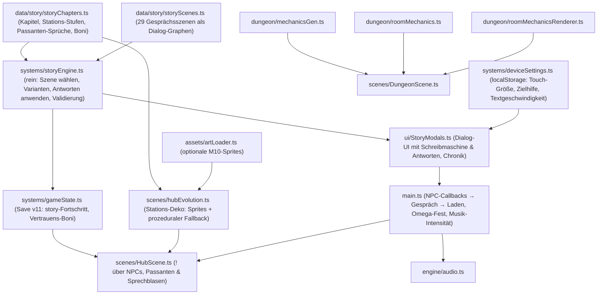

# Architektur- & Vorgehensplan: Meilenstein 10-A — Story-Tiefe, Sektor-Rätsel & Audio-/Mobile-Feinschliff

> **Status:** 🔜 Geplant — Umsetzungsvorlage für einen KI-Coding-Agent (z. B. Claude Sonnet)
> **Basis:** Stand nach Meilenstein 9 (`SaveData v10`, Galaktisches Netzwerk, Wöchentliche Prüfung)
> **Ziel-Save-Version:** `SAVE_VERSION = 11`
> **Quelle der Anforderungen:** [GAME_DESIGN_DOCUMENT.md §5](GAME_DESIGN_DOCUMENT.md) (Roadmap M10-A) + Wunsch des Projektinhabers: **mehr Story, beeinflussbare Dialoge und eine sichtbar lebendige Raumstation — bei Bedarf auch mit neuen Sprites**

**So benutzt du dieses Dokument:** Lies zuerst [AGENTS.md](AGENTS.md) und §2 (Invarianten). Arbeite dann die Phasen in §7 **strikt in Reihenfolge** ab. Jede Phase ist einzeln baubar, testbar und committbar (`feat(m10): …`). Zeilennummern sind Orientierung (Stand M9) — **immer per `grep` verifizieren**. Wo der Plan ein „Warum“ nennt, ist das eine bewusste Designentscheidung: nicht stillschweigend anders lösen, sondern Abweichungen in §11 notieren.

---

## 1. Scope

| # | Feature | Kurzbeschreibung | Risiko |
| :--- | :--- | :--- | :--- |
| F1 | **Story-Kapitel mit Entscheidungen** | 7 Kapitel (Prolog → S1–S4 → Omega → NG+) mit einer durchgehenden Geschichte rund um **das Echo**. Kael, Lyra, Nyx und Vex haben pro Kapitel eine **Gesprächsszene (4–8 Textboxen) mit Antwortwahl**. Die Antworten verändern **Vertrauen**, setzen **Story-Flags** (andere Zeilen, andere Deko, anderer Epilog) und schalten pro NPC einen **Vertrauens-Bonus** frei. Dazu kommen ein einmaliges **Omega-Fest** und eine **📜 Chronik** im Logbuch. | mittel |
| F2 | **Lebendige Raumstation** | Port Solaris verändert sich mit Kapiteln **und** Entscheidungen: Deko (prozedural für Linien-Elemente, **Sprites für Objekte**), mehr und neue Passanten, kurze Sprechblasen über Passanten, die auf das Geschehen reagieren. | mittel |
| F3 | **Sektor-Raum-Mechaniken** | S2: reflektierende **Kristall-Prismen** · S3: periodische **Schmelz-Düsen** + **Magnetplatten** · S4: paarweise **Astral-Teleporter-Pads**. Gilt auch für die Spirale (über `visualSector`). | **hoch** |
| F4 | **Boss-Phase-2-Musik** | Musik-„Intensität“: Tempo +18 %, Hi-Hat-Puls, Oktav-Lead und ein einmaliger Phasen-Sting, sobald ein Boss in Phase 2 geht. | niedrig |
| F5 | **Anpassbare Touch-Button-Größe** | 4 Stufen (85 % / 100 % / 115 % / 130 %) für Buttons **und** Joystick, gespeichert **pro Gerät**. | niedrig |
| F6 | **Mobile-Aim-Assist & Textgeschwindigkeit** | 3 Zielhilfe-Modi (*Aus*, *Standard* = heutiges Verhalten, *Smart*) und 3 Textgeschwindigkeiten für Dialoge (*Normal*, *Schnell*, *Sofort*), pro Gerät. | mittel |

**Nicht im Scope:** neue Gegner, Sektoren oder Bosse; Änderungen an Firebase oder den Firestore-Regeln; voll vertonte Dialoge.

### 1.1 „Mehr Story, aber nicht nervig“ — verbindliche UX-Regeln
1. **Story ist ein Angebot, kein Zwang.** Jede Szene hat auf der ersten Textbox den Button **„Später ▸ {Station}“**. Er öffnet sofort den gewohnten Laden; die Szene bleibt verfügbar. Ein Überspringen hat **keine** Nachteile.
2. **Nichts startet ungefragt** — mit einer einzigen Ausnahme: dem **Omega-Fest** (einmalig nach dem Omega-Sieg beim Betreten der Promenade). Auch das ist auf der ersten Box überspringbar und in der Chronik wiederholbar.
3. **Kurz:** höchstens **8 Textboxen pro Szene** (ein Pfad), höchstens **180 Zeichen pro Box**, höchstens **3 Antworten** pro Entscheidung, **1–2 Entscheidungen** pro Szene.
4. **Schnell bedienbar:** Schreibmaschinen-Effekt mit einstellbarer Geschwindigkeit (F6). Klick, `E`, `Enter` oder `Leertaste` zeigen erst den ganzen Text, dann geht es weiter; `1`–`3` wählen Antworten. Touch funktioniert über die Buttons.
5. **Dezente Hinweise:** Ein neues Gespräch zeigt ein hüpfendes „!“ über dem NPC. Wurde es einmal mit „Später“ übersprungen, wird daraus ein **ruhiger kleiner Punkt** (kein Hüpfen).
6. **Keine falschen Antworten:** Antworten unterscheiden sich im *Ton* (warm / direkt / neugierig / vorsichtig). Jede NPC-Figur schätzt einen anderen Ton. Abzug gibt es höchstens −1, und **nie** wird ein Feature gesperrt.

---

## 2. Design-Invarianten & Leitplanken (verbindlich)

1. **Zero-Dungeon-Credits:** Kein `state.credits +=` in `DungeonScene.ts`, `enemyAi.ts`, `dungeonRenderer.ts` **und auch nicht in den neuen Dateien unter `src/dungeon/`**. Story-Belohnungen sind Rabatte, Komfort und Optik — **niemals Credits**.
2. **Alles In-Game:** Gespräche entstehen beim Ansprechen der NPCs auf der Promenade; die Chronik steht im Logbuch; Geräte-Einstellungen liegen im Inventar-Tab **„Hilfe“** (Abschnitt „⚙ Steuerung“). Keine externen Menüs.
3. **Save-Abwärtskompatibilität (v10 → v11):** Neue `SaveData`-Felder sind optional (`?`) und werden in `GameState.load()` defensiv vorbelegt. **Geräte-Einstellungen (F5/F6) kommen NICHT in den Spielstand** (Begründung §4.6).
4. **Wöchentliche Prüfung (M9) bleibt fair und deterministisch:**
   - Vertrauens-Boni wirken **nicht** in der Prüfung (Guard über `state.activeTrial` bzw. `scene.isWeeklyTrial`).
   - Raum-Mechaniken werden mit **eigenem lokalem PRNG** platziert und verbrauchen kein globales `Math.random()` (§4.3).
   - Mechanik-Zyklen laufen über eine **raumlokale Uhr**; das Gate `TRIAL_MECHANICS_FROM_WEEK` verhindert Änderungen mitten in einer Woche.
5. **Assets sind optional, der Fallback ist Pflicht:** Jedes neue Sprite wird über `loadImage()` geladen (liefert bei fehlender Datei `null`). Für jedes Sprite gibt es eine prozedurale Ersatzdarstellung, damit das Spiel **nie** kaputt aussieht, wenn ein PNG fehlt.
6. **Modularität wie in M8/M9:** Story-Daten, Story-Logik, Story-UI und Mechaniken leben in **eigenen Modulen**. `UIManager.ts`, `HubScene.ts`, `DungeonScene.ts` und `dungeonRenderer.ts` bekommen nur dünne Aufrufe.
7. **Chunk-Splitting:** Neue Dungeon-Module liegen unter `src/dungeon/` (→ `dungeon`-Chunk). Story-Daten sind reines Hub-Wissen und dürfen im `index`-Chunk liegen.
8. **Strict TS:** `import type` für Typ-Importe; kein `enum`, `namespace` und keine Parameter-Properties (`erasableSyntaxOnly`); keine ungenutzten Variablen.
9. **Deutsch & neutral:** Alle Texte auf Deutsch. Der Kapitän wird mit **„du“** bzw. „Kapitän“ angesprochen; **keine geschlechtsspezifischen Pronomen** für den Kapitän.
10. **Input-Parität:** Jede neue Interaktion funktioniert mit Maus/Tastatur, Touch und Gamepad.
11. **Fremde/gespeicherte Strings im DOM** immer durch `escapeHtml` (aus `src/ui/NetworkModals.ts`).

---

## 3. Ziel-Architektur & Dateikarte



### 3.1 Neue Module

| Datei | Verantwortung |
| :--- | :--- |
| `src/data/story/storyChapters.ts` | `STORY_CHAPTERS` (7 Kapitel), `computeStoryChapter()`, `TRUST_PERKS`, `CHATTER_LINES` (Passanten-Sprüche je Kapitel/Flag), `STROLLER_PLAN` (Passanten je Kapitel). |
| `src/data/story/storyScenes.ts` | `STORY_SCENES: StoryScene[]` — 28 NPC-Szenen + 1 Ereignis-Szene (`event_festival`) als Dialog-Graphen (Format §4.1.4). Reine Daten. |
| `src/systems/storyEngine.ts` | Rein und testbar: `getPendingScene()`, `resolveNode()`, `getVisibleChoices()`, `applyChoice()`, `formatStoryText()`, `validateStoryScenes()`. Keine DOM-Zugriffe. |
| `src/ui/StoryModals.ts` | `StoryDialogController` (Schreibmaschine, Tasten 1–3/Enter/E/Leertaste, Später-Button, Abschluss-Callback) und `renderChronicleHtml()`. Host-Interface wie `MarketModalHost`. |
| `src/scenes/hubEvolution.ts` | `HubEvolutionRenderer`: zeichnet die Stations-Entwicklung je Kapitel/Flag (Sprite oder prozeduraler Fallback), liefert Kollisionskreise (Obelisk) und y-sortierte Drawables. |
| `src/systems/deviceSettings.ts` | `DeviceSettings { touchScale, aimAssist, textSpeed }` in `localStorage`, mit Listenern. |
| `src/dungeon/mechanicsGen.ts`, `src/dungeon/roomMechanics.ts`, `src/dungeon/roomMechanicsRenderer.ts` | Raum-Mechaniken (unverändert gegenüber der ersten Planfassung, §4.3). |

### 3.2 Erweiterte Bestandsdateien

| Datei | Änderung |
| :--- | :--- |
| `src/types.ts` | `StoryNpcId`, `StoryFlagId`, `StoryProgress`, `AimAssistMode`, `TextSpeed`; `SaveData.story?`. |
| `src/systems/gameState.ts` | `SAVE_VERSION = 11`; `story: StoryProgress`; `refreshStoryChapter()`, `getPendingScene(npc)`, `recordStoryChoice(...)`, `markSceneSeen(...)`, `markSceneSkipped(...)`, `hasTrustPerk(npc)`; die 4 Vertrauens-Boni (§4.1.6); 2 neue Erfolge. |
| `src/data/companions.ts` | Erfolge `chronicler` und `heart_of_solaris` → **18 Erfolge**. |
| `src/assets/artLoader.ts` | 12 optionale M10-Sprites (§4.2.2) in `HDArtAssets`, `Promise.all` und `imgToCanvas`. |
| `src/scenes/HubScene.ts` | „!“/Punkt über NPCs; Prompt „[E] 💬 Kael · Neues Gespräch“; Passanten-Plan je Kapitel; Sprechblasen; Aufruf von `HubEvolutionRenderer`; `onEnter` meldet „Fest fällig“ an `main.ts`. |
| `src/main.ts` | `withNpcScene(npc, open)`, Omega-Fest-Auslösung, `refreshStoryChapter()` nach Dungeon-Rückkehr, Musik-Intensität. |
| `src/ui/UIManager.ts` | `openStoryScene(scene, opts)` (delegiert an `StoryModals`), Logbuch: „📜 Chronik“, Hilfe-Tab: „⚙ Steuerung“, Schmiede-Kosten über `getForgeCreditCost()`. |
| `src/dungeon/dungeonRenderer.ts` | Vex-Bonus „Sektor-Scanner“ in `renderMinimap` (§4.1.6) + Mechanik-Rendering + Zielmarker. |
| übrige Dateien | wie §4.3–§4.6 (Mechaniken, Audio, Touch, Aim). |
| Doku | `GAME_DESIGN_DOCUMENT.md` (inkl. Story-Kurzfassung), `AGENTS.md`, `README.md`, `TESTING_AND_VERIFICATION.md`, `ART_AND_DESIGN_GUIDE.md` (M10-Prompts nachtragen). |

---

## 4. Subsystem-Spezifikationen

### 4.0 Story-Bibel (Quelle der Wahrheit für alle Texte)

**Setting:** Port Solaris ist eine Handelsstation am Rand der kartierten Galaxis. Vor zwölf Jahren wurde sie von Bergungsleuten gegründet, die von den Wracks der vier Sektoren leben. Jeder kennt das **Echo** — ein leises, wiederkehrendes Signal aus den Wracks. Die meisten halten es für Funkmüll.

**Die Wahrheit (wird Kapitel für Kapitel enthüllt):**
- Die **Ältesten** bauten vor Jahrtausenden vier **Siegel** und das **5. Tor**, um die **Omega-Anomalie** einzuschließen. Jedes Siegel wurde von einem **Wächter** geschützt (die vier Sektor-Endbosse).
- Die Anomalie hat die Wächter über die Jahrhunderte **verdorben**; sie greifen alles an. Das Echo ist der „Gesang“ der Siegel — eine **Warnung** an alle, die zuhören.
- Mit jedem besiegten Wächter wird das Echo **klarer**. Nach dem Omega-Sieg **verstummt** es: Nichts muss mehr eingesperrt werden. Die Spirale hinter dem Tor bleibt — ein Rätsel für die Zukunft.
- Im Hintergrund will das **Helion-Konsortium** (Symbol: goldener Sonnenring) die Anomalie als Energiequelle ausbeuten und kauft dafür Informationen.

**Figuren-Bögen:**

| NPC | Stimme | Schätzt den Ton | Persönlicher Bogen |
| :--- | :--- | :--- | :--- |
| **Kael** (Schmied) | Ruppig, kurze Sätze, Handwerks-Metaphern, versteckte Wärme. | **direkt** | Seine Schülerin **Juno** verschwand vor drei Jahren mit der Korvette (S1). Kael gibt sich die Schuld. Er erfährt, dass Juno den Reaktor von innen versiegelte und so die Crew rettete → Trauer wird zu Stolz. |
| **Dr. Lyra** (Ärztin) | Warm, ruhig, sorgfältig, stellt Fragen zurück. | **warm** | Behandelt das **Echo-Fieber** (Menschen, die das Echo im Schlaf hören). War Ärztin der gescheiterten **ersten Monolith-Expedition** und hat damals Verletzte zurücklassen müssen → Schuld wird zu Annahme. |
| **Nyx** (Schwarzmarkt) | Geheimnisvoll, spöttisch, Andeutungen statt Antworten. | **vorsichtig** | Schmuggelte früher für **Helion**. Das Konsortium will über sie an die Koordinaten des 5. Tors → Verrat oder Wende, je nach deinen Entscheidungen. |
| **Vex** (Ingenieurin) | Schnell, begeistert, Zahlen und Ausrufezeichen, verliert sich in Details. | **neugierig** | Entschlüsselt das Echo Stück für Stück. Nach dem Omega-Sieg will sie das Rätsel der Spirale erforschen → Aufbruch oder Bleiben. |

**Schreibregeln für alle Szenen:** maximal 180 Zeichen pro Box; keine Erklär-Monologe (eine Enthüllung pro Szene); jede Szene endet mit einem kleinen emotionalen Schlusspunkt; Erzähltext (`speaker: 'narrator'`) kursiv und sparsam (höchstens 2 Boxen pro Szene); `{captain}` wird durch den Kapitänsnamen ersetzt.

### 4.1 F1 — Story-Kapitel mit Entscheidungen

#### 4.1.1 Kapitel

| Kap. | Titel | Auslöser | Stations-Stufe (F2) |
| :--- | :--- | :--- | :--- |
| 0 | Prolog · Ankunft auf Port Solaris | Spielstart | Grundzustand |
| 1 | Kapitel I · Junos Zeichen | A.E.G.I.S. LEVIATHAN besiegt | Lichterketten leuchten wieder |
| 2 | Kapitel II · Das Lied der Kristalle | ★ PRISMA-ARCHON besiegt | Kristall-Laternen, Kristall-Pilger auf der Promenade |
| 3 | Kapitel III · Funken der Sonnenschmiede | ★ VULKAN-TITAN besiegt | Solar-Wimpel, Gießerei-Arbeiter |
| 4 | Kapitel IV · Das Erbe der Ältesten | ★ DER STERNEN-ARCHON besiegt | Holo-Obelisk, Ältesten-Gelehrte |
| 5 | Kapitel V · Licht jenseits des 5. Tors | ★ OMEGA STERNEN-ARCHON besiegt | Omega-Fest: Sternenbanner & Feuerwerk |
| 6 | Epilog · Ein neuer Zyklus | New Game+ gestartet | Zyklus-Hologramm |

```ts
/** Rein: höchstes aktuell verdientes Kapitel. */
export function computeStoryChapter(s: {
  sector1Cleared: boolean; sector2Cleared: boolean; sector3Cleared: boolean;
  sector4Cleared: boolean; omegaCleared: boolean; ngPlusLevel: number;
}): number {
  if (s.ngPlusLevel >= 1) return 6;
  if (s.omegaCleared) return 5;
  if (s.sector4Cleared) return 4;
  if (s.sector3Cleared) return 3;
  if (s.sector2Cleared) return 2;
  if (s.sector1Cleared) return 1;
  return 0;
}
```
- **NG+:** `startNewGamePlus()` setzt `sectorNCleared` zurück. Deshalb ist `story.chapter` ein **Maximum, das nie sinkt**: `story.chapter = Math.max(story.chapter, computeStoryChapter(this))`.
- Pro NPC wird immer **nur die Szene des aktuellen Kapitels** angeboten. Übersprungene Kapitel-Szenen früherer Kapitel (weil man z. B. zwei Bosse am Stück besiegt hat) werden **nachgeholt**: `getPendingScene(npc)` liefert die **älteste ungelesene** Szene ≤ `chapter`. *Warum:* Die Geschichte bleibt lückenlos, und jeder Besuch liefert höchstens eine Szene.

#### 4.1.2 Vertrauen, Flags & Varianten
- **Vertrauen** je NPC: Start **2**, Bereich **0–10**. Antworten geben −1, 0, +1 oder +2.
- **Flags** (`StoryFlagId`) — vollständige Liste:

| Flag | Gesetzt in | Wirkung |
| :--- | :--- | :--- |
| `knows_juno` | Kael · Prolog (Frage nach der 2. Werkbank) | Andere Eröffnung in Kael · Kap. I |
| `kael_memorial` | Kael · Kap. I (Denkmal) | Deko: Junos Gedenk-Amboss neben der Schmiede; Festrede-Zusatz; Epilog-Variante |
| `kael_forward` | Kael · Kap. I (nach vorne) | Deko: Esse glüht heller (mehr Funken); Epilog-Variante |
| `lyra_clinic` | Lyra · Kap. II (Echo-Station eröffnen) | Deko: Schild „Echo-Station“ an der Med-Bay; eigene Passanten-Sprüche |
| `vex_shared_signal` | Vex · Kap. II (Signal öffentlich machen) | Passanten-Sprüche über das Echo; Vex · Kap. III Variante |
| `nyx_helion_known` | Nyx · Kap. III (Nachfrage zum Sonnenring) | Zusätzliche 3. Antwort in Nyx · Kap. IV |
| `lyra_told_truth` | Lyra · Kap. IV (Geständnis angenommen) | Lyra · Kap. V Variante; Epilog-Variante |
| `nyx_confronted` / `nyx_covered` | Nyx · Kap. IV | Grundlage für `nyx_redeemed` |
| `nyx_redeemed` | **berechnet** beim Abschluss von Nyx · Kap. IV und erneut vor Nyx · Kap. V: `(nyx_confronted && trust.nyx >= 5) \|\| (nyx_covered && trust.nyx >= 7)` | Nyx · Kap. V Variante; Deko: warme Freihandels-Laterne am Stand; Epilog |
| `vex_spiral` / `vex_stays` | Vex · Kap. V | Deko: Forschungs-Leuchtfeuer bzw. Holo-Lehrtafel am Tech-Labor; Epilog |
| `festival_seen` | Omega-Fest abgeschlossen oder übersprungen | Fest wird nicht erneut ausgelöst |

- **Varianten:** Eine Textbox kann `variants` haben; die **erste** Variante, deren Bedingung erfüllt ist, ersetzt den Standardtext. Antworten können `requires` haben (sonst unsichtbar).

#### 4.1.3 Ablauf beim Ansprechen
1. `HubScene`: Hat `state.getPendingScene('kael')` eine Szene, lautet der Prompt `[E] 💬 Kael · Neues Gespräch` und über Kael schwebt ein „!“ (bzw. ein Punkt, wenn schon einmal übersprungen).
2. `main.ts`:
   ```ts
   private withNpcScene(npc: StoryNpcId, open: () => void): void {
     const scene = this.state.getPendingScene(npc);
     if (!scene) { open(); return; }
     this.ui.openStoryScene(scene, {
       laterLabel: STATION_LABEL[npc],          // z. B. "Später ▸ Exo-Schmiede"
       onLater: () => { this.state.markSceneSkipped(scene.id); open(); },
       onFinish: (res) => { this.announceStoryResult(res); open(); },
       onClose: () => { /* ESC/✕/Hintergrund: wie „Später“, aber ohne Laden zu öffnen */ this.state.markSceneSkipped(scene.id); },
     });
   }
   ```
   `onOpenForge` → `kael`, `onOpenMedBay` → `lyra`, `onOpenBlackMarket` → `nyx`, `onOpenTechLab` → `vex`.
3. **Antworten werden sofort angewendet** (`state.recordStoryChoice`), nicht erst am Szenenende. *Warum:* Bricht der Spieler nach einer Antwort ab, geht die Entscheidung nicht verloren. Die Szene gilt erst am Ende als gelesen.
4. `announceStoryResult`: Toast bei neuem Vertrauens-Bonus (`🤝 Kael vertraut dir: Meisterhand freigeschaltet — Schmiede-Upgrades −5 % Credits!`) und bei Erfolgen.
5. **Omega-Fest:** Ist `story.chapter >= 5` und `festival_seen` nicht gesetzt, öffnet `HubScene.onEnter` über einen Callback **nach 0,8 s** einmalig die Szene `event_festival`. „Später“ gibt es hier nicht; stattdessen auf der ersten Box **„Überspringen“**, das `festival_seen` setzt. In der Chronik ist das Fest wiederholbar.
6. **Kapitel-Toast:** Steigt `story.chapter` (nach Dungeon-Rückkehr), folgt ein Toast `📜 {Kapiteltitel} — auf Port Solaris gibt es Neuigkeiten!`.

#### 4.1.4 Datenformat (Dialog-Graph)

```ts
export type StorySpeaker = StoryNpcId | 'narrator' | 'captain';
export type StoryTone = 'warm' | 'direkt' | 'neugierig' | 'vorsichtig';

export interface StoryCondition {
  flag?: StoryFlagId;            // Flag muss gesetzt sein
  notFlag?: StoryFlagId;         // Flag darf nicht gesetzt sein
  minTrust?: Partial<Record<StoryNpcId, number>>;
}
export interface StoryChoice {
  id: string;                    // eindeutig innerhalb der Szene, z. B. "a"
  label: string;                 // Antworttext (≤ 90 Zeichen)
  tone: StoryTone;               // wird als kleines Icon angezeigt (💛 / ⚡ / 🔍 / 🛡)
  trust?: Partial<Record<StoryNpcId, number>>;
  setFlags?: StoryFlagId[];
  requires?: StoryCondition;
  chronicle: string;             // Chronik-Satz, z. B. "Du hast Kael geraten, Junos Opfer zu ehren."
  next: string;                  // Knoten-ID oder "end"
}
export interface StoryNode {
  speaker: StorySpeaker;
  text: string;                  // ≤ 180 Zeichen, {captain} erlaubt
  variants?: Array<{ when: StoryCondition; text: string }>;
  choices?: StoryChoice[];       // entweder choices …
  next?: string;                 // … oder next ("end" beendet)
}
export interface StoryScene {
  id: string;                    // "kael_c1", "event_festival"
  npc: StoryNpcId | 'event';
  chapter: number;               // 0..6
  title: string;                 // z. B. "Junos Zeichen"
  start: string;                 // Start-Knoten
  nodes: Record<string, StoryNode>;
}
```

**Vollständiges Beispiel (so in `storyScenes.ts` übernehmen):**

```ts
{
  id: 'kael_c0', npc: 'kael', chapter: 0, title: 'Die leere Werkbank', start: 'n1',
  nodes: {
    n1: { speaker: 'kael', text: 'Noch ein Kapitän, der glaubt, die Wracks wären ein Spaziergang. Zeig mal deine Klinge.', next: 'n2' },
    n2: { speaker: 'narrator', text: 'Kael dreht die Klinge im Licht der Esse. Neben ihm steht eine zweite Werkbank — sauber, unberührt, als warte sie auf jemanden.', next: 'n3' },
    n3: { speaker: 'kael', text: 'Grobe Arbeit, aber ehrlich. Bring mir Schrott aus den Wracks, und ich mach dir was draus, das nicht beim ersten Hieb splittert.',
      choices: [
        { id: 'a', tone: 'direkt', label: 'Ich brauche keine Ratschläge. Nur gutes Werkzeug.', trust: { kael: 2 }, chronicle: 'Du hast Kael gezeigt, dass du nicht drum herumredest.', next: 'a1' },
        { id: 'b', tone: 'neugierig', label: 'Für wen ist die zweite Werkbank?', setFlags: ['knows_juno'], chronicle: 'Du hast Kael nach der leeren Werkbank gefragt.', next: 'b1' },
        { id: 'c', tone: 'warm', label: 'Danke, Kael. Ich lerne gern vom Besten.', trust: { kael: 1 }, chronicle: 'Du hast Kael für seine Hilfe gedankt.', next: 'c1' },
      ] },
    a1: { speaker: 'kael', text: 'Ha! Endlich jemand, der nicht drum herumredet. Wir verstehen uns, {captain}.', next: 'end' },
    b1: { speaker: 'kael', text: '… Für meine Schülerin. Juno. Sie ist mit der Korvette rausgeflogen. Vor drei Jahren. Frag nicht weiter.', next: 'b2' },
    b2: { speaker: 'narrator', text: 'Er wendet sich ab und schlägt härter auf den Amboss als nötig.', next: 'end' },
    c1: { speaker: 'kael', text: 'Hmpf. Schmeichelei schärft keine Klingen. … Schadet aber auch nicht.', next: 'end' },
  },
},
```

#### 4.1.5 Szenen-Inhalt

**Vollständig ausgeschriebene Schlüsselszenen** (Text 1:1 übernehmen, ins Format §4.1.4 übertragen):

**`kael_c1` · Junos Zeichen**
1. *Erzähler:* „Kael hält einen geschmolzenen Splitter aus dem Kern des Leviathan in der Zange. Ins Metall ist ein kleines Zeichen geprägt: ein Stern über einem Hammer.“
2. *Kael* — Variante `knows_juno`: „Das ist Junos Zeichen. Ich hab's ihr selbst beigebracht. Sie war dort, {captain}. Im Herz von diesem Ding.“ — Standard: „Dieses Zeichen gehört meiner Schülerin Juno. Sie war auf der Korvette, als sie verschwand. Sie war dort, {captain}.“
3. *Kael:* „Der Reaktor war mit einer Schmiedenaht versiegelt. Von innen. Wer das gemacht hat, wusste, dass er nicht mehr rauskommt.“
   - **A** (warm, Kael +2, `kael_memorial`): „Dann hat sie die Crew gerettet. Lass uns ihr ein Denkmal schmieden.“ → *Kael:* „Ein Denkmal … aus dem Stahl, den sie gebändigt hat. Ja. Das machen wir.“ → *Erzähler:* „Zum ersten Mal sieht Kael nicht wütend aus, sondern stolz.“ — Chronik: „Du hast Kael geraten, Junos Opfer mit einem Denkmal zu ehren.“
   - **B** (direkt, Kael +1, `kael_forward`): „Du kannst es nicht mehr ändern, Kael. Schmiede nach vorne.“ → *Kael:* „… Hart, aber wahr. Sie hätte dasselbe gesagt. Dann nach vorne — mit ihrem Stahl in deiner Klinge.“ — Chronik: „Du hast Kael ermutigt, nach vorne zu schauen.“
   - **C** (neugierig, ±0): „Vielleicht hat sie überlebt?“ → *Kael:* „Hoffnung ist ein schlechtes Metall. Biegt sich, wenn man's braucht.“ → *Kael:* „Aber … halt da draußen die Augen offen. Bitte.“ — Chronik: „Du hast Kael Hoffnung gemacht.“

**`lyra_c2` · Das Echo-Fieber**
1. *Lyra:* „Seit du den Prisma-Archon besiegt hast, kommen mehr Leute zu mir. Sie hören etwas im Schlaf. Ein Summen, wie Kristall unter einem Finger.“
2. *Lyra:* „Die Händler wollen, dass ich schweige — schlecht fürs Geschäft. Aber die Kranken brauchen einen Ort, an dem sie keine Angst haben müssen.“
   - **A** (warm, Lyra +2, `lyra_clinic`): „Eröffne eine Echo-Station. Ich stehe hinter dir.“ → „Du meinst das ernst? Dann hänge ich heute noch das Schild auf. Danke, {captain}.“ — Chronik: „Du hast Lyra ermutigt, die Echo-Station zu eröffnen.“
   - **B** (vorsichtig, Lyra +1): „Halte es ruhig, bis wir mehr wissen.“ → „Vielleicht hast du recht. Panik hilft niemandem. Aber ich führe Buch über jeden Fall.“ — Chronik: „Du hast Lyra zur Vorsicht geraten.“
   - **C** (neugierig, Lyra +1, Vex +1): „Vex untersucht das Signal. Arbeitet zusammen.“ → „Vex? Sie redet schneller, als ich zuhören kann … Aber gut. Zwei Köpfe, ein Rätsel.“ — Chronik: „Du hast Lyra und Vex zusammengebracht.“

**`nyx_c4` · Der Sonnenring**
1. *Erzähler:* „Hinter Nyx' Stand flackert ein verschlüsselter Bildschirm. Bevor sie ihn zuklappt, blitzt ein Logo auf: ein goldener Sonnenring.“
2. *Nyx:* „Du hast nichts gesehen. … Na gut. Du hast etwas gesehen.“
3. *Nyx:* „Das Helion-Konsortium will die Koordinaten des 5. Tors. Sie zahlen genug, um diesen ganzen Markt zu kaufen. Mich eingeschlossen.“
   - **A** (direkt, Nyx +1, `nyx_confronted`): „Sag ihnen ab, Nyx. Port Solaris ist mehr wert als ihr Geld.“ → „Mehr wert? Du klingst wie jemand, der nie Schulden hatte.“ → *Erzähler:* „Sie starrt lange auf den zugeklappten Bildschirm.“ → „Ich denk drüber nach. Mehr versprech ich nicht.“ — Chronik: „Du hast Nyx aufgefordert, Helion abzusagen.“
   - **B** (vorsichtig, Nyx +2, `nyx_covered`): „Ich habe nichts gesehen. Das ist deine Sache.“ → „Klüger, als du aussiehst, {captain}. Ich werde mich daran erinnern.“ — Chronik: „Du hast Nyx' Geheimnis für dich behalten.“
   - **C** (requires `nyx_helion_known`; neugierig, Nyx +2, `nyx_confronted`): „Ich weiß schon länger von Helion. Ich hab gewartet, bis du es selbst sagst.“ → „Du hast mich durchschaut und trotzdem bei mir gekauft? Entweder bist du verrückt oder ein Freund. Vielleicht beides.“ — Chronik: „Du hast Nyx gezeigt, dass du ihr Geheimnis längst kanntest.“
   - Nach der Szene: `nyx_redeemed` berechnen (§4.1.2).

**`vex_c5` · Jenseits der Spirale**
1. *Vex:* „Das Echo ist verstummt! Weißt du, was das heißt? Die Siegel singen nicht mehr, weil nichts mehr eingesperrt werden muss!“
2. *Vex:* „Aber hinter dem 5. Tor dreht sich die Spirale weiter. Endlos. Meine Messwerte ergeben keinen Sinn. Wunderschöne, unsinnige Messwerte!“
3. *Vex:* „Ich will ein Forschungs-Leuchtfeuer am Tor bauen. Das dauert ein Jahr. Vielleicht länger. Was meinst du?“
   - **A** (neugierig, Vex +2, `vex_spiral`): „Bau es. Die Galaxis braucht Leute wie dich.“ → „Ja! Ja, ja, ja! Ich fange heute Nacht an. Du bekommst den ersten Datensatz, versprochen!“ — Chronik: „Du hast Vex ermutigt, die Spirale zu erforschen.“
   - **B** (warm, Vex +1, `vex_stays`): „Bleib hier. Port Solaris braucht seine Ingenieurin.“ → „Hm. … Vielleicht. Die Station hat genug Rätsel für ein ganzes Leben. Ich bleibe. Fürs Erste.“ — Chronik: „Du hast Vex gebeten, auf Port Solaris zu bleiben.“

**`event_festival` · Das Omega-Fest** (automatisch, einmalig)
1. *Erzähler:* „Port Solaris leuchtet. Banner hängen zwischen den Ständen, und über der Promenade zerplatzen Funken in den Farben der vier Sektoren.“
2. *Redner* = NPC mit dem höchsten Vertrauen (Gleichstand: Kael > Lyra > Nyx > Vex). **Umsetzung:** Knoten `n1` hat `next: '@speaker'`. Die Engine löst `'@speaker'` über `pickFestivalSpeaker(progress)` zu `speech_kael` / `speech_lyra` / `speech_nyx` / `speech_vex` auf (`resolveNext()` in `storyEngine.ts`; `validateStoryScenes` akzeptiert `'@speaker'` nur in `event_festival` und prüft, dass alle 4 `speech_*`-Knoten existieren). Jeder `speech_*`-Knoten führt zu einem eigenen Knoten `toast_<npc>` (gleicher Erzähltext aus Schritt 3) mit den drei Antworten — so kann Antwort B den **jeweiligen** Redner mit +2 belohnen.
   - Kael: „Ich bin kein Redner. Also kurz: Dieser Kapitän hat die Wracks bezwungen, vor denen wir jahrelang Angst hatten. Auf {captain}!“ (Variante `kael_memorial`: „… Juno wäre stolz gewesen. Auf {captain}!“)
   - Lyra: „Vor einem Jahr hatte ich mehr Patienten als Betten. Heute schlafen die Leute wieder durch. Das verdanken wir dir, {captain}.“
   - Nyx: „Normalerweise verkaufe ich Geheimnisse. Heute verschenke ich eins: Ohne diesen Kapitän gäbe es keinen Markt mehr, auf dem man irgendwas verkaufen könnte.“
   - Vex: „Laut meinen Berechnungen lag deine Überlebenschance bei 3,7 Prozent! Ich hab mich noch nie so gern verrechnet!“
3. *Erzähler:* „Alle Blicke richten sich auf dich.“
   - **A** (warm, alle +1): „Hebt die Gläser — auf Port Solaris!“ — Chronik: „Du hast auf ganz Port Solaris angestoßen.“
   - **B** (warm, Redner +2 — in `toast_kael` also `trust: { kael: 2 }` usw.): „Ich war nicht allein. Danke euch allen.“ — Chronik: „Du hast deinen Freunden auf Port Solaris gedankt.“
   - **C** (vorsichtig, ±0): „(Still lächeln und anstoßen.)“ — Chronik: „Du hast still mitgefeiert.“
4. Abschluss: `festival_seen`.

**Szenen-Gerüst für die übrigen 23 NPC-Szenen** — Text im Stil der Beispiele schreiben; **Antworten, Effekte und Flags exakt wie angegeben**. Format: *Situation* → Antworten (Ton, Effekt) → gewünschter Schlusspunkt.

| Szene | Situation & Enthüllung | Antworten (Ton · Effekt) | Schlusspunkt |
| :--- | :--- | :--- | :--- |
| `lyra_c0` Erste Visite | Lyra untersucht dich kurz, erwähnt beiläufig Patienten, die „Summen im Schlaf“ hören. | A „Ich halte die Ohren offen.“ (warm · Lyra +1) · B „Klingt nach Raumkoller.“ (direkt · ±0) | Lyra gibt dir ein Pflaster „für später“. |
| `nyx_c0` Nicht im Katalog | Nyx testet dich mit einem Rätsel-Angebot („Ein Schlüssel ohne Schloss — kaufst du?“). | A „Erst will ich das Schloss sehen.“ (vorsichtig · Nyx +2) · B „Wenn er glänzt, gern.“ (direkt · Nyx +1) | „Komm wieder, wenn du mehr Mut als Credits hast.“ |
| `vex_c0` Frische Daten | Vex zeigt dir ihr Echo-Diagramm: ein Muster, das sich alle 47 Sekunden wiederholt. | A „Was bedeutet das Muster?“ (neugierig · Vex +2) · B „Klingt nach Störfunk.“ (direkt · Vex −1, dann versöhnlich) | Vex: „Ich finde es heraus. Und du bringst mir Wrack-Daten!“ |
| `lyra_c1` Das erste Licht | Die Lichterketten brennen wieder; eine Patientin hat zum ersten Mal ruhig geschlafen. | A „Freut mich für sie.“ (warm · Lyra +1) · B „Zufall oder Zusammenhang?“ (neugierig · Lyra +1, Vex +1) | Lyra notiert „Leviathan besiegt → Echo leiser“. |
| `nyx_c1` Reaktorkern-Interessenten | Jemand fragt bei Nyx nach dem Leviathan-Kern; sie gibt an, wer, ohne den Namen zu nennen. | A „Für wen fragst du?“ (neugierig · Nyx +1) · B „Der Kern bleibt bei mir.“ (vorsichtig · Nyx +2) | Nyx wirft eine goldene Münze in die Luft (Sonnenring — nur sichtbar, nicht kommentiert). |
| `vex_c1` Das zweite Signal | Das Echo aus S1 ist verstummt, ein zweites aus dem Kristall-Nebel wird lauter — „klingt wie Musik“. | A „Spiel es mir vor.“ (neugierig · Vex +2) · B „Kann es gefährlich sein?“ (vorsichtig · Vex +1) | Vex summt die Melodie falsch nach. |
| `kael_c2` Kristall in der Esse | Kael schmiedet mit Kristall; Variante `kael_memorial`: das Denkmal ist fertig; Variante `kael_forward`: neue Werkbank für Lehrlinge. | A „Zeig mir, was du gemacht hast.“ (neugierig · Kael +1) · B „Bring mir bei, wie das geht.“ (direkt · Kael +2) | Kael: „Ein Funke Talent hast du. Ein kleiner.“ |
| `nyx_c2` Zu viele Fragen | Fremde fragen auf dem Markt nach dir und deinen Routen. | A „Danke für die Warnung.“ (warm · Nyx +1) · B „Wer genau?“ (vorsichtig · Nyx +2) | „Halt die Augen offen in der Gießerei.“ |
| `vex_c2` Linsen aus Licht | Vex hat Teile des Echos entschlüsselt: es sind Koordinaten. Sie will es der ganzen Station erzählen. | A „Erzähl es allen!“ (neugierig · Vex +2, `vex_shared_signal`) · B „Behalte es vorerst für uns.“ (vorsichtig · Vex +1) | Tipp zu Prismen: „Schieß mal auf eins — vertrau mir.“ |
| `kael_c3` Der Schmied der Sonne | Der Vulkan-Titan war ein Schmied der Ältesten. Kael ist erschüttert: auch Meister können verderben. | A „Du bist nicht wie er.“ (warm · Kael +1) · B „Dann schmiede besser als er.“ (direkt · Kael +2) | Kael legt Titan-Glut in seine Esse. |
| `lyra_c3` Brandsalbe & Geduld | Lyra versorgt Gießerei-Arbeiter; Variante `lyra_clinic`: die Echo-Station ist voll. | A „Brauchst du Hilfe?“ (warm · Lyra +2) · B „Du arbeitest zu viel.“ (direkt · Lyra +1) | Lyra lacht zum ersten Mal richtig. |
| `nyx_c3` Der Mann mit dem Ring | Ein Fremder mit goldenem Sonnenring verlässt Nyx' Stand. | A „Wer war das?“ (neugierig · Nyx +1, `nyx_helion_known`) · B „Ich hab nichts gesehen.“ (vorsichtig · Nyx +1) | Nyx: „Neugier kostet extra.“ |
| `vex_c3` Magnetfeld-Musik | Vex erklärt Magnetplatten; Variante `vex_shared_signal`: die halbe Station summt das Echo nach. | A „Wie nutze ich die Platten?“ (neugierig · Vex +2) · B „Und das Echo?“ (neugierig · Vex +1) | Hinweis zu Teleportern im Monolith. |
| `kael_c4` Junos letzte Nachricht | Vex hat ein Logbuch aus S1 rekonstruiert: Juno versiegelte den Reaktor bewusst. Kael hört ihre Stimme. | A „Sie war eine Heldin.“ (warm · Kael +2) · B „Sie hat von dir gelernt.“ (direkt · Kael +2) · C (Schweigen) „(Hand auf seine Schulter legen.)“ (warm · Kael +1) | Kael: „Danke. Für alles.“ |
| `lyra_c4` Die erste Expedition | Lyra gesteht: Sie war Ärztin der ersten Monolith-Expedition und musste Verletzte zurücklassen. | A „Du hast getan, was du konntest.“ (warm · Lyra +2, `lyra_told_truth`) · B „Warum erzählst du es erst jetzt?“ (direkt · Lyra ±0, `lyra_told_truth`) · C „Das muss nicht heute sein.“ (vorsichtig · Lyra +1) | Lyra: „Versprich mir, dass du vor dem Tor zu mir kommst.“ |
| `vex_c4` Das Muster der Tore | Das Echo ist eine Warnung der Ältesten: „Öffnet das Tor nur, um es zu schließen.“ | A „Dann schließen wir es.“ (direkt · Vex +1) · B „Was steckt dahinter?“ (neugierig · Vex +2) | Vex' Messgeräte zittern. |
| `kael_c5` Feuer für das Fest | Kael baut das Feuerwerk aus Restfunken. | A „Lass mich helfen.“ (direkt · Kael +1) · B „Du hast dir eine Pause verdient.“ (warm · Kael +1) | Variante `kael_memorial`: Juno-Stern im Feuerwerk. |
| `lyra_c5` Endlich durchschlafen | Das Echo-Fieber verschwindet; Variante `lyra_told_truth`: Lyra hat Frieden mit der Expedition gemacht. | A „Und du? Schläfst du auch?“ (warm · Lyra +2) · B „Gut gemacht, Doktor.“ (direkt · Lyra +1) | „Ruh dich aus, {captain}. Wirklich.“ |
| `nyx_c5` Falsche Koordinaten | Variante `nyx_redeemed`: Nyx hat Helion falsche Koordinaten ins Nichts geschickt. Sonst: „Helion hat aufgegeben. Für jetzt.“ | A „Danke, Nyx.“ (warm · Nyx +1) · B „Und was jetzt?“ (neugierig · Nyx +1) | Variante `nyx_redeemed`: neue Laterne „Freihandel“ am Stand. |
| `kael_c6` Alles von vorn | NG+; Kael zeigt Junos Stern auf deiner Klinge (Variante `kael_memorial`) bzw. die neuen Lehrlinge (Variante `kael_forward`). | A „Diesmal besser.“ (direkt · Kael +1) · B „Mit euch allen im Rücken.“ (warm · Kael +1) | „Die alten Wracks sind wach. Wütender.“ |
| `lyra_c6` Neue Narben | Lyra erinnert an die Anfänge; Varianten nach `lyra_clinic`/`lyra_told_truth`. | A „Die Med-Bay ist mein Zuhause.“ (warm · Lyra +1) · B „Halt die Betten frei.“ (direkt · Lyra +1) | „Wie immer, {captain}.“ |
| `nyx_c6` Für Veteranen | Nyx bietet „Veteranen-Ware“ an (rein erzählerisch); Variante `nyx_redeemed` vs. Rest. | A „Was hast du?“ (neugierig · Nyx +1) · B „Ich vertraue dir.“ (warm · Nyx +1) | Nyx zwinkert. |
| `vex_c6` Zyklus-Daten | Variante `vex_spiral`: Leuchtfeuer sendet erste Daten aus der Spirale; `vex_stays`: Vex unterrichtet junge Ingenieure. | A „Was hast du herausgefunden?“ (neugierig · Vex +1) · B „Ich bin stolz auf dich.“ (warm · Vex +1) | „Mal sehen, wie weit du diesmal kommst!“ |

> Beim Schreiben der 23 Szenen gilt §1.1 und §4.0. Jede Szene wird in Phase 1 durch `validateStoryScenes()` geprüft (§4.1.7).

#### 4.1.6 Vertrauens-Boni (ab Vertrauen **≥ 7**, dauerhaft)

| NPC | Bonus | Umsetzung | Prüfung |
| :--- | :--- | :--- | :--- |
| Kael | **Meisterhand:** Schmiede-Upgrades und Waffen-Fertigung kosten 5 % weniger Credits. | `GameState.getForgeCreditCost(base, shop)` → bei `shop === 'forge'` und Bonus `Math.round(base * 0.95)`. Verwenden in `canCraftWeapon`, `craftWeapon`, `canAffordUpgrade`, `purchaseUpgrade` **und** in allen Preis-Anzeigen (`grep -n "creditCost" src/ui/UIManager.ts`). | nicht betroffen |
| Lyra | **Lyras Notfallset:** +1 Stimpack-Ladung. | In `getStats()`: `maxStimCharges + (hasTrustPerk('lyra') && !trialActive ? 1 : 0)`. | **aus** (Guard) |
| Nyx | **Hinterzimmer-Ware:** +1 zusätzliches seltenes Angebot im täglichen Sortiment. | In `generateNyxStock()` nach `r2` ein `r3` (Bestand 1), nur mit Bonus. | nicht betroffen |
| Vex | **Sektor-Scanner:** Die Minimap zeigt Schatz- und Bossraum ab Betreten der Ebene. | In `DungeonRenderer.renderMinimap` (~Zeile 3203) die Sichtbarkeitsprüfung für `treasure`/`boss` überspringen, wenn `state.hasTrustPerk('vex') && !scene.isWeeklyTrial`. | **aus** (Guard) |

- Die Boni sind in der **Chronik** sichtbar (Vertrauensleiste 0–10 je NPC mit Markierung bei 7).
- Erfolge: `chronicler` 📜 „Chronist von Port Solaris“ — alle 4 Kapitel-V-Szenen gelesen. `heart_of_solaris` 💞 „Herz von Port Solaris“ — alle 4 NPCs mit Vertrauen ≥ 7. Gesamt **18 Erfolge**.

#### 4.1.7 Story-Engine (`src/systems/storyEngine.ts`, rein)

```ts
export function getPendingScene(p: StoryProgress, npc: StoryNpcId): StoryScene | null;      // älteste ungelesene ≤ chapter
export function resolveNodeText(node: StoryNode, p: StoryProgress): string;                  // Varianten
export function getVisibleChoices(node: StoryNode, p: StoryProgress): StoryChoice[];        // requires
export function applyChoice(p: StoryProgress, sceneId: string, c: StoryChoice):
  { trustBefore: Record<StoryNpcId, number>; newPerks: StoryNpcId[] };                        // mutiert p, klemmt 0..10
export function formatStoryText(text: string, captainName: string): string;                 // {captain}
export function pickFestivalSpeaker(p: StoryProgress): StoryNpcId;                           // höchstes Vertrauen, Tie-Break-Reihenfolge
export function resolveNext(next: string, p: StoryProgress): string;                         // '@speaker' → 'speech_<npc>'
export function validateStoryScenes(scenes: StoryScene[]): string[];                        // leere Liste = gültig
```

`validateStoryScenes` prüft:
- jede `next`-ID existiert oder ist `"end"`; jeder Knoten ist erreichbar;
- jeder Pfad endet in höchstens 8 Boxen;
- Texte ≤ 180 und Antworten ≤ 90 Zeichen;
- jede Antwort hat einen `chronicle`-Satz;
- genau eine Szene je NPC und Kapitel 0–6 plus `event_festival`;
- alle Flags sind in `StoryFlagId` enthalten;
- keine Antwort mit `trust` außerhalb −1…+2.

#### 4.1.8 Dialog-UI (`src/ui/StoryModals.ts`)
- **Layout:** Modal (`max-width: 640px`, Mobil einspaltig). Links das Porträt: NPC-Sprite (`art.npcKael` usw. als Canvas → `toDataURL()` einmal cachen) in 3-facher Pixel-Skalierung (`image-rendering: pixelated`) mit Namensplakette in NPC-Farbe (Kael `#fb923c`, Lyra `#34d399`, Nyx `#c084fc`, Vex `#38bdf8`). Rechts die Textbox. Erzähler-Boxen ohne Porträt, kursiv, gedämpft. Header: `📜 {Kapiteltitel} · {Szenentitel}` mit `white-space: nowrap`.
- **Schreibmaschine:** Geschwindigkeit aus `getDeviceSettings().textSpeed` — `normal` 40 Zeichen/s, `schnell` 90 Zeichen/s, `sofort` ohne Animation. Der erste Klick/Tastendruck zeigt den ganzen Text, der zweite geht weiter. `requestAnimationFrame` statt `setInterval`; beim Schließen sauber abbrechen.
- **Antworten:** Buttons mit Ton-Icon (💛 warm, ⚡ direkt, 🔍 neugierig, 🛡 vorsichtig) und Tastenhinweis `1`–`3`. Erst sichtbar, wenn der Text komplett ist.
- **Tastatur-Listener** nur solange das Modal offen ist (im Modal-Root registrieren, beim Schließen entfernen), damit `E`/`Enter` nicht zusätzlich die Welt-Interaktion auslösen. Die Spielszenen pausieren bei offenem Modal bereits (`ui.modalOpen`).
- **Chronik** (Logbuch-Tab, eigener Abschnitt): je erreichtem Kapitel eine Karte mit Titel, Auslöser, Stations-Änderung und pro gelesener Szene den gewählten Chronik-Satz. Dazu der Button „▶ Erneut ansehen“ (Wiedergabe **ohne** Effekte: `openStoryScene(scene, { replay: true })`). Oben die Vertrauensleisten und Boni. Nicht erreichte Kapitel: „🔒 ???“.

### 4.2 F2 — Lebendige Raumstation

**Entscheidungsregel Sprite vs. prozedural:**
- **Linien- und Partikel-Elemente** (Lichterketten, Wimpel-Seile, Feuerwerk, Licht-Tönung) → **prozedural**; das sieht in Pixel-Optik gut aus.
- **Objekte mit Volumen** (Laternen, Obelisk, Denkmal, Schilder, Leuchtfeuer, Passanten) → **Sprite bevorzugt**, prozedurale Darstellung **nur als Fallback**, wenn das PNG fehlt.
- **QA-Kriterium (Phase 3):** Jedes Element per Screenshot gegen den Hub-Hintergrund prüfen: gleiche 3/4-Perspektive? dunkle Outline wie die NPC-Sprites? Schatten (`drawPixelShadow`) und Licht (`drawGlow`) vorhanden? Proportionen passend zu Kael (Darstellung 26×29 px)? Wirkt ein prozedurales Element „aufgeklebt“, **wird es ins Sprite-Paket aufgenommen** und in §11 notiert.
- **Keine neuen Hub-Hintergründe.** *Warum:* Generierte Bilder treffen die begehbaren Flächen und Stations-Hotspots in `hub_bg.png` nicht pixelgenau; Kollisionen und Prompts würden verrutschen. Die Entwicklung entsteht über Overlays.

#### 4.2.1 Stations-Stufen (kumulativ)

| Kap./Flag | Element | Darstellung | Startposition (per Screenshot justieren) |
| :--- | :--- | :--- | :--- |
| Kap. 1 | Lichterketten | prozedural: 2 durchhängende Kabel, je 9 Glühpunkte (`#fbbf24`/`#38e8d4`, Flackern), nachts heller | (150,96)→(232,96) und (248,96)→(330,96), Durchhang 8 px |
| Kap. 2 | Kristall-Laternen ×2 | **Sprite** `prop_hub_crystal_lantern` (Anzeige 22×30) · Fallback: Pfahl + Rauten-Kristall | links neben `FORGE_POS` (x−22), rechts neben `MEDBAY_POS` (x+22) |
| Kap. 3 | Solar-Wimpel | prozedural: Seil mit 7 dreieckigen Wimpeln (`#f97316`/`#fbbf24`), wehend | (120,112)→(360,112) |
| Kap. 4 | Holo-Obelisk | **Sprite** `prop_hub_elder_obelisk` (Anzeige 34×44, y-sortiert, Kollisionskreis r=8) · Fallback: Trapez + Holo-Ring | Platzmitte (240,160) — vorher prüfen, dass dort nichts Interaktives liegt |
| Kap. 5 | Sternenbanner ×2 + Feuerwerk | **Sprite** `prop_hub_star_banner` (Anzeige 24×32) · Feuerwerk prozedural alle 2,5–4 s | Banner (176,86) & (304,86); Feuerwerk y 30–70 |
| Kap. 6 | Zyklus-Hologramm | **Sprite** `prop_hub_cycle_holo` (Anzeige 26×26) + Text `ZYKLUS {ngPlusLevel}` prozedural darüber | rechts neben `GUILD_BOARD_POS` (x+30, y−14) |
| `kael_memorial` | Junos Gedenk-Amboss | **Sprite** `prop_kael_memorial` (26×26) + ewige Flamme (Glow) | links von Kael (x−30, y+6) |
| `kael_forward` | Heißere Esse | prozedural: stärkerer Glow + Funkenpartikel an der Schmiede | Esse bei (132,82) |
| `lyra_clinic` | Schild „Echo-Station“ | **Sprite** `prop_lyra_echo_sign` (22×22) | über/neben Med-Bay-Eingang |
| `nyx_redeemed` | Freihandels-Laterne | **Sprite** `prop_nyx_free_lantern` (20×26) | an Nyx' Stand |
| `vex_spiral` | Forschungs-Leuchtfeuer | **Sprite** `prop_vex_beacon` (30×40) + Lichtstrahl prozedural nach oben | neben dem Tech-Labor |
| `vex_stays` | Holo-Lehrtafel | **Sprite** `prop_vex_classboard` (26×24) | neben dem Tech-Labor |

- Umsetzung in `src/scenes/hubEvolution.ts`: Klasse `HubEvolutionRenderer` mit `renderBackLayer(ctx, state, time)` (Kabel, Wimpel, Licht — **vor** den Drawables), `getDrawables(ctx, state, time): Drawable[]` (Objekte, **y-sortiert** mit Kael & Co.), `renderSkyLayer(ctx, state, time, dt)` (Feuerwerk) und `getColliders(state): Array<{x,y,r}>` (Obelisk, Leuchtfeuer) für die Hub-Bewegung.
- **Regel:** Keine Station, kein NPC und keine Prompt-Plakette darf verdeckt werden; Sign-Pills (`renderSignPills`) bleiben lesbar.
- Performance: ≤ 60 zusätzliche Draw-Calls pro Frame; Sprites einmal laden, nicht pro Frame skalieren.

#### 4.2.2 Sprite-Paket (12 optionale Assets)

Alle Dateien nach `public/art/sprites/<name>.png`, **96×96 RGBA**, erzeugt mit Prompt-Formel **B** aus [ART_AND_DESIGN_GUIDE.md §2](ART_AND_DESIGN_GUIDE.md) (weißer Hintergrund, Flood-Fill-Freistellung nach §3, `NEAREST`-Skalierung, Sichtprüfung). Palette „Port Solaris Promenade“ (Schiefer-Metall `#334155`, Laternen-Amber `#f59e0b`, Pastell-Nebel `#818cf8`/`#38e8d4`).

| Datei / `art`-Key | Motiv für `<Objekt>` in Formel B |
| :--- | :--- |
| `prop_hub_crystal_lantern` / `propHubCrystalLantern` | a slim brass street lantern post holding a glowing violet amethyst crystal instead of a flame, soft magenta inner glow |
| `prop_hub_elder_obelisk` / `propHubElderObelisk` | a tall slender dark obsidian alien obelisk with glowing cyan glyph lines and a floating golden holo-ring around its middle |
| `prop_hub_star_banner` / `propHubStarBanner` | a hanging festival cloth banner in deep navy with a large golden eight-pointed star emblem and small tassels |
| `prop_hub_cycle_holo` / `propHubCycleHolo` | a small floating cyan hologram display panel on a slim metal stand, empty screen with scanlines, no text |
| `prop_kael_memorial` / `propKaelMemorial` | a small memorial anvil on a stone base with a carved star-above-hammer emblem and an eternal orange flame in a brass bowl |
| `prop_lyra_echo_sign` / `propLyraEchoSign` | a hanging clinic sign with a glowing cyan medical cross combined with a soft sound-wave symbol, brass frame, no text |
| `prop_nyx_free_lantern` / `propNyxFreeLantern` | a warm amber paper-and-brass lantern hanging from a hook, with a small open-hand emblem, cozy light |
| `prop_vex_beacon` / `propVexBeacon` | a compact research antenna beacon with a satellite dish, blinking lights and a glowing violet energy coil on top |
| `prop_vex_classboard` / `propVexClassboard` | a small holographic teaching board on tripod legs showing simple glowing cyan schematics, no text |
| `npc_pilgrim` / `npcPilgrim` | a hooded crystal pilgrim traveler in violet robes carrying a small glowing amethyst shard, friendly pose, full body |
| `npc_foundry_worker` / `npcFoundryWorker` | a stocky foundry worker in an orange heat-resistant suit with soot marks, goggles on forehead, carrying a wrench, full body |
| `npc_elder_scholar` / `npcElderScholar` | an elderly scholar in teal and gold robes holding a floating holo-tablet, kind face, full body |

- **Loader:** in `artLoader.ts` wie die bestehenden Props (`HDArtAssets`-Feld, `Promise.all`-Eintrag mit `loadImage('/art/sprites/…png')`, `imgToCanvas`). Fehlende Dateien liefern `null` → `hubEvolution.ts` zeichnet den Fallback.
- **⚠ Bildgenerator:** Steht in der Umsetzungsumgebung **kein Bildgenerator** zur Verfügung, wird der Code **vollständig mit Fallbacks** fertiggestellt. Die Tabelle oben wird zusätzlich als fertig formulierte Prompts nach [ART_AND_DESIGN_GUIDE.md](ART_AND_DESIGN_GUIDE.md) (neuer Abschnitt „M10-Prompts“) übernommen, damit der Projektinhaber die Bilder extern erzeugen und als `art_source/m10/<name>_raw.png` ablegen kann. Ein späterer Lauf extrahiert sie dann nach §3 des Guides. Das in §11 vermerken und dem Nutzer am Ende **ausdrücklich mitteilen**.

#### 4.2.3 Lebendige Promenade (Passanten & Sprechblasen)
- **Passanten-Plan** (`STROLLER_PLAN`): Kap. 0–1: 2 (heutiger Stand) · Kap. 2: +1 Kristall-Pilger · Kap. 3: +1 Gießerei-Arbeiter · Kap. 4: +1 Ältesten-Gelehrter · Kap. 5: +1 zufälliger Festgast (vorhandene Kunden-Sprites) · max. **6**. Neue `Stroller.kind`-Werte `'pilgrim' | 'foundry' | 'scholar'`; Fallback-Sprites: `art.customers[i]` mit leichter Farbtönung über `globalCompositeOperation = 'source-atop'` (einmal vorberechnet, nicht pro Frame).
- Wegpunkte nur innerhalb von `PLAZA_LEFT/RIGHT/TOP/BOTTOM` und **nicht** auf Stations-Hotspots oder dem Obelisk (`getColliders`).
- **Sprechblasen:** Alle 14–22 s spricht **ein** zufälliger Passant eine Zeile (Blase 3,5 s, Pixel-Font 4,6 px, max. 34 Zeichen pro Zeile, max. 2 Zeilen). Keine Blase, wenn der Spieler < 40 px entfernt ist oder ein Prompt aktiv ist. Kein Ton.
- `CHATTER_LINES` (je Kapitel ≥ 4 Zeilen plus flag-abhängige Zeilen), z. B.:
  - Kap. 0: „Hörst du das Summen? Nein? Gut.“ · „Neue Kapitäne halten selten lange.“
  - Kap. 1: „Der Leviathan ist tot! Wirklich tot!“ · „Endlich wieder Licht auf der Promenade.“
  - Kap. 2: „Die Kristalle singen, sagen die Pilger.“ · (`vex_shared_signal`) „Vex sagt, das Echo sind Koordinaten!“ · (`lyra_clinic`) „Lyras Echo-Station hat mir geholfen.“
  - Kap. 3: „Heiß wie in der Gießerei heute.“ · „Die Wimpel hat Kael bezahlt, sagt man.“
  - Kap. 4: „Der Obelisk summt nachts. Beruhigend.“ · „Vier Siegel … und das Tor ist offen.“
  - Kap. 5: „Auf den Kapitän!“ · „Hast du das Feuerwerk gesehen?“ · (`kael_memorial`) „Ein Stern für Juno im Feuerwerk.“
  - Kap. 6: „Alles von vorn? Respekt.“ · (`vex_spiral`) „Das Leuchtfeuer am Tor blinkt die ganze Nacht.“

#### 4.2.4 Promenaden-Prompts & Marker
- „!“: gelbe Sprechblase mit `!`, hüpft (`sin(time*5)`), im Stil der VIP-Plakette (`ShopScene.renderCustomer`). Nach „Später“: kleiner gelber Punkt ohne Hüpfen.
- Prompt-Text mit neuer Szene: `[E] 💬 Kael · Neues Gespräch` (statt `[E] Kael's Exo-Schmiede …`).

### 4.3 F3 — Sektor-Raum-Mechaniken (größtes Feature)

#### 4.3.1 Datentypen (in `src/world/dungeonGen.ts`, neben `HazardVent`)

```ts
export interface CrystalPrism { id: number; x: number; y: number; r: number; } // S2, solide
export interface FlameJet {                    // S3, Linien-Gefahr
  x: number; y: number;                        // Mittelpunkt
  axis: 'h' | 'v'; length: number;             // h = horizontaler Strahl
  phase: number;                               // Sekunden-Offset im Zyklus
}
export interface MagnetPlate {                 // S3, Kreisfeld
  x: number; y: number; r: number;
  polarity: 'pull' | 'push';
  phase: number;
}
export interface TeleportPad {                 // S4, immer paarweise
  id: number; pairId: number; x: number; y: number;
  colorIdx: 0 | 1 | 2;                         // gleiche Farbe = gleiches Paar
}
// DungeonRoom (alles optional, damit alte Codepfade unverändert bleiben):
prisms?: CrystalPrism[];
flameJets?: FlameJet[];
magnetPlates?: MagnetPlate[];
teleporters?: TeleportPad[];
```

#### 4.3.2 Platzierung (`src/dungeon/mechanicsGen.ts`)

```ts
export function applySectorMechanics(
  rooms: Map<string, DungeonRoom>,
  sector: SectorId,
  floorIndex: 1 | 2 | 3,
): void {
  if (sector < 2 || sector > 4) return;           // S1 & Omega: keine
  for (const room of rooms.values()) {
    if (room.type !== 'combat' || room.isRiftChamber || room.secretParentKey) continue;
    const rng = mulberry32(hashString(`m10:${sector}:${floorIndex}:${room.key}:${room.tileSeed}`));
    if (sector === 2) placePrisms(room, rng, floorIndex);
    else if (sector === 3) placeFoundryMechanics(room, rng, floorIndex);
    else placeTeleporters(room, rng, floorIndex);
  }
}
```

- **Aufruf:** in `generateSectorFloor` **direkt vor `return { … }`**, nach Geheimkammer und Rift. Rift-Kammern und Geheimräume sind über die Bedingungen oben ausgeschlossen. Die Spirale nutzt `generateSectorFloor(visualSector, …)` und bekommt die Mechaniken dadurch **automatisch**.
- **Nur `rng()` verwenden — niemals `Math.random()`** in `mechanicsGen.ts`. Das prüft ein Test (§7, Phase 4).
- `tileSeed` stammt aus dem (in der Prüfung geseedeten) Generator → das Ergebnis ist dort deterministisch, ohne die globale Folge zu verbrauchen.

**Freihalte-Zonen** (Funktion `isFreeSpot(room, x, y, r)`):
- Kein Überlapp mit `obstacles`, `chasms` (`hitsAnyRect`, siehe §3.2), `hazards` (Abstand ≥ r+16), `pods` (≥ r+12), `chest` (≥ r+20) und vorhandenen Mechaniken (≥ r+14).
- Tür-Korridore frei halten: Rechtecke von 40 px Breite und 46 px Tiefe vor jeder offenen Tür (`room.doors`).
- Raummitte (`ROOM_CENTER_X/Y`, Radius 22) frei halten (Rift-Portal, Medstation, Loot-Spawn).
- Abstand ≥ 26 px zu jedem `spawns`-Punkt, damit kein Gegner in einem Prisma startet.

**Kandidatenraster:** x ∈ {ROOM_LEFT+48, ROOM_CENTER_X−92, ROOM_CENTER_X−46, ROOM_CENTER_X+46, ROOM_CENTER_X+92, ROOM_RIGHT−48}, y ∈ {ROOM_TOP+36, ROOM_CENTER_Y−30, ROOM_CENTER_Y+30, ROOM_BOTTOM−36}. Kandidaten mit `rng` mischen (Fisher-Yates) und die ersten freien nehmen.

| Sektor | Wahrscheinlichkeit pro Kampfraum | Anzahl | Werte |
| :--- | :--- | :--- | :--- |
| S2 Prismen | E1 55 % · E2 70 % · E3 85 % | 2 (E1) bzw. 2–3 (E2/E3) | r = 7 |
| S3 Düsen | E1 40 % · E2 60 % · E3 75 % | 1–2 | length 96–150 (an Raumgrenzen kappen), axis per `rng`, phase = `rng()*3` |
| S3 Magnetplatten | E1 25 % · E2 45 % · E3 60 % (unabhängig von Düsen) | 1 | r = 22, polarity 70 % `pull` / 30 % `push`, phase = `rng()*5` |
| S4 Teleporter | E1 50 % · E2 70 % · E3 85 % | 1 Paar (E1/E2) bzw. 1–2 Paare (E3) | Pad-Radius 9; Paar-Abstand ≥ 140 px; bevorzugt gegenüberliegende Raumhälften; in Räumen mit `chasms` ein Pad je Schluchtseite |

#### 4.3.3 Laufzeit (`src/dungeon/roomMechanics.ts`)

```ts
export class RoomMechanicsSystem {
  constructor(private readonly scene: DungeonScene) {}   // ⚠ erasableSyntaxOnly: KEINE Parameter-Properties!
  // → stattdessen: private scene: DungeonScene; constructor(scene: DungeonScene) { this.scene = scene; }
  public resetForRoom(): void;                           // Uhr & Cooldowns zurücksetzen
  public update(dt: number): void;                       // Düsen-Schaden, Magnetkräfte, Teleport, Prisma-Cooldowns
  public collides(x: number, y: number, r: number): boolean; // nur Prismen sind solide
  public handleProjectile(p: Projectile): 'pass' | 'reflected' | 'split' | 'absorbed';
  public onMeleeHit(x: number, y: number, r: number): void;  // Prisma-Splitterburst
  public applyToEnemy(e: Enemy, dt: number): void;       // Düsen-Schaden & Magnetkraft auf Gegner
}
```

- **Uhr:** `scene.mechanicsClock` (öffentliches Feld) wird in `DungeonScene.update` hochgezählt und in `enterRoom` auf 0 gesetzt. Alle Zyklen nutzen `(mechanicsClock + phase) % period`.

**S2 — Kristall-Prismen**
- Solide: `DungeonScene.collidesRoomObstacle()` gibt zusätzlich `this.mechanics.collides(x, y, r)` zurück. Das wirkt automatisch auf Spieler-, Gegner-, Discus- und Loot-Bewegung.
- `updateProjectiles`: **vor** der `hitWall`-Prüfung `const res = this.mechanics.handleProjectile(p)` aufrufen; bei `'absorbed'` splicen und `continue`.
  - **Gegner-Projektil trifft Prisma** → `'reflected'`: Geschwindigkeit an der Kreis-Normale spiegeln, `fromPlayer = true`, `damage = round(damage * 1.5)`, Farbe `#e879f9`, `life = max(life, 0.8)`. Das Projektil aus dem Prisma-Radius schieben, damit es nicht doppelt trifft.
  - **Spieler-Projektil trifft Prisma** → `'split'`: Das Original wird absorbiert; das Prisma feuert 3 Projektile (je 55 % Schaden, radius 2.6, Farbe `#c084fc`, Geschwindigkeit = Original) auf die bis zu 3 nächsten Gegner, bei weniger Gegnern im Fächer ±25°. Dann 0,35 s Prisma-Cooldown (währenddessen `'reflected'` statt `'split'`, um Endlosschleifen zu vermeiden).
  - **Nahkampf / Discus trifft Prisma** (`onMeleeHit`): radialer Burst aus 6 Splittern (`fromPlayer: true`, Schaden fest `round(12 × (1 + (currentFloor − 1) × 0.25))`, radius 2.6, life 0.7), Cooldown 2,5 s pro Prisma. Sound: bestehendes `sound.playSecretChime()` (es gibt keinen eigenen Kristall-Sound).
  - Aufrufstelle Nahkampf: dort, wo Schwünge Pods treffen (`breakPod` wird aufgerufen) — Prismen analog prüfen.

**S3 — Schmelz-Düsen** (Zyklus 3,6 s: sicher 0–2,0 · Warnung 2,0–2,8 · aktiv 2,8–3,6)
- Warnung: dünne, pulsierende orange Linie entlang des Strahls. Aktiv: Flammenband (Breite 10 px) plus Partikel.
- Spieler: Kollision Punkt–Segment (Abstand ≤ 5 + Spieler-Radius 6) → `damagePlayer(16, Normale)`. Gleiche Ausnahmen wie bei den Vents (`dashTimer > 0`, `lanceChargeTimer > 0` = sicher). Die vorhandene `invulnTimer`-Logik verhindert Mehrfachtreffer.
- Gegner (`applyToEnemy`): 30 Schaden/s. `damageEnemy(e, amount, kx, ky, knockForce, piercing = false, allowInfusion = true)` hat **keinen** DoT-Modus → Schaden pro Gegner in einer `Map<number, number>` (Enemy-`id` → Akku) sammeln und alle 0,25 s ganzzahlig anwenden: `scene.damageEnemy(e, n, 0, 0, 0, true, false)` (piercing = Schild-Drohnen blocken Lava nicht; keine Prägungs-Effekte). **Bosse nehmen nur 25 %** davon. Map in `resetForRoom()` leeren.
- Düsen sind **nicht** solide.

**S3 — Magnetplatten** (Zyklus 5,0 s: aktiv 0–1,6 · sonst ruhend mit schwachem Glimmen)
- Aktiv: Wesen im Radius `r + 34` erfahren eine Kraft zur Mitte (`pull`) bzw. von ihr weg (`push`): 70 px/s für den Spieler (über `scene.moveEntityWithCollisions(dx*dt, dy*dt)`, nicht während Dash), 90 px/s für normale Gegner (über die vorhandene Gegner-Bewegungs-/Kollisionsroutine — in `enemyAi.ts` nachsehen), **keine** Wirkung auf Bosse.
- Projektile im Radius werden leicht abgelenkt (Geschwindigkeitsvektor um max. 25°/s zur Mitte drehen) — nur `pull`-Platten.
- Kein direkter Schaden. *Warum:* Die Platten sollen Positionierung erzwingen (Gegner in Düsen ziehen), nicht Schaden stapeln.

**S4 — Astral-Teleporter**
- Der Spieler steht ≥ 0,25 s auf einem Pad (Abstand < 9, nicht im Dash) → Teleport zum Partner-Pad, danach 1,2 s Sperre für **beide** Pads. Sperre auch beim Ankommen, damit kein Ping-Pong entsteht.
- Teleport: `playerX/Y = partner`, `lastSafeX/Y` aktualisieren, `invulnTimer = max(invulnTimer, 0.3)`, `spawnBurst` an beiden Pads, `sound.playWarp()`.
- Gegner teleportieren **nicht** (Aggro-Abbau ist der taktische Kern). Projektile: Stretch-Ziel, nicht nötig.
- Paar-Farben: `['#38e8d4', '#fde047', '#c084fc'][colorIdx]` — passend zu Vex' Hinweis „Gleiche Farbe, gleiches Ziel“.

#### 4.3.4 Gegner-Integration (`enemyAi.ts`)
- In der Haupt-Update-Schleife pro lebendem Gegner **einmal** `this.scene.mechanics.applyToEnemy(e, dt)` aufrufen, nach der Bewegung und vor dem Angriff.
- Gegner-KI muss Prismen umlaufen. Da `collidesRoomObstacle` die Prismen enthält, ist das automatisch erfüllt. Prüfen, dass kein Gegner-Typ eine eigene Kollisionsroutine ohne `collidesRoomObstacle` nutzt (`grep -n "obstacles" src/dungeon/enemyAi.ts`).

#### 4.3.5 Rendering (`roomMechanicsRenderer.ts`)
- **Boden-Layer** (Düsen-Schienen, Magnetplatten, Teleporter-Pads): direkt nach dem Vent-Block in `dungeonRenderer.ts` (~Zeile 132–175) aufrufen.
- **Solide Prismen:** als y-sortiertes Drawable in die vorhandene `drawables`-Liste (~Zeile 486) einfügen. Optik: Kristall-Säule aus 2 Rauten (`#7c3aed`, Kanten `#f0abfc`), Glanzpunkt, `drawPixelShadow`, beim Splitten kurzer Blitz-Ring.
- Magnetplatte: Kreis mit 4 Pfeilen (nach innen bei `pull`, nach außen bei `push`), aktiv mit animierten konzentrischen Ringen (`#38bdf8` bei `pull`, `#fb7185` bei `push`).
- Teleporter-Pad: Ellipse mit rotierendem Runen-Ring in Paar-Farbe; während der Sperre ausgegraut; Ladering beim Draufstehen (0–0,25 s).
- **Lesbarkeit:** Jede Gefahr braucht eine Warnphase mit ≥ 0,8 s; Farben dürfen sich nicht mit Gegner-Projektilen verwechseln lassen (Düse = orange Band, nicht Kugel).

#### 4.3.6 Wöchentliche Prüfung & Spirale
- `src/systems/weeklyTrial.ts`: `export const TRIAL_MECHANICS_FROM_WEEK = 'YYYY-Www';` — **auf die ISO-Woche NACH dem geplanten Merge setzen** (`getIsoWeekId(new Date(Date.now() + 7 * 86400000))` beim Umsetzen ausrechnen und als **String-Literal** eintragen).
- `generateSectorFloor` bekommt einen optionalen 4. Parameter `opts?: { mechanics?: boolean }` (Default `true`).
  - `DungeonScene.startFloor`: in der Prüfung `generateSectorFloor(sector, floorIndex, undefined, { mechanics: trialInfo.weekId >= TRIAL_MECHANICS_FROM_WEEK })`. String-Vergleich funktioniert bei `YYYY-Www`.
  - Signatur von `generateSectorFloor` vorher prüfen: Der 3. Parameter ist die Raumanzahl (`customRooms`).
- Die Spirale bekommt die Mechaniken immer (keine Wertungsfairness nötig, eigene Rangliste nur nach Tiefe).
- Der Seed-Test aus M9 (zwei `withSeededRandom`-Läufe identisch) muss **weiter grün** sein und zusätzlich identische `prisms/flameJets/magnetPlates/teleporters` liefern.

### 4.4 F4 — Boss-Phase-2-Musik (`src/engine/audio.ts`)

- Neues Feld `private musicIntensity: 0 | 1 = 0` und `public setMusicIntensity(level: 0 | 1): void`. Hat sich der Wert geändert → `restartMusicLoop()`. Das Intervall wird neu gesetzt, `musicStep` aber **nicht** zurückgesetzt (der Takt läuft weiter).
- Intensität wirkt **nur**, wenn der aktive Track `'boss'` ist (Jukebox-Override eingeschlossen):
  - `ensureMusicLoop`: `stepMs * (intensity ? 0.82 : 1)`.
  - `tickMusic`: bei Intensität 1 zusätzlich (a) Lead eine Oktave höher, leise gedoppelt (`leadVol * 0.45`, `'square'`), (b) auf jedem 2. Schritt ein kurzer Hi-Hat über `playNoise(0.035, 7200, 0.025)`, (c) Bass auf Schritt 0/8 mit +12 Halbtönen als Akzent. `playNoise` respektiert `muted` über `ready()`, **muss aber zusätzlich `musicMuted` beachten** — dafür eine eigene Hilfsfunktion `playMusicNoise` mit Check auf `musicMuted` bauen.
- `public playPhaseShiftSting(): void` — absteigender Sägezahn-Sweep 880→110 Hz (0,5 s), Rauschen 0,3 s und ein tiefer Sinus 55 Hz (0,6 s). Respektiert `muted` (SFX).
- **DungeonScene:** `public isBossPhase2Active(): boolean { return this.enemies.some((e) => this.isBossKind(e.kind) && e.bossPhase2 === true); }`
- **main.ts → `syncMusic()`** (wird jeden Frame aufgerufen):
  ```ts
  const phase2 = this.activeScene === 'dungeon' && this.dungeonScene.isBossPhase2Active();
  if (phase2 && !this.lastBossPhase2) sound.playPhaseShiftSting();
  this.lastBossPhase2 = phase2;
  sound.setMusicIntensity(phase2 ? 1 : 0);
  ```
  Ein Sting pro Phasenwechsel. Nach dem Boss-Tod oder beim Szenenwechsel geht die Intensität automatisch auf 0 zurück.

### 4.5 F5 — Anpassbare Touch-Button-Größe

- `DeviceSettings.touchScale: 0.85 | 1 | 1.15 | 1.3` (Default `1`).
- `applyTouchScale(scale)` setzt `document.documentElement.style.setProperty('--touch-scale', String(scale))`.
- **CSS** (in `src/style.css`): `:root { --touch-scale: 1; }` und dann alle festen Touch-Maße multiplizieren:
  - `.joy-base` 118px → `calc(118px * var(--touch-scale))`, `.joy-knob` 48px, `.joy-ring inset` 14px
  - `.touch-pad-grid.shop-pad` Spalten 74px / Zeilen 46px 64px; `.touch-pad-grid.dungeon-pad` Spalten 60px / Zeilen 44px 62px; `gap` 8px
  - `.tbtn` `font-size` 9px → `calc(9px * min(var(--touch-scale), 1.15))` (Schrift nur moderat mitwachsen lassen)
  - `.tbtn-swap-strip` Höhe 28px
  - alle Touch-Maße in den Portrait/Landscape-Media-Queries (~Zeile 907–967) prüfen und ebenfalls skalieren
- **`TouchControls.ts`:** `joyMaxRadius` aus `38 * scale` berechnen (aus `readonly` wird ein normales Feld). Bei Änderung aktualisieren (Listener aus `deviceSettings.ts`).
- **Layout-Abnahme:** Bei 130 % dürfen Joystick und Button-Raster sich im Portrait-Modus (390×844) und Landscape (844×390) **nicht überlappen** und nicht aus dem Viewport ragen (§7, Phase 7). Reicht der Platz nicht, die Stufe 130 % im Landscape intern auf 115 % begrenzen und das in der UI anzeigen („Im Querformat max. 115 %“).

### 4.6 F6 — Mobile-Aim-Assist, Textgeschwindigkeit & Geräte-Einstellungen

**Warum `localStorage` statt `SaveData`:** Touch-Größe, Zielhilfe und Textgeschwindigkeit sind **gerätebezogen** (Handy ≠ PC). Der Spielstand wird per Cloud zwischen Geräten synchronisiert und würde die Einstellungen sonst gegenseitig überschreiben.

```ts
// src/systems/deviceSettings.ts
export type AimAssistMode = 'off' | 'standard' | 'smart';   // AimAssistMode zusätzlich in types.ts exportieren
export type TextSpeed = 'normal' | 'fast' | 'instant';                // ebenfalls in types.ts exportieren
export interface DeviceSettings { touchScale: 0.85 | 1 | 1.15 | 1.3; aimAssist: AimAssistMode; textSpeed: TextSpeed; }
const KEY = 'starlighter_device_settings_v1';
export const DEFAULT_DEVICE_SETTINGS: DeviceSettings = { touchScale: 1, aimAssist: 'standard', textSpeed: 'normal' };
export function loadDeviceSettings(): DeviceSettings;              // try/catch, Werte validieren
export function saveDeviceSettings(s: DeviceSettings): void;       // try/catch, danach Listener benachrichtigen
export function getDeviceSettings(): DeviceSettings;               // gecachte Instanz
export function onDeviceSettingsChange(cb: (s: DeviceSettings) => void): () => void;
```

**`DungeonScene.getAimAngle(input)`** (~Zeile 1130) — die Maus hat weiter Vorrang (unverändert):

| Modus | Verhalten ohne Maus (Touch/Tastatur/Gamepad) |
| :--- | :--- |
| `off` | Kein Auto-Ziel: Winkel der aktuellen Bewegungsrichtung (`input.getMoveVector()`), sonst die letzte Blickrichtung (`this.facing` → Winkel). Pods werden nicht angepeilt. |
| `standard` | **Exakt das heutige Verhalten** (nächster Gegner < 185 px, Leviathan-Arme, Pods < 56 px). Code nicht verändern, nur in eine Methode `aimStandard()` verschieben. |
| `smart` | Score je Gegner im Radius 210 px: `score = dist + angleDiffToFacing * 70 − (lowHp ? 25 : 0) − (isBoss ? 0 : 10)`, wobei `angleDiffToFacing` (rad) die Abweichung zur Bewegungs- bzw. Blickrichtung ist. **Ziel-Haftung:** Das bisherige Ziel (`this.aimTargetId`) bleibt, solange es lebt, < 230 px entfernt ist und sein Score nicht um > 35 schlechter ist als der des besten. Leviathan-Arme wie bei `standard`. Fallback wie bei `standard` (Pods). |

- `this.aimTargetId: number | null` (Gegner haben eine `id`, siehe `nextEnemyId`) — in `enterRoom` zurücksetzen.
- **Ziel-Marker** (nur `smart`, nur ohne Maus-Steuerung): kleines pulsierendes Fadenkreuz (4 Ecken, `#fde047`) unter dem anvisierten Gegner, gezeichnet in `dungeonRenderer.ts` über einen Getter `scene.getAimTarget()`.
- **Gilt für alle Nicht-Maus-Eingaben.** Die Einstellung steht unter „Mobile-Aim-Assist“, gilt aber auch für Gamepad und Tastatur ohne Maus. In der UI so erklären.

**UI (Inventar-Modal, Tab „Hilfe“):** neuer oberster Abschnitt `⚙ STEUERUNG (DIESES GERÄT)`:
- Touch-Größe: 4 Buttons (`85 %`, `100 %`, `115 %`, `130 %`), aktive Stufe hervorgehoben; Änderung wirkt sofort (Live-Vorschau am echten Touch-Deck).
- Zielhilfe: 3 Buttons (`Aus`, `Standard`, `Smart`) mit je einer Erklärzeile.
- Textgeschwindigkeit (Dialoge): 3 Buttons (`Normal`, `Schnell`, `Sofort`).
- Hinweis: „Diese Einstellungen gelten nur für dieses Gerät und werden nicht in der Cloud gespeichert.“
- Der Abschnitt ist auch ohne Touch sichtbar (Aim-Assist betrifft Gamepad/Tastatur); die Touch-Größe zeigt dann „(Touch-Steuerung auf diesem Gerät nicht aktiv)“.

---

## 5. Typen & Save v11

### 5.1 `src/types.ts`
```ts
export type StoryNpcId = 'kael' | 'lyra' | 'nyx' | 'vex';
export type StoryFlagId =
  | 'knows_juno' | 'kael_memorial' | 'kael_forward'
  | 'lyra_clinic' | 'lyra_told_truth'
  | 'vex_shared_signal' | 'vex_spiral' | 'vex_stays'
  | 'nyx_helion_known' | 'nyx_confronted' | 'nyx_covered' | 'nyx_redeemed'
  | 'festival_seen';
export type AimAssistMode = 'off' | 'standard' | 'smart';
export type TextSpeed = 'normal' | 'fast' | 'instant';

export interface StoryProgress {
  chapter: number;                              // 0..6, sinkt nie
  trust: Record<StoryNpcId, number>;            // 0..10, Start 2
  flags: StoryFlagId[];
  seenScenes: string[];                         // abgeschlossene Szenen-IDs
  skippedScenes: string[];                      // mit „Später“ übersprungen (nur für den ruhigen Marker)
  choiceLog: Array<{ sceneId: string; choiceId: string; ts: number }>; // max. 80, älteste kappen
}

// SaveData (optional) — Kommentar "// Milestone 10-A: Story (Save v11)":
story?: StoryProgress;
```

### 5.2 `GameState`
- `SAVE_VERSION = 11`; Feld `story: StoryProgress = createEmptyStory()` (`chapter 0`, `trust` alle 2, Listen leer).
- **An allen 4 Stellen pflegen:** Feld-Initialisierung, `initFreshState()`, `buildSavePayload()` und `load()`. In `load()` jedes Feld validieren:
  - `trust` auf 0–10 klemmen;
  - Flags und Szenen-IDs gegen die bekannten Listen filtern (unbekannte verwerfen);
  - `choiceLog` auf 80 kürzen;
  - danach `refreshStoryChapter(false)` aufrufen (ohne Toast).
- **Migration v10 → v11:** Ein Bestandsspieler mit S3-Sieg hat danach `chapter = 3` und keine gelesenen Szenen. Er bekommt die Szenen **nacheinander ab Prolog** angeboten (`getPendingScene` = älteste ungelesene). Das ist gewollt, die Geschichte bleibt lückenlos. Über „Später“ lässt sich jede Szene überspringen.
- Methoden:
  - `refreshStoryChapter(toast = true): number | null` — gibt das neue Kapitel zurück, wenn es gestiegen ist.
  - `getPendingScene(npc)` und `isSceneSkipped(id)`.
  - `recordStoryChoice(sceneId, choice)` — wendet Antwort und Flags an, berechnet `nyx_redeemed`, schreibt das Log, speichert und gibt neue Boni zurück.
  - `markSceneSeen(id)` und `markSceneSkipped(id)`.
  - `hasTrustPerk(npc)` — `trust >= 7`.
  - `getForgeCreditCost(base, shop)`.
- `startNewGamePlus()`: `story` bleibt erhalten, danach `refreshStoryChapter()` (→ Kapitel 6).
- `checkAchievements`: `chronicler`, `heart_of_solaris`.
- **Prüfungs-Guard:** Lyras Bonus in `getStats()` nur ohne `activeTrial`.

---

## 6. Aufruf- & Einbaupunkte (Spickzettel)

| Ort | Was | Wie finden |
| :--- | :--- | :--- |
| `main.ts` Hub-Callbacks | `withNpcScene(npc, open)` | `grep -n "onOpenForge" src/main.ts` |
| `main.ts handleReturnFromDungeon` | `refreshStoryChapter()` + Kapitel-Toast (beide Zweige, inkl. Prüfung) | `grep -n "private handleReturnFromDungeon" src/main.ts` |
| `HubScene.onEnter` | Fest fällig? → Callback `onFestivalDue()` nach 0,8 s | `grep -n "public onEnter" src/scenes/HubScene.ts` |
| `HubScene.render` | `evo.renderBackLayer` vor Drawables, `evo.getDrawables` in die Drawable-Liste, `evo.renderSkyLayer` nach den Sternen; „!“-Marker | `grep -n "drawables.push" src/scenes/HubScene.ts` |
| `HubScene` Bewegung | Kollision mit `evo.getColliders()` | `grep -n "PLAZA_LEFT" src/scenes/HubScene.ts` |
| `HubScene` Passanten | `STROLLER_PLAN` + Sprechblasen | `grep -n "updateStrollers" src/scenes/HubScene.ts` |
| `gameState` Schmiede | `getForgeCreditCost` in `canCraftWeapon`/`craftWeapon`/`canAffordUpgrade`/`purchaseUpgrade` | `grep -n "creditCost" src/systems/gameState.ts` |
| `UIManager` Preis-Anzeigen | ebenfalls `getForgeCreditCost` | `grep -n "creditCost" src/ui/UIManager.ts` |
| `gameState.generateNyxStock` | Nyx-Bonus `r3` | `grep -n "const r2 = pickFrom" src/systems/gameState.ts` |
| `dungeonRenderer.renderMinimap` | Vex-Bonus | `grep -n "private renderMinimap" src/dungeon/dungeonRenderer.ts` |
| Logbuch-Tab | Abschnitt „📜 Chronik“ | `grep -n "activeInvTab === 'logbook'" src/ui/UIManager.ts` |
| Hilfe-Tab | Abschnitt „⚙ Steuerung“ | `grep -n "activeInvTab === 'help'" src/ui/UIManager.ts` |
| `artLoader.ts` | 12 optionale Sprites | `grep -n "propScoreboard" src/assets/artLoader.ts` |
| Raum-Mechaniken, Audio, Touch, Aim | siehe §4.3–§4.6 | — |
| `generateSectorFloor` Ende | `applySectorMechanics(rooms, sector, floorIndex)` (wenn `opts.mechanics !== false`) | `grep -n "floorName: floorNames\[floorIndex\]" src/world/dungeonGen.ts` |
| `DungeonScene` Konstruktor | `this.mechanics = new RoomMechanicsSystem(this);` | `grep -n "this.enemyAi = new DungeonEnemyAi" src/scenes/DungeonScene.ts` |
| `DungeonScene.update` | `this.mechanicsClock += dt; this.mechanics.update(dt);` nach `updateHazardsAndDebris(dt)` | `grep -n "updateHazardsAndDebris(dt)" src/scenes/DungeonScene.ts` |
| `DungeonScene.enterRoom` | `mechanicsClock = 0; mechanics.resetForRoom(); aimTargetId = null;` | `grep -n "public enterRoom" src/scenes/DungeonScene.ts` |
| `collidesRoomObstacle` | `… \|\| this.mechanics.collides(x, y, r)` | `grep -n "public collidesRoomObstacle" src/scenes/DungeonScene.ts` |
| `updateProjectiles` | `handleProjectile(p)` **vor** `hitWall` | `grep -n "public updateProjectiles" src/scenes/DungeonScene.ts` |
| Nahkampf → Pods | an allen Stellen mit `breakPod(pod)` zusätzlich `this.mechanics.onMeleeHit(x, y, r)` | `grep -n "breakPod(" src/scenes/DungeonScene.ts` |
| `enemyAi` Gegner-Loop | `this.scene.mechanics.applyToEnemy(e, dt)` | `grep -n "public updateEnemies" src/dungeon/enemyAi.ts` |
| `dungeonRenderer` | Boden-Layer nach den Vents, Prismen als Drawables, Zielmarker | `grep -n "Floor II/III Steam & Plasma Hazard Vents" src/dungeon/dungeonRenderer.ts` |
| `main.ts syncMusic` | Intensität + Sting | `grep -n "private syncMusic" src/main.ts` |

---

## 7. Vorgehensplan (Phasen in Reihenfolge)

> **Jede Phase endet mit:** `npm run build` (0 Fehler) → Invarianten-`rg` (§8) → Browser-Tests der Phase (Harness §10) → **Screenshots ansehen** → **ein Commit pro Phase**. Phasen nicht ungetestet stapeln.

### Phase 0 — Fundament (keine sichtbare Änderung)
- [ ] Typen (§5.1); `storyChapters.ts` (Kapitel, `computeStoryChapter`, Boni-Texte, Passanten-Plan, Sprüche); leeres `storyScenes.ts` mit `kael_c0` aus §4.1.4; `storyEngine.ts` vollständig inkl. `validateStoryScenes`.
- [ ] Save v11 (§5.2) ohne UI; `deviceSettings.ts`.
- [ ] Raum-Fundament: `DungeonRoom`-Felder (§4.3.1); `hitsAnyRect` auf Modulebene verschieben und exportieren (Verhalten identisch); `generateSectorFloor(..., opts?)` (noch ohne Mechanik-Aufruf).
- [ ] **Referenzwerte für die Zielhilfe aufzeichnen:** `getAimAngle` (ohne Maus) für 5 gestellte Gegner-Konstellationen speichern (für Phase 7).
- **Abnahme:**
  - v10-Save lädt → `story.chapter` aus den Flags (S3 → 3); Roundtrip erhält `story`.
  - NG+ senkt `chapter` nicht.
  - `getPendingScene` liefert die älteste ungelesene Szene.
  - `applyChoice` klemmt Vertrauen auf 0–10; `nyx_redeemed` wird korrekt berechnet (4 Kombinationen testen).
  - `validateStoryScenes([kael_c0])` liefert `[]`; eine absichtlich kaputte Szene (fehlendes `next`, 200-Zeichen-Text) liefert Fehler.
  - `loadDeviceSettings()` mit kaputtem JSON → Defaults.
  - M9-Seed-Test weiterhin identisch.

### Phase 1 — F1a Story-Inhalt
- [ ] Alle 28 NPC-Szenen + `event_festival` in `storyScenes.ts` (Schlüsselszenen wörtlich aus §4.1.5, übrige nach dem Gerüst).
- **Abnahme:**
  - `validateStoryScenes(STORY_SCENES)` → `[]`.
  - Jede NPC-Figur kann auf mindestens einem Antwortpfad Vertrauen 7 erreichen (automatischer Test: pro NPC die Antworten mit dem höchsten Vertrauenszuwachs wählen und aufsummieren).
  - Jeder Flag aus §4.1.2 wird in mindestens einer Szene gesetzt (außer `nyx_redeemed`, berechnet) und mindestens einmal gelesen.
  - Kein Text enthält `{` außer `{captain}`.

### Phase 2 — F1b Dialog-UI & Ablauf
- [ ] `StoryModals.ts` (Schreibmaschine, Tasten, Später, Antworten, Replay), `UIManager.openStoryScene`, `main.ts withNpcScene`, Omega-Fest, Kapitel-Toast, „!“/Punkt-Marker und Prompt-Texte in `HubScene`.
- [ ] Chronik im Logbuch, Vertrauens-Boni (§4.1.6) inkl. Schmiede-Preis-Anzeigen, 2 Erfolge.
- **Abnahme:**
  - Neues Spiel: 4 NPCs mit „!“.
  - Kael ansprechen → `kael_c0` → Antwort B → `knows_juno` gesetzt → nach „end“ öffnet sich die Schmiede, das „!“ ist weg.
  - „Später“ öffnet die Schmiede sofort, der Marker wird zum Punkt.
  - ESC markiert als übersprungen, ohne die Schmiede zu öffnen.
  - Tasten `1`–`3` und `Enter` funktionieren; `E` löst im Modal **keine** Welt-Interaktion aus.
  - Kapitel 5 + Betreten des Hubs → Fest startet genau einmal; „Überspringen“ setzt `festival_seen`.
  - Replay aus der Chronik verändert weder Vertrauen noch Flags.
  - Kael-Vertrauen 7 → Schmiede-Preise −5 % in Logik **und** Anzeige; Lyra-Bonus in der Prüfung aus (`getStats` mit `activeTrial`).
  - Screenshots: Dialog mit Antworten (Desktop + 390×844), Erzähler-Box, Fest-Redner, Chronik mit Vertrauensleisten.

### Phase 3 — F2 Lebendige Raumstation
- [ ] `hubEvolution.ts` (alle Stufen §4.2.1, mit Sprites aus §4.2.2, falls vorhanden, sonst Fallback), Kollision, Passanten-Plan, Sprechblasen, Loader-Einträge.
- [ ] **Sprite-Paket:** Steht ein Bildgenerator zur Verfügung, die 12 Sprites nach dem Art-Guide erzeugen, freistellen und **einzeln ansehen**. Sonst die Prompts in den Art-Guide übernehmen (§4.2.2) und mit Fallbacks fertigstellen.
- **Abnahme:**
  - Hub-Screenshots für `chapter` 0–6 jeweils **mit und ohne** Sprites (Sprites per Test-Hook auf `null` setzen) sowie für die Flag-Varianten (`kael_memorial`/`kael_forward`, `lyra_clinic`, `nyx_redeemed`, `vex_spiral`/`vex_stays`).
  - Keine Station, kein NPC und keine Plakette verdeckt; Obelisk-Kollision greift; Passanten laufen nicht durch Objekte.
  - Sprechblasen erscheinen nicht neben dem Spieler/Prompt.
  - QA-Kriterium §4.2 dokumentiert: welche Elemente als Sprite, welche prozedural, und warum (§11).

### Phase 4 — F3a Mechanik-Generator (rein)
- [ ] `mechanicsGen.ts` (Platzierung, Freihalte-Zonen, lokaler PRNG) + Aufruf in `generateSectorFloor`.
- **Abnahme (Browser-Asserts):**
  - (a) Über 200 generierte Ebenen je Sektor/Etage liegen die Anteile der Räume mit Mechanik ±10 % um die Zielwerte.
  - (b) Kein Mechanik-Objekt verletzt eine Freihalte-Zone.
  - (c) Teleporter immer paarweise, Abstand ≥ 140.
  - (d) S1, Omega, Rift-Kammern und Geheimräume ohne Mechaniken.
  - (e) **Determinismus:** `withSeededRandom('x', () => generateSectorFloor(3, 2))` zweimal → identisch inkl. Mechaniken.
  - (f) **Folge unberührt:** `obstacles`, `chasms`, `spawns` und `tileSeed` eines geseedeten Floors sind **gleich mit und ohne** `opts.mechanics`.
  - (g) `rg -n "Math\.random" src/dungeon/mechanicsGen.ts` → 0 Treffer.

### Phase 5 — F3b Mechanik-Laufzeit & Rendering (in 3 Commits: 5a S2 Prismen · 5b S3 Düsen & Magnetplatten · 5c S4 Teleporter + Prüfungs-Gate)
- Abnahme je Unterphase:
  - **5a Prismen:** gestellte Projektile werden korrekt gespiegelt bzw. geteilt; Screenshot S2-Raum.
  - **5b Düsen & Platten:** Düse aktiv → 16 Schaden, im Dash 0; `pull`-Platte zieht normale Gegner, Bosse nicht; Screenshots Warn- und Aktivphase.
  - **5c Teleporter:** 0,3 s auf Pad A → B; kein Ping-Pong; `weekId` < Gate → keine Mechaniken in der Prüfung; Zero-Credits-`rg` = 0; Screenshot S4-Raum.

### Phase 6 — F4 Boss-Phase-2-Musik
- Abnahme:
  - Gemockter Boss mit `bossPhase2 = true` → `isBossPhase2Active()` liefert `true`.
  - Intensität nur bei Track `boss`; genau ein Sting pro Wechsel (Spy).
  - Bei `musicMuted` keine Hi-Hats.
  - Keine Exceptions ohne AudioContext.

### Phase 7 — F5 + F6 Steuerung & Textgeschwindigkeit
- Abnahme:
  - Touch-Deck-Screenshots bei 85/100/115/130 % in 390×844 und 844×390 — keine Überlappung, nichts außerhalb.
  - `standard`-Zielhilfe liefert die Referenzwinkel aus Phase 0; `off` folgt der Bewegung; `smart` bevorzugt den Blickkegel und hält das Ziel.
  - Textgeschwindigkeit `instant` zeigt Dialoge sofort.
  - Einstellungen überleben einen Reload und stehen **nicht** in `exportSaveJson()`.

### Phase 8 — Abschluss & Doku
- [ ] `GAME_DESIGN_DOCUMENT.md`:
  - M10-A ✅;
  - neue Kurz-Sektion **„Story & Figuren“** (Zusammenfassung §4.0, Kapitel-Tabelle);
  - Dateikarte; Save v11; Erfolge 18.
- [ ] `AGENTS.md`:
  - `SAVE_VERSION = 11`;
  - Doku-Map;
  - How-to „Neue Story-Szene / neuer Flag“ (Format §4.1.4 + `validateStoryScenes`), „Neue Raum-Mechanik“, „Neues Promenaden-Element“ (Sprite + Fallback);
  - Invarianten-`rg` erweitern.
- [ ] `ART_AND_DESIGN_GUIDE.md`: Abschnitt „M10-Prompts“ (§4.2.2).
- [ ] `README.md` (v1.3); `TESTING_AND_VERIFICATION.md` (Test-Hooks §10, Stolperfallen).
- [ ] Diese Datei: Status ✅ + §11.
- [ ] Gesamt-Regression (§8).

---

## 8. Gesamt-Verifikation (vor dem finalen Push)

1. `npm run build` → 0 Fehler; Chunks `index` / `dungeon` / `firebase` vorhanden; `mechanicsGen`, `roomMechanics*` im `dungeon`-Chunk.
2. **Zero-Credits (erweitert):**
   `rg -n "state\.credits\s*\+=" src/scenes/DungeonScene.ts src/dungeon/` → **0 Treffer** (`rg` mit Exit-Code 1 = gut).
3. `rg -n "Math\.random" src/dungeon/mechanicsGen.ts` → 0; `rg -n "Math.random = " src` → nur `seededRng.ts`.
4. Browser-Regression:
   - normale Läufe S1–S4 (ungeseedet unterschiedlich),
   - Spirale (Mechaniken nach `visualSector`),
   - Omega (keine Mechaniken),
   - Prüfung (M9-Invarianten: keine Credits/Beute/Inventar-/Progressionsänderung, Seeds identisch),
   - Save v9 → v10 → v11-Migration (Story ab Prolog verfügbar),
   - Story: `validateStoryScenes(STORY_SCENES)` = `[]`; Vertrauens-Boni außerhalb der Prüfung aktiv, darin aus,
   - Geister-Kapitäne und Konjunktur unverändert,
   - 0 `pageerror`; Netzwerkfehler zu `firestore`/`googleapis`/`favicon` filtern.
5. **Screenshots ansehen:** Hub (Kapitel 0–6, mit und ohne Sprites, Flag-Varianten), Dialog mit Antworten (Desktop + Mobil), Omega-Fest, Chronik mit Vertrauensleisten, S2-/S3-/S4-Raum mit Mechaniken (Warnung + aktiv), Boss-Kampf-HUD, Touch-Deck 130 % (Portrait + Landscape), Hilfe-Tab „⚙ Steuerung“.

---

## 9. Bekannte Fallstricke (vorab gesammelt)

| Fallstrick | Lösung |
| :--- | :--- |
| Story wirkt aufdringlich | Regeln §1.1: „Später“ auf der ersten Box, nur das Fest startet automatisch, Marker wird nach dem Überspringen ruhig. |
| Szenen werden zu lang oder Figuren klingen gleich | `validateStoryScenes` (Längen, Pfadtiefe) + Stimmen-Tabelle §4.0; jede Szene nur eine Enthüllung. |
| Entscheidung geht bei Abbruch verloren | Antworten sofort anwenden (`recordStoryChoice`), Szene erst am Ende als gelesen markieren. |
| Replay aus der Chronik verändert Vertrauen | `replay: true` → `applyChoice` wird nicht aufgerufen (Test Phase 2). |
| `E`/`Enter` im Dialog löst zusätzlich eine Welt-Interaktion aus | Tasten-Listener nur im Modal, `preventDefault`; Szenen-Update pausiert bei `ui.modalOpen`. |
| Story-Kapitel fällt nach NG+ zurück | `story.chapter` = Maximum, sinkt nie. |
| Bestandsspieler verpassen frühere Kapitel | `getPendingScene` liefert die älteste ungelesene Szene ≤ `chapter`. |
| Vertrauens-Boni verfälschen die Wochen-Prüfung | Lyra- und Vex-Bonus mit `activeTrial`/`isWeeklyTrial`-Guard; Kael und Nyx wirken nur im Hub. |
| Schmiede-Rabatt in der Logik, aber alter Preis in der Anzeige | Eine Hilfsfunktion `getForgeCreditCost` für Logik **und** UI (`grep creditCost`). |
| Fehlendes Sprite → leere Stelle oder Exception | Jeder Zugriff `art.xyz ? drawImage : drawFallback`; Test mit allen M10-Sprites auf `null`. |
| Neue Sprites passen stilistisch nicht | Prompt-Formel B + Palette „Promenade“; Proportion zu Kael prüfen; sonst prozeduralen Fallback behalten und in §11 notieren. |
| Passanten laufen durch den Obelisk | Wegpunkte gegen `getColliders()` prüfen. |
| Sprechblasen überdecken Prompts | Keine Blase bei aktivem Prompt oder Spielernähe < 40 px. |
| Mechanik-Platzierung verbraucht `Math.random` → alle Layouts (auch die laufende Prüfungswoche) ändern sich | Lokaler `mulberry32` pro Raum (§4.3.2); Test 4(f). |
| Laufende Prüfungswoche bekommt mitten in der Woche Mechaniken | `TRIAL_MECHANICS_FROM_WEEK` auf die Woche nach dem Merge setzen. |
| Zyklen über `scene.time` → Phase hängt von der vorherigen Spielzeit ab | `mechanicsClock` mit Reset in `enterRoom`. |
| `RoomMechanicsSystem` mit `constructor(private scene…)` | `erasableSyntaxOnly` verbietet Parameter-Properties → Feld explizit deklarieren. |
| Gesplittete Prisma-Projektile treffen sofort wieder das Prisma | Spawn außerhalb des Radius + 0,35 s Prisma-Cooldown. |
| Teleporter-Ping-Pong | Sperre beider Pads nach dem Teleport; Verweildauer 0,25 s. |
| Magnetplatte schiebt den Spieler in eine Schlucht | Kraft abschalten, wenn das Ziel `getChasmAt(x, y, 4)` ist. |
| Bosse werden aus der Arena geschoben oder weggeschmolzen | Platten wirken nicht auf Bosse; Düsen nur 25 %. |
| Hi-Hats spielen trotz „Musik aus“ | Eigene `playMusicNoise` mit `musicMuted`-Check. |
| Musik-Intervall startet jeden Frame neu | `restartMusicLoop()` nur bei echter Wertänderung. |
| Touch-Deck läuft bei 130 % im Querformat über | Querformat-Kappung auf 115 %. |
| Geräte-Einstellungen wandern in die Cloud | Nur `localStorage`; Test: nicht in `exportSaveJson()`. |
| `standard`-Zielhilfe ändert sich unbemerkt | Referenzwinkel aus Phase 0 in Phase 7 vergleichen. |
| Dungeon-Screenshot schwarz | `dng.roomFade = 0` vor `render`. |

---

## 10. Test-Harness & Test-Hooks

**Harness (Playwright, in der Cloud-Umgebung vorinstalliert — Skripte in ein Scratch-Verzeichnis, nicht ins Repo):**

```js
// harness.cjs — Aufruf: node harness.cjs test.cjs   (test.cjs exportiert async ({ page, scratch }) => {})
const { spawn } = require('node:child_process');
const path = require('node:path');
const { chromium } = require('playwright');
const REPO = '/home/user/Space-Game'; const PORT = 4197;
(async () => {
  const vite = spawn('npx', ['vite', '--port', String(PORT), '--host', '127.0.0.1', '--strictPort'], { cwd: REPO, stdio: 'pipe' });
  let ready = false; vite.stdout.on('data', (d) => { if (String(d).includes('Local')) ready = true; });
  for (let i = 0; i < 100 && !ready; i++) await new Promise((r) => setTimeout(r, 100));
  const browser = await chromium.launch(); const errors = []; let code = 0;
  try {
    const page = await browser.newPage({ viewport: { width: 1280, height: 720 } });
    page.on('pageerror', (e) => errors.push('PAGEERROR ' + e.message));
    page.on('console', (m) => { if (m.type() === 'error' && !/favicon|firestore|googleapis|net::ERR|Failed to load resource/.test(m.text())) errors.push('CONSOLE ' + m.text()); });
    await page.goto(`http://127.0.0.1:${PORT}/`);
    await page.waitForFunction(() => document.styleSheets.length > 0);
    await page.evaluate(async () => { const { preloadHDArt } = await import('/src/assets/artLoader.ts'); await preloadHDArt(); });
    await require(path.resolve(process.argv[2]))({ page, browser, scratch: __dirname, PORT });
  } catch (e) { console.error('TEST FAILED:', e); code = 1; }
  if (errors.length) { console.error('RUNTIME ERRORS:\n' + errors.join('\n')); code = 1; }
  await browser.close(); vite.kill(); process.exit(code);
})();
```

**Muster in Tests:**
- Spiel-Loop anhalten: `const h = requestAnimationFrame(() => {}); for (let i = 1; i <= h + 20; i++) cancelAnimationFrame(i);`
- Titel ausblenden: `document.getElementById('title-overlay')?.classList.add('hidden')`.
- `UIManager` im Test: `ui.titleVisible = false` setzen, sonst bleibt das HUD leer.
- Canvas rendern: `ctx.setTransform(2,0,0,2,0,0); ctx.imageSmoothingEnabled = false;`; im Dungeon vorher `dng.roomFade = 0`.
- **Callback-Mocks als normale Objekte**, nicht als `Proxy` mit `get`-Trap (der schluckt Zuweisungen — M9-Erfahrung).
- Badge/Schwellen-Erwartungen immer aus den echten Konstanten ableiten, nicht im Kopf rechnen (M9-Erfahrung: Par-Zeiten je Sektor verschieden).

**Neue Test-Hooks, die die Umsetzung bereitstellen soll:**
- `storyEngine` ist rein → `getPendingScene`, `applyChoice`, `validateStoryScenes` direkt mit gestellten `StoryProgress`-Objekten testen.
- `state.story` ist direkt setzbar (`chapter`, `trust`, `flags`) → Hub-Screenshots je Kapitel und Flag-Variante.
- `StoryDialogController` hat `advance()`, `choose(index)`, `skipLater()` → UI-Ablauf ohne Klick-Simulation testbar.
- `HubEvolutionRenderer` liest Sprites über `getHDArt()` → im Test einzelne Felder auf `null` setzen, um Fallbacks zu prüfen.
- `RoomMechanicsSystem` hat öffentliche Methoden (`handleProjectile`, `applyToEnemy`, `update`); `scene.mechanicsClock` ist öffentlich; `applySectorMechanics` ist exportiert.
- `saveDeviceSettings()` / `getDeviceSettings()` → Modi im Test umschalten.

---

## 11. Umsetzungsnotizen

*(Wird bei der Umsetzung ausgefüllt.)* Pflichtangaben:
- gewählter Wert für `TRIAL_MECHANICS_FROM_WEEK`;
- welche Promenaden-Elemente als Sprite bzw. prozedural umgesetzt sind und warum;
- ob ein Bildgenerator verfügbar war — falls nicht: Hinweis an den Projektinhaber, welche PNGs noch fehlen;
- Balancing-Anpassungen (Mechanik-Werte, Vertrauens-Schwellen);
- sonstige Abweichungen vom Plan.

---

## 12. Verknüpfte Dokumente
- [AGENTS.md](AGENTS.md) — Regeln & Cheat-Sheet
- [GAME_DESIGN_DOCUMENT.md](GAME_DESIGN_DOCUMENT.md) — Roadmap & Dateikarte
- [ART_AND_DESIGN_GUIDE.md](ART_AND_DESIGN_GUIDE.md) — Prompt-Formeln, Freistellung, Paletten (Pflicht für das Sprite-Paket §4.2.2)
- [MILESTONE_9_ARCHITECTURE.md](MILESTONE_9_ARCHITECTURE.md) — Seeds, Wöchentliche Prüfung & Invarianten, die M10 nicht brechen darf
- [MILESTONE_8_ARCHITECTURE.md](MILESTONE_8_ARCHITECTURE.md) — Muster für Modul-Split & Host-Interfaces
- [TESTING_AND_VERIFICATION.md](TESTING_AND_VERIFICATION.md) — Build-, Invarianten- & Screenshot-Workflow
