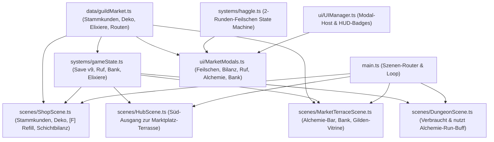

# Architektur- & Umsetzungsdokument: Meilenstein 8 — Händler-Gilde, Verhandeln & Port-Solaris-Marktplatz

> **Status:** ✅ Umgesetzt & Live auf `main` (`SaveData v9`)  
> **Basis:** Aufgebaut auf Meilenstein 7 (`SaveData v8`, Architektur-Split & Firebase Cloud-Save).

---

## 1. Design-Invarianten & Leitplanken

1. **Zero-Dungeon-Credits-Regel:** Niemals `state.credits +=` in `src/scenes/DungeonScene.ts`, `src/dungeon/enemyAi.ts` oder `src/dungeon/dungeonRenderer.ts`. Einnahmen entstehen ausschließlich im Shop, durch Großaufträge/Bounties oder durch die **Solaris-Handelsbank** auf der Marktplatz-Terrasse.
2. **Modulare Erweiterung statt Monolith-Wachstum:** Neue Daten, Feilsch-Logik, die neue Szene und alle M8-Modals leben in **4 fokussierten Modulen** (`guildMarket.ts`, `haggle.ts`, `MarketTerraceScene.ts`, `MarketModals.ts`), um `UIManager.ts` und `ShopScene.ts` schlank zu halten.
3. **Save-Abwärtskompatibilität (v8 → v9):** Alle neuen Felder in `SaveData` sind optional (`?`) und werden in `GameState.load()` defensiv mit Defaults initialisiert, sodass bestehende lokale Spielstände & Firebase Cloud-Saves nahtlos migrieren.
4. **Kein harter Asset-Blocker:** `artLoader.ts` unterstützt optional `marketTerraceBg`, während `MarketTerraceScene.ts` ein vollwertiges prozedurales Pixel-Art-Terrassendeck als Fallback rendert.
5. **Input-Parität:** Desktop (Maus + Tastatur inkl. `[F]` Schnell-Nachfüllen), Touch (`TouchControls.ts`) und Gamepad (`InputManager.pollGamepad()`) werden durchgängig unterstützt.

---

## 2. Ziel-Architektur & Dateikarte

### Neue Module (4 Dateien)
| Datei | Verantwortung |
| :--- | :--- |
| `src/data/guildMarket.ts` | Statische Definitionen für 4 Stammkunden, 3 Rufstufen, 4 Shop-Deko-Objekte, Großaufträge, 5 Alchemie-Elixiere (Run-Buffs) und 4 Solaris-Handelsrouten. |
| `src/systems/haggle.ts` | Reine, UI-unabhängige State-Machine für das 2-Runden-Feilschen (Risikoberechnung, Geduldsleiste, Gegenangebote, Deal-Ergebnis). |
| `src/scenes/MarketTerraceScene.ts` | Begehbare Neben-Szene südlich der Promenade (`480×270` Logik-Koordinaten) mit **Milo's Alchemie-Bar**, **Solaris-Handelsbank** & **Händler-Gilden-Schaukasten**. |
| `src/ui/MarketModals.ts` | Ausgelagerte HTML-Modal-Renderer & Event-Bindings für: Schicht-Bilanz, Feilschen, Stammkunden-Ruf & Großaufträge, Milo's Alchemie-Bar und Solaris-Handelsbank. |

### Erweiterte Bestandsdateien
- `src/types.ts`: `SceneId` um `'market_terrace'` erweitert; neue Typen (`PatronId`, `AlchemyBuffId`, `TradeRouteId`, `PatronProgress`, `BigOrderContract`, `BankInvestment`, `ShiftSummary`, `HagglePayload`) und optionale `SaveData`-Felder.
- `src/systems/economy.ts`: `getOptimalCodexPrice(itemId, entry)` für `[F]` Schnell-Nachfüllen.
- `src/systems/gameState.ts`: `SAVE_VERSION = 9`, Buff- & Deko-Integration in `getStats()`, Stammkunden-Ruf/Großaufträge, Alchemie-Bar, Bank-Zyklus-Tick in `advanceTimeOfDay()`, Rix-Rabatt bei Nyx & `quickRefillPedestal()`.
- `src/data/companions.ts`: 2 neue Erfolge (`master_haggler`, `guild_patron` — gesamt 14).
- `src/scenes/ShopScene.ts`: `[F]` Schnell-Nachfüllen, Schicht-Bilanz (`ShiftSummary`), optionales Feilschen, Stammkunden-Spawns & 4 sichtbare Shop-Deko-Objekte.
- `src/scenes/HubScene.ts`: Süd-Ausgang zur Marktplatz-Terrasse bei `(240, 222)`.
- `src/scenes/DungeonScene.ts`: Verbrauch des aktiven Alchemie-Run-Buffs bei Expeditionsende.
- `src/main.ts`, `src/ui/UIManager.ts`, `src/ui/TouchControls.ts`, `src/assets/artLoader.ts`, `src/style.css`: Verdrahtung, HUD-Badges & Styles.

---

## 3. Subsystem-Spezifikationen

### 3.1 Shop-QoL (`[F]` Schnell-Nachfüllen & Schicht-Bilanz)
- **Quick-Refill (`[F]`):** Merkt sich das zuletzt ausgelegte Item pro Podest-ID (`lastPedestalItems`) und füllt leere oder teilbestückte Podeste aus Truhe/Rucksack zum Scan-Codex-Optimalpreis (`getOptimalCodexPrice`) nach.
- **Schicht-Bilanz (`ShiftSummary`):** Zeigt am Schichtende verkaufte Relikte, Brutto-Umsatz, Feilsch-Gewinn, VIP/Dieb-Statistik, Top-Verkauf, Stammkunden-Besuche sowie den Tag/Nacht-Wechsel inkl. Hinweis auf fällige Bank-Auszahlungen.

### 3.2 Verhandlungs-System („Feilschen“ — `src/systems/haggle.ts`)
- Wird beim manuellen Kassieren (`[E]`) angeboten für **VIPs**, **Stammkunden** sowie **epische / Boss- / Rift-Relikte** (`baseValue >= 180`). Normale Common-Verkäufe und der Handels-Droide bleiben blitzschnell ohne Modal.
- **Max. 2 Runden:** Aktionen *Sofort annehmen (`+0 %`)*, *Charme (`+15 %`)*, *Selbstbewusst (`+28 %`)*, *Hoch pokern (`+40 %`)*. Bei Geduld `0 %` geht der Kunde verärgert, das Relikt landet sicher zurück in der Truhe (kein Item-Verlust).

### 3.3 Stammkunden-Ruf (4 Named NPCs — `src/data/guildMarket.ts`)
| ID | Name & Rolle | Vorliebe | Stufe 2 Shop-Deko | Stufe 3 Großauftrag & Permanenter Perk |
| :--- | :--- | :--- | :--- | :--- |
| `vance` | **Admiral Vance** (Flotten-Veteran) | Sektor 1 & 3 | **Flotten-Standarte** (`+10 %` Dieb-Kopfgeld & `+5 %` Tipp) | 2× `aegis_plate` + 1× `leviathan_core` → **1.800 Cr** + `+5 %` Verkaufspreis S1/S3 |
| `zora` | **Kuratorin Zora** (Xenologie-Museum) | Sektor 2 & 4 | **Kristall-Vitrine** (`+15 %` Kunden-Geduld) | 2× `crystal_capacitor` + 1× `archon_heart` → **2.600 Cr** + `+5 %` Verkaufspreis S2/S4 |
| `rix` | **Schmuggler Rix** (Freihändler) | `smuggler`- & Rift-Relikte | **Schmuggler-Laterne** (`+8 %` VIP-/Stammkunden-Chance) | 2× `phase_geode` + 1× `rift_catalyst` → **2.200 Cr** + `15 %` Rabatt bei Nyx |
| `tala` | **Ingenieurin Tala** (Solaris-Chefarchitektin) | Uncommon- & Rare-Tech | **Holo-Konjunktur-Globus** (`+6 %` Feilsch-Chance) | 3× `drone_core` + 2× `foundry_gear` → **2.400 Cr** + `+5 %` Bank-Rendite |

- **XP-Schwellen:** Stufe 1 (`40 XP`, `+10 %` Trinkgeld), Stufe 2 (`120 XP`, Shop-Deko), Stufe 3 (`240 XP`, Großauftrag). Verkauf: `+15 XP` (`+25 XP` bei Vorliebe, `+10 XP` bei erfolgreichem Feilschen).

### 3.4 Marktplatz-Terrasse: Alchemie-Bar & Solaris-Handelsbank
- **Milo's Alchemie-Bar (1 aktiver Run-Buff pro Expedition, direkt in `GameState.getStats()`):**
  - `solar_espresso` (`+20 %` Waffenschaden), `aegis_tonic` (`+25 %` Max-HP & `+1` Stimpack), `nebula_nectar` (`+35 %` Loot-Glück), `chrono_fizz` (`+18 %` Tempo & `-20 %` Dash-CD), `void_elixir` (`+15 %` Krit & `+25 %` EN-Regen).
- **Solaris-Handelsbank (max. 2 aktive Routen gleichzeitig):**
  - `solaris_shuttle` (150 Cr / 2 Zyklen / +15–25 %), `crystal_convoy` (400 Cr / 3 Zyklen / +20–38 %), `foundry_freight` (900 Cr / 3 Zyklen / +22–45 %), `elder_expedition` (1.800 Cr / 4 Zyklen / +25–55 %).
  - Reifen bei jedem `advanceTimeOfDay()` und werden an der Bank auf der Marktplatz-Terrasse abgeholt.
