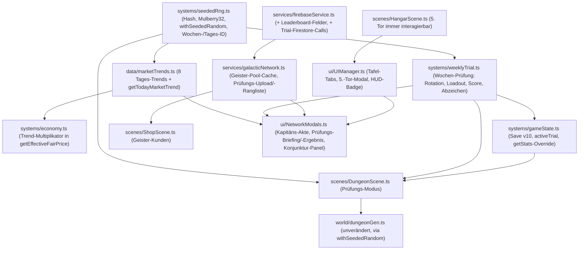

# Architektur- & Vorgehensplan: Meilenstein 9 — Galaktisches Netzwerk & Lebendige Community

> **Status:** ✅ Umgesetzt auf Branch `claude/architektur-vorgehensplan-lgme5i` (Phasen 0–5) — siehe Abschnitt 10 „Umsetzungsnotizen“
> **Basis:** `main` nach Meilenstein 8 (`SaveData v9`, Firebase `starlighter-15b1f`, Architektur-Split)
> **Ziel-Save-Version:** `SAVE_VERSION = 10`
> **Quelle der Anforderungen:** [GAME_DESIGN_DOCUMENT.md §5](GAME_DESIGN_DOCUMENT.md) (Roadmap M9, Punkte 1–4)

**So benutzt du dieses Dokument:** Arbeite die Phasen in §6 **strikt in Reihenfolge** ab. Jede Phase ist für sich baubar, testbar und committbar. Vor jedem Commit gilt die Pipeline aus [TESTING_AND_VERIFICATION.md](TESTING_AND_VERIFICATION.md) + die Phasen-Abnahmekriterien. Alle Dateipfade, Funktionsnamen und Zeilenhinweise wurden gegen den aktuellen Code geprüft (Zeilennummern sind Orientierung, keine Garantie — immer per `grep` verifizieren).

---

## 1. Scope (die 4 Features)

| # | Feature | Kurzbeschreibung | Risiko |
| :--- | :--- | :--- | :--- |
| F1 | **Klickbare Kapitäns-Akten** | Klick auf einen Eintrag der Kapitäns-Tafel → Detailprofil (Waffe + Prägung, 5 Bestzeiten, Tage-Rekorde, Rift, Erfolge, Abzeichen). | niedrig |
| F2 | **Globale Markt-Konjunktur** | Deterministischer, weltweit identischer Tages-Trend (UTC-Datum) → Preismultiplikator, sichtbar an Kapitäns-Tafel, Scan-Codex & HUD. | niedrig |
| F3 | **Geister-Kapitäne als Kunden** | Echte Spieler aus `leaderboard` besuchen *Astro-Barter* als Hologramm-Kunden (Name + Anzug-Farbe + Gruß), zahlen +10 % Gilden-Trinkgeld. | mittel |
| F4 | **Wöchentliche „Galaktische Prüfung“** | Wochen-Seed (`YYYY-Www`) am 5. Tor: identisches Layout, normierte Ausrüstung, eigene Wochen-Rangliste & Prüfungs-Abzeichen. | hoch |

**Nicht im Scope:** M10-A (Story-Kapitel, Raum-Mechaniken, Boss-Musik, Touch-Größe). Keine neuen Sprites zwingend nötig (alles prozedural/mit bestehender Art umsetzbar).

---

## 2. Design-Invarianten & Leitplanken (verbindlich)

1. **Zero-Dungeon-Credits:** Die Prüfung (F4) zahlt **keine Credits** und erzeugt **keine Beute**. Belohnung = Ruhm (Rangliste, Abzeichen, Erfolge). Kein `state.credits +=` in `DungeonScene.ts`, `enemyAi.ts`, `dungeonRenderer.ts`. Das Geister-Trinkgeld (F3) entsteht ausschließlich in `ShopScene.ts` beim Kassieren — erlaubt.
2. **Alles In-Game:** Kapitäns-Akten & Prüfungs-Rangliste leben in der **Kapitäns-Tafel** (Promenade), die Prüfung startet am **5. Tiefenraum-Tor** (Raumhafen), die Konjunktur erscheint an Tafel/Codex/HUD. Keine externen Seiten.
3. **Save-Abwärtskompatibilität (v9 → v10):** Alle neuen `SaveData`-Felder optional (`?`) und in `GameState.load()` defensiv defaulten. Alte Leaderboard-Dokumente ohne neue Felder müssen fehlerfrei rendern.
4. **Offline-/Gast-Robustheit:** Ohne Firebase-Konfiguration, ohne Login oder ohne Netzwerk muss alles weiterlaufen: F2 funktioniert komplett offline (rein deterministisch), F3 spawnt dann schlicht keine Geister, F4 ist lokal spielbar (Ergebnis wird lokal gespeichert, Upload nur wenn angemeldet), F1 zeigt mindestens den eigenen Eintrag.
5. **Modularität wie in M8:** Neue Logik in **fokussierte neue Module** (§3), `UIManager.ts` (3.2k Zeilen) und `DungeonScene.ts` (4k Zeilen) nur minimal verdrahten.
6. **Strict TS:** `import type` für reine Typ-Importe, keine ungenutzten Locals/Parameter, kein `enum`/`namespace`/Parameter-Properties (`erasableSyntaxOnly`).
7. **Deutsch:** Alle UI-Texte, Toasts, Namen auf Deutsch.
8. **Fairness der Prüfung:** Ergebnis darf **nicht** von NG+-Level, Boss-Zähler, Upgrades, Prägungen, Begleitern oder Alchemie-Buffs abhängen (siehe §4.4).

---

## 3. Ziel-Architektur & Dateikarte



### 3.1 Neue Module (5 Dateien)

| Datei | Verantwortung | Abhängigkeiten |
| :--- | :--- | :--- |
| `src/systems/seededRng.ts` | Reine Funktionen: `hashString`, `mulberry32`, `withSeededRandom`, `getIsoWeekId`, `getUtcDayId`, `getWeekEndUtc`. **Keine** Imports aus dem Projekt. | — |
| `src/data/marketTrends.ts` | `MarketTrendDef`-Liste (8 Trends) + `getTodayMarketTrend(now?)` + `getMarketTrendMultiplier(itemId, now?)`. | `seededRng`, `items` |
| `src/systems/weeklyTrial.ts` | Reine Prüfungs-Logik: `getCurrentWeeklyTrial(now?)`, `TRIAL_COMBAT_LEVELS`, `TRIAL_PAR_TIMES`, `computeTrialScore`, `getTrialBadge`, `getTrialFloorSeed`. | `seededRng`, `infusions` (Mutator-Liste), Typen |
| `src/services/galacticNetwork.ts` | Netzwerk-Fassade: Geister-Kapitäne-Pool (Cache 10 Min.), `pickGhostCaptain()`, Prüfungs-Upload & Wochen-Rangliste. Test-Hooks. | `firebaseService` |
| `src/ui/NetworkModals.ts` | HTML-Renderer: Kapitäns-Akte, Prüfungs-Tab der Tafel, Prüfungs-Briefing, Prüfungs-Ergebnis, Konjunktur-Panel. Muster wie `MarketModals.ts` (Host-Interface). | Daten-/System-Module |

### 3.2 Erweiterte Bestandsdateien

| Datei | Änderung |
| :--- | :--- |
| `src/types.ts` | Neue Typen (§5.1), `LeaderboardEntry` + `SaveData` + `RunSummary` optional erweitert. |
| `src/systems/gameState.ts` | `SAVE_VERSION = 10`, neue Felder + Load-Defaults, `activeTrial`-Runtime-Feld, `getStats()`-Override, `getActiveInfusion()`-Guard, `recordWeeklyTrialResult()`, 2 neue Erfolge prüfen. |
| `src/systems/economy.ts` | `getEffectiveFairPrice()` multipliziert mit `getMarketTrendMultiplier(itemId)`. |
| `src/services/firebaseService.ts` | `buildLeaderboardEntry()` + neue Felder; `submitWeeklyTrialEntry()`, `fetchWeeklyTrialEntries()`. |
| `src/data/companions.ts` | 2 neue Erfolge (`trial_runner`, `trial_gold`) → gesamt 16. |
| `src/scenes/ShopScene.ts` | Geister-Kunde im `Customer`-Interface, Spawn, Render, +10 % Trinkgeld beim Kassieren. |
| `src/scenes/HangarScene.ts` | 5. Tor ist immer interagierbar und öffnet das Ziel-Modal (Omega ggf. gesperrt). |
| `src/scenes/DungeonScene.ts` | `startWeeklyTrial()`, `isWeeklyTrial`, Seeded-Floor-Gen, Fairness-Skalierung, Beute aus, `finishWeeklyTrial()`. |
| `src/dungeon/dungeonRenderer.ts` | HUD-Zeile „🏅 PRÜFUNG KW xx · Mutator“ + Begleiter-Guard. |
| `src/main.ts` | `pendingWeeklyTrial`-Flag, Verdrahtung Tor-Modal → Dungeon, Rückkehr → Ergebnis-Modal, Geister-Prefetch. |
| `src/ui/UIManager.ts` | Tafel: Zeilen klickbar (`data-lb-uid`), neue Tabs `trial` & Konjunktur-Banner, Konto-Tab: Gruß-Feld; `openOmegaGateModal` → 3 Karten; HUD-Konjunktur-Badge; Codex-Hinweis. |
| `src/style.css` | `.m9-*`-Klassen (Akte, Abzeichen, Hologramm-Pill, Trend-Banner). |
| `firestore.rules` | `leaderboard`-Validierung für neue Felder, neue Collection `weeklyTrials/{weekId}/entries/{uid}`. |
| Doku | `GAME_DESIGN_DOCUMENT.md`, `AGENTS.md` (SAVE_VERSION 10, Doku-Map), `README.md`, `TESTING_AND_VERIFICATION.md` (neue Test-Hooks). |

---

## 4. Subsystem-Spezifikationen

### 4.1 Gemeinsames Fundament: `src/systems/seededRng.ts`

Der Dungeon-Generator (`src/world/dungeonGen.ts`) verwendet **überall direkt `Math.random()`** (~40 Aufrufe). Statt ihn umzuschreiben, wird `Math.random` **während der synchronen Generierung** temporär ersetzt. Das ist sicher, weil `generateSectorFloor()` vollständig synchron läuft.

```ts
/** FNV-1a 32-bit — stabiler String-Hash für Seeds. */
export function hashString(input: string): number {
  let h = 0x811c9dc5;
  for (let i = 0; i < input.length; i++) {
    h ^= input.charCodeAt(i);
    h = Math.imul(h, 0x01000193);
  }
  return h >>> 0;
}

/** Mulberry32 PRNG → Werte in [0, 1). */
export function mulberry32(seed: number): () => number {
  let a = seed >>> 0;
  return () => {
    a = (a + 0x6d2b79f5) >>> 0;
    let t = a;
    t = Math.imul(t ^ (t >>> 15), t | 1);
    t ^= t + Math.imul(t ^ (t >>> 7), t | 61);
    return ((t ^ (t >>> 14)) >>> 0) / 4294967296;
  };
}

/** Führt fn mit deterministischem Math.random aus; stellt das Original IMMER wieder her. */
export function withSeededRandom<T>(seed: string, fn: () => T): T {
  const original = Math.random;
  Math.random = mulberry32(hashString(seed));
  try {
    return fn();
  } finally {
    Math.random = original;
  }
}

/** ISO-8601-Woche in UTC, z. B. "2026-W48". */
export function getIsoWeekId(now: Date = new Date()): string { /* Donnerstag-Regel, UTC */ }

/** UTC-Kalendertag, z. B. "2026-11-25". */
export function getUtcDayId(now: Date = new Date()): string { /* toISOString().slice(0, 10) */ }

/** Montag 00:00 UTC der Folgewoche (für „Endet in x Tg. y Std.“). */
export function getWeekEndUtc(now: Date = new Date()): number { /* ms-Timestamp */ }
```

- `getIsoWeekId` **muss** die ISO-Regel nutzen (Woche mit dem Donnerstag bestimmt das Jahr; Woche beginnt Montag). Testfälle: `2026-01-01` → `2026-W01`, `2027-01-01` → `2026-W53`, `2026-11-25` → `2026-W48`.
- Alle Funktionen nehmen `now` als Parameter (Testbarkeit). Nirgends sonst `new Date()` für diese IDs verwenden.

### 4.2 F1 — Klickbare Kapitäns-Akten

**Daten:** `LeaderboardEntry` (in `types.ts`) bekommt optional:
- `achievementIds?: string[]` — IDs aus `ACHIEVEMENT_DEFS` (max. 32 Einträge).
- `riftsCleared?: number`
- `ghostGreeting?: string` (F3, max. 60 Zeichen)
- `trialBadges?: { gold: number; silver: number; bronze: number }` (F4)
- `bestTrialWeekId?: string`, `bestTrialTimeSec?: number` (F4, nur Anzeige)

`firebaseService.buildLeaderboardEntry()` befüllt diese Felder aus `GameState` (`state.unlockedAchievements.slice(0, 32)`, `state.records.riftsCleared ?? 0`, …).

**UI (in `UIManager.renderGuildBoardModal`, ~Zeile 2778):**
1. Jede Ranglisten-Zeile erhält `data-lb-uid="${escapeHtml(r.uid)}"`, `cursor:pointer` und einen Hover-Rahmen. Nach dem Rendern Click-Listener binden → `this.guildSelectedUid = uid; this.guildTab = 'file'; this.renderGuildBoardModal();`.
2. Neuer Tab-Zustand `'file'` (nicht als sichtbarer Tab-Button, sondern Unteransicht mit Button `← Zurück zur Tafel`). `guildTab`-Typ entsprechend erweitern.
3. Für `guildTab === 'file'`: Eintrag aus `allRows` per `guildSelectedUid` holen und `renderCaptainFileHtml(entry, isMe)` aus `NetworkModals.ts` einsetzen.

**Inhalt der Akte (`renderCaptainFileHtml`)** — zweispaltiges Grid, auf schmalen Viewports einspaltig:
- Kopf: Rang-Farbe, Kapitäns-Name, Anzug-Farbschema (Farbpunkt + `SUIT_THEMES[...].name`), `NG+n`, „zuletzt aktiv {formatRelativeTime(updatedAt)}“.
- **Hauptwaffe + Prägung:** `WEAPON_META[equippedWeapon]` + `getInfusionDef(activeInfusion)` (Icon + Name).
- **Sektor-Bestzeiten S1–S4 + 5. Tor:** `formatDurationSec(bestSectorClearSec[n])`.
- **Tage-Rekorde:** schnellster S4-, Omega-, NG+-Clear (`Tag n` oder `—`).
- **Rift:** tiefste Spiral-Ebene, gesäuberte Rift-Risse.
- **Händler:** `totalEarned` (de-DE), `totalSold`, Shop-Stufe.
- **Erfolge:** Raster aller `ACHIEVEMENT_DEFS`-Icons; freigeschaltete leuchten, andere ausgegraut mit `title`-Tooltip. Fehlt `achievementIds` (alter Eintrag) → nur „{achievementsCount} / 16 Erfolge“.
- **Prüfungs-Abzeichen:** 🥇/🥈/🥉-Zähler + Bestzeit der besten Woche.
- **Gruß:** `ghostGreeting` in Anführungszeichen (escaped).
- Alle Fremd-Strings **immer** durch `escapeHtml` (vorhandene Hilfsfunktion in `renderGuildBoardModal` → nach `NetworkModals.ts` als exportierte Utility verschieben oder duplizieren).

### 4.3 F2 — Globale Markt-Konjunktur

**`src/data/marketTrends.ts`:**

```ts
export type MarketTrendId =
  | 'calm' | 'corvette_nostalgia' | 'crystal_boom' | 'foundry_surge'
  | 'elder_fever' | 'rift_rush' | 'collector_season' | 'scrap_glut';

export interface MarketTrendDef {
  id: MarketTrendId;
  icon: string;
  name: string;        // z. B. "Kristall-Boom"
  description: string; // z. B. "Sektor-2-Relikte +25 %"
  accent: string;      // Hex-Farbe für Banner/Badge
  multiplierFor: (item: ItemDef) => number;
}
```

| ID | Name | Effekt |
| :--- | :--- | :--- |
| `calm` | 🌙 Ruhiger Markt | alles ×1,00 |
| `corvette_nostalgia` | 🛰 Korvetten-Nostalgie | `sector === 1` ×1,25 |
| `crystal_boom` | 💎 Kristall-Boom | `sector === 2` ×1,25 |
| `foundry_surge` | 🔥 Gießerei-Hochkonjunktur | `sector === 3` ×1,25 |
| `elder_fever` | 👑 Ältesten-Fieber | `sector === 4` ×1,25 |
| `rift_rush` | 🌀 Rift-Rausch | `sector === 5` ×1,30 |
| `collector_season` | ★ Sammler-Saison | `rarity === 'epic'` ×1,20 |
| `scrap_glut` | ⚙ Schrott-Schwemme | `common` ×0,85, `rare` ×1,10 |

- Auswahl: `TREND_LIST[hashString('starlighter-trend:' + getUtcDayId(now)) % TREND_LIST.length]` → weltweit identisch, ohne Server.
- `getMarketTrendMultiplier(itemId, now?)` → `getItemDef(itemId)` + `multiplierFor`. Ergebnis pro `dayId` cachen (Modul-Variable), um Hash-Aufrufe pro Frame zu vermeiden.
- Ein Item ohne `sector` zählt als Sektor 1 (wie in `generateNyxStock`).

**Integration:**
- `economy.ts → getEffectiveFairPrice()` multipliziert zusätzlich mit `getMarketTrendMultiplier(itemId)`. Dadurch wirken `evaluatePrice`, `getOptimalCodexPrice` (`[F]`-Nachfüllen) und Kunden-Reaktionen automatisch konsistent.
- **Wichtig:** Die im Codex gespeicherten Schwellen (`maxCheapPrice` etc.) sind historische Beobachtungen und bleiben unverändert. Im Codex-Tab (Inventar-Modal, `renderInventoryModal`) bei betroffenen Items Hinweis-Pill `📈 Konjunktur +25 %` / `📉 −15 %` anzeigen.
- **Anzeige:** (a) Banner oben in der Kapitäns-Tafel (alle Tabs) mit Icon, Name, Beschreibung, „gilt bis 00:00 UTC“; (b) kleines HUD-Badge in Shop/Promenade (dort, wo `MARKET_EVENT_META`-Events angezeigt werden — per `grep MARKET_EVENT_META src/ui/UIManager.ts` finden); (c) im Pedestal-Modal beim Preis-Setzen, wenn das Item betroffen ist.
- Der Trend ist **unabhängig** vom bestehenden In-Game-`marketEvent` (Tages-Event) und stapelt sich multiplikativ.

### 4.4 F4 — Wöchentliche „Galaktische Prüfung“ (größtes Feature)

#### 4.4.1 Regeln
- **Zugang:** 5. Tiefenraum-Tor im Raumhafen, freigeschaltet ab `state.sector1Cleared === true` (Neulinge sollen die Grundlagen kennen). Unbegrenzte Versuche, bester Versuch zählt.
- **Woche:** `weekId = getIsoWeekId(now)` beim **Start** des Versuchs (Wechsel während eines Laufs ist egal; Ergebnis zählt für die Start-Woche).
- **Sektor-Rotation:** `sector = (hashString('trial-sector:' + weekId) % 4) + 1` → Sektor 1–4.
- **Wochen-Mutator:** `mutator = RIFT_MUTATOR_LIST[hashString('trial-mut:' + weekId) % 4]` (aus `src/data/infusions.ts`).
- **Ablauf:** 3 Ebenen des Sektors (wie ein normaler Lauf), Ende beim Sieg über den Ebene-3-Endboss.
- **Seeds pro Ebene:** `getTrialFloorSeed(weekId, floor) = \`starlighter-trial:${weekId}:F${floor}\``. Die Floor-Generierung läuft in `withSeededRandom(seed, () => generateSectorFloor(sector, floor))` → identisches Layout & Gegner-Platzierung für alle Spieler. Kampf-Zufall (Crits, AI) bleibt bewusst frei.
- **Normierte Ausrüstung (`TRIAL_COMBAT_LEVELS`):** Alle 6 Waffen auf Level 4, `suit: 4`, `stimpack: 2`, `bioRegen: 1`, `modCrit: 1`, `modThruster: 1`, `modLuck: 0`. Der Spieler nutzt seine **aktuell ausgerüstete Waffe** (+ evtl. Zweitwaffe) — Waffentyp ist Geschmackssache, die Stufe ist normiert.
- **Deaktiviert in der Prüfung:** Prägungen (`getActiveInfusion()` → `'none'`), Begleiter-Drohne, Alchemie-Buff (wird weder angewendet noch verbraucht), Nacht-Loot-Bonus, NG+-Gegnerskalierung, Boss-Zähler-Skalierung.
- **Keine Beute, keine Credits, keine Progression:** `spawnLootDrop` gibt früh zurück; Truhen bleiben zu (Toast „🏅 Prüfungs-Truhe versiegelt — hier zählt nur Ruhm!“); Rift-Risse werden in der Prüfung nicht betreten (Prompt unterdrücken); **kein** Setzen von `sectorNCleared`, `bossDefeatedCount`, `deepestFloorSx`, kein `recordSectorClear`. Die Fracht (`inventory.cargo`) wird **nicht** angefasst — weder Verlust bei Niederlage noch Warp-Effekte.
- **Warp-Beacon (`R`):** Bricht die Prüfung ab → Ergebnis „Abgebrochen“ (zählt wie Niederlage mit erreichter Ebene/Räumen), keine Warp-Gebühr.

#### 4.4.2 Wertung & Abzeichen (`src/systems/weeklyTrial.ts`)

```ts
export interface WeeklyTrialInfo {
  weekId: string;
  sector: 1 | 2 | 3 | 4;
  mutator: RiftMutatorId;
  endsAtUtc: number;
}

export function computeTrialScore(r: { completed: boolean; timeSec: number; floorReached: number; roomsCleared: number }): number {
  // Niedriger = besser. Abgeschlossene Läufe immer vor unvollständigen.
  return r.completed
    ? Math.max(1, Math.round(r.timeSec))
    : 1_000_000 - (r.floorReached * 1000 + Math.min(999, r.roomsCleared));
}

export const TRIAL_PAR_TIMES: Record<1 | 2 | 3 | 4, { gold: number; silver: number }> = {
  1: { gold: 420, silver: 660 },
  2: { gold: 480, silver: 720 },
  3: { gold: 540, silver: 780 },
  4: { gold: 600, silver: 840 },
};
// getTrialBadge(sector, completed, timeSec): 'gold' | 'silver' | 'bronze' | null
// Abgeschlossen = mind. Bronze; < silver = Silber; < gold = Gold.
```

> Par-Zeiten sind Startwerte; nach dem ersten echten Testlauf in der Verifikation (§7) plausibilisieren und ggf. anpassen.

#### 4.4.3 Persistenz (Save v10)
```ts
export interface WeeklyTrialRecord {
  weekId: string;
  sector: 1 | 2 | 3 | 4;
  attempts: number;
  completed: boolean;
  bestTimeSec: number | null;
  bestFloorReached: number;
  bestRoomsCleared: number;
  bestScore: number;
  badge: TrialBadge | null;   // 'gold' | 'silver' | 'bronze'
  uploaded: boolean;          // false → beim nächsten Login/Sync erneut hochladen
}
```
- `SaveData.weeklyTrial?: WeeklyTrialRecord` (nur aktuelle/letzte Woche) und `SaveData.trialBadgeHistory?: Record<string, TrialBadge>` (weekId → bestes Abzeichen, max. 52 Einträge, älteste kappen).
- `GameState.recordWeeklyTrialResult(result)`: setzt Rekord zurück, wenn `weekId` neu ist; erhöht `attempts`; übernimmt nur, wenn `score` besser; aktualisiert `trialBadgeHistory`; `logMilestone(...)` nur bei neuem Bestwert; `checkAchievements`; `save()`. Gibt `{ isNewBest, badge, record }` zurück.
- **Runtime-Feld (nicht gespeichert):** `GameState.activeTrial: WeeklyTrialInfo | null`. Wird beim Start gesetzt, bei `finishWeeklyTrial` auf `null`. Bei Reload mitten in der Prüfung ist der Lauf verloren — gewollt, kein Recovery nötig, da nichts am Inventar verändert wurde.

#### 4.4.4 GameState-Overrides
- `getStats()`: `const levels = this.activeTrial ? { ...this.upgrades, ...TRIAL_COMBAT_LEVELS } : this.upgrades; const base = getPlayerCombatStats(levels);` und `const buff = this.activeTrial ? null : this.activeAlchemyBuff;`.
- `getActiveInfusion()` (~Zeile 1234): `if (this.activeTrial) return 'none';` am Anfang.
- `consumeAlchemyBuff()`: in der Prüfung nicht aufrufen (Guard in `DungeonScene.finishWeeklyTrial`, siehe unten).

#### 4.4.5 DungeonScene-Integration
Neue öffentliche Felder: `isWeeklyTrial = false`, `trialInfo: WeeklyTrialInfo | null = null`.

1. **`startWeeklyTrial(info: WeeklyTrialInfo)`**: analog `startRun()` (alle Run-Telemetrie-Felder zurücksetzen — am besten die gemeinsame Reset-Logik aus `startRun`/`startEndlessRift` in eine private Methode `resetRunTelemetry()` extrahieren), dann `this.isWeeklyTrial = true; this.trialInfo = info; this.state.activeTrial = info; this.activeRiftMutator = info.mutator; this.haloShieldReady = false; this.state.restoreFullVitals(); this.startFloor(1, true, info.sector);` + Toast `🏅 GALAKTISCHE PRÜFUNG {KW} — Sektor n · Mutator …`.
2. **`startRun()` und `startEndlessRift()`** setzen `isWeeklyTrial = false; trialInfo = null; state.activeTrial = null`.
3. **`startFloor()`**: Die `deepestFloor*`-Updates nur, wenn `!this.isWeeklyTrial`. Floor-Generierung:
   ```ts
   this.floor = this.isWeeklyTrial && this.trialInfo
     ? withSeededRandom(getTrialFloorSeed(this.trialInfo.weekId, floorIndex), () => generateSectorFloor(sector, floorIndex))
     : generateSectorFloor(sector, floorIndex);
   ```
4. **`spawnEnemy()`** (~Zeile 612): Fairness-Skalierung
   ```ts
   const ngLevel = this.isWeeklyTrial ? 0 : this.state.ngPlusLevel;
   const bossCount = this.isWeeklyTrial ? 1 : this.state.bossDefeatedCount;
   ```
   und den Mutator-Zweig auf `this.isEndlessRift || this.isWeeklyTrial` erweitern. `riftHpMult` in der Prüfung: `riftMutator === 'armored' ? 1.3 : 1.0` (keine Tiefen-Skalierung).
5. **Begleiter:** In `DungeonScene.ts` (11 Stellen) und `dungeonRenderer.ts` (3 Stellen) liest der Code `state.equippedCompanion`. Einen Getter `public get activeCompanion(): CompanionId | null { return this.isWeeklyTrial ? null : this.state.equippedCompanion; }` einführen und **alle** Lesezugriffe dort darauf umstellen (`grep -n equippedCompanion`).
6. **Beute aus:** `spawnLootDrop()` (~Zeile 3321): `if (this.isWeeklyTrial) return;` am Anfang. Truhen-Interaktion: in der Prüfung nur Toast, kein Roll. Rift-Riss-Prompt in der Prüfung unterdrücken.
7. **Boss-Siege (`onEnemyKilled`, ~Zeile 2692 ff.):** Die Sektor-Endboss-Zweige setzen `sectorNCleared`, `bossDefeatedCount`, `recordSectorClear`. Direkt **vor** diesen Zweigen (nach der allgemeinen Kill-Zählung `enemiesDefeated`) einfügen:
   ```ts
   if (this.isWeeklyTrial && this.isBossKind(e.kind)) {
     this.handleTrialBossKilled(e); // FX + floorBossDefeated = true, KEINE Progression/Beute
     return;
   }
   ```
   `handleTrialBossKilled`: Shake/Burst/Toast wie gewohnt, `this.floorBossDefeated = true`. Prüfen, dass Mini-Bosse auf Ebene 1/2 ebenfalls hier landen und danach der normale Ebenen-Ausgang (Portal) erscheint.
8. **Ebenen-Ende (~Zeilen 3640–3740, dort wo `startFloor(next)` bzw. `triggerSafeWarp('boss_victory', false)` aufgerufen wird):** Wenn `isWeeklyTrial` und Ebene 3 geschafft → `this.finishWeeklyTrial('victory')` statt `triggerSafeWarp`.
9. **Warp-Beacon (~Zeile 1275) & Niederlage (`triggerDefeat`)**: Wenn `isWeeklyTrial` → `this.finishWeeklyTrial('abort' | 'defeat')` statt der normalen Pfade (kein `processDefeatPenalty`, kein `processSafeReturnEffects`, keine Warp-Gebühr).
10. **`finishWeeklyTrial(outcome)`**:
    ```ts
    if (this.finished || !this.trialInfo) return;
    this.finished = true;
    const completed = outcome === 'victory';
    const timeSec = Math.max(1, Math.round(this.runElapsedSec));
    const result = this.state.recordWeeklyTrialResult({ ...this.trialInfo, completed, timeSec, floorReached: this.maxFloorReached, roomsCleared: this.roomsCleared, weapon: this.state.equippedWeapon });
    this.state.activeTrial = null;
    this.state.restoreFullVitals();
    this.callbacks.onReturnToHub({ victory: completed, reason: completed ? 'boss_victory' : outcome === 'defeat' ? 'defeat' : 'warp', sector: this.trialInfo.sector, isWeeklyTrial: true, trialOutcome: outcome, trialResult: result, /* Telemetrie, itemsSaved: 0, itemsLost: 0, Arrays leer */ });
    ```
11. **HUD (`dungeonRenderer.ts` ~Zeile 3277):** Mutator-Anzeige auch bei `isWeeklyTrial`; zusätzliche Zeile `🏅 PRÜFUNG {KW} · Ebene n/3 · ⏱ mm:ss`.

#### 4.4.6 Raumhafen & Modals
- **`HangarScene.ts` (~Zeile 425):** Das 5. Tor ist **immer** interagierbar. Prompt: `[E] 5. TIEFENRAUM-TOR — Ziel wählen`. Interaktion ruft immer `this.callbacks.onLaunchOmegaGate()`. Die Sperrlogik wandert ins Modal.
- **`UIManager.openOmegaGateModal(onStartOmega, onStartEndlessRift, onStartWeeklyTrial)`:** 3 Karten (Grid `repeat(auto-fit, minmax(180px, 1fr))`, `max-width: 680px`, Header `white-space: nowrap`):
  1. 🌌 Omega — gesperrt mit „🔒 {keys}/4 Sektor-Siegel“, wenn < 4 Schlüssel (Schlüssel-Anzahl als Parameter übergeben oder per `state.sectorNCleared` zählen).
  2. 🌀 Spirale — wie bisher.
  3. 🏅 Galaktische Prüfung — KW, Sektor, Mutator, „endet in x Tg. y Std.“, eigener Wochen-Bestwert + Abzeichen, Par-Zeiten. Button `🏅 Prüfung starten` (gesperrt bis S1 geschafft). Hinweis-Zeile: „Normierte MK-V-Ausrüstung · keine Prägung/Drohne/Elixier · keine Beute“.
- **`main.ts`:** `pendingWeeklyTrial: WeeklyTrialInfo | null`. In `transitionTo('dungeon')` Reihenfolge: Prüfung → Spirale → normaler Lauf. Alle `onLaunchSectorN` setzen `pendingWeeklyTrial = null`.
- **Rückkehr:** `handleReturnFromDungeon(summary)`: Wenn `summary.isWeeklyTrial` → `this.ui.openWeeklyTrialResultModal(summary)` statt `openRunSummaryModal`, danach Upload (§4.6) anstoßen.
- **Ergebnis-Modal (`NetworkModals.renderWeeklyTrialResultModal`)**: Ergebnis (Zeit/Ebene), Abzeichen (groß), „Neuer Wochen-Bestwert!“, Versuch Nr., Upload-Status („☁ an Kapitäns-Tafel gemeldet“ / „Lokal gespeichert — melde dich an der Kapitäns-Tafel an, um teilzunehmen“), Button `Zur Wochen-Rangliste` (öffnet nichts außerhalb — nur Hinweis, dass sie an der Tafel auf der Promenade steht; das In-Game-Prinzip bleibt gewahrt).

#### 4.4.7 Wochen-Rangliste an der Kapitäns-Tafel
- Neuer Tab `🏅 Prüfung` in `renderGuildBoardModal` (neben Rangliste/Feed/Konto). Inhalt aus `NetworkModals.renderTrialBoardHtml(entries, ownRecord, info)`: Kopf mit KW/Sektor/Mutator/Restzeit, dann Top 30 sortiert nach `score` aufsteigend (Platz, Name, Anzug-Farbe, Waffe, Zeit oder „Ebene n“, Abzeichen-Icon). Eigener lokaler Wert wird immer eingemischt (wie beim Haupt-Leaderboard per `byUid`-Map).
- Daten via `galacticNetwork.fetchWeeklyTrialBoard(weekId)` (Cache 60 s).

### 4.5 F3 — Geister-Kapitäne als Kunden

**Netzwerk (`src/services/galacticNetwork.ts`):**
```ts
export interface GhostCaptain {
  uid: string;
  name: string;
  suitTheme: SuitThemeId;
  greeting: string;
  ngPlusLevel: number;
}
class GalacticNetwork {
  private ghostPool: GhostCaptain[] = [];
  private ghostFetchedAt = 0;
  private testOverride: GhostCaptain[] | null = null;
  /** Lädt max. 30 Leaderboard-Einträge (bestehendes fetchLeaderboard), max. alle 10 Min. Fire-and-forget. */
  public prefetchGhostCaptains(ownUid: string | null): void;
  /** Synchron: zufälliger Geist (nicht ownUid, updatedAt < 30 Tage alt), sonst null. */
  public pickGhostCaptain(ownUid: string | null, excludeUids: Set<string>): GhostCaptain | null;
  public setGhostPoolForTest(pool: GhostCaptain[] | null): void;
  // F4:
  public submitWeeklyTrial(state: GameState): Promise<boolean>;
  public fetchWeeklyTrialBoard(weekId: string): Promise<WeeklyTrialEntry[]>;
}
export const galacticNetwork = new GalacticNetwork();
```
- Grüße: Wenn `ghostGreeting` leer → zufälliger Gruß aus `GHOST_GREETING_PRESETS` (8 deutsche Standardgrüße, z. B. „Grüße aus Dock III — schöne Podeste!“). Gruß auf 60 Zeichen kappen; nur druckbare Zeichen (`/[^\p{L}\p{N}\p{P}\p{Zs}\p{So}]/gu` entfernen).
- `prefetchGhostCaptains` wird aufgerufen in `ShopScene.onEnter()` und nach Login (`firebaseService.onAuthChange` in `main.ts`).

**ShopScene (`src/scenes/ShopScene.ts`):**
1. `Customer`-Interface (~Zeile 51) erweitern: `ghost: GhostCaptain | null`.
2. `spawnCustomer()` (~Zeile 632): **nach** Dieb/Stammkunde/VIP-Würfeln: Wenn kein Dieb, kein Stammkunde, kein VIP, kein anderer Geist aktiv, Podest bestückt, und `Math.random() < 0.12` → `ghost = galacticNetwork.pickGhostCaptain(ownUid, shiftGhostUids)`. Bei Treffer: `basePatience = 34`, Toast `👻 Holo-Kapitän {name}: „{gruß}“`, `sound.playVipChime()`, Burst in `SUIT_THEMES[suit].auraColor`. `shiftGhostUids` verhindert denselben Geist zweimal pro Schicht.
3. **Render (`renderCustomer`, ~Zeile 1935):** Geist = Holo-Look: gleiche Kunden-Figur, aber `globalAlpha 0.82`, Aura-Ellipse in `SUIT_THEMES[suit].accent`, 2–3 horizontale Scanlines (1 px, `auraColor`, Alpha 0.25, laufen mit `this.time`), Namensschild über dem Kopf (`Silkscreen`-Pixel-Font wie andere Labels im Shop, max. 14 Zeichen + „…“). Keine neuen Sprites nötig.
4. **Kassieren (`completeSale`-Logik, ~Zeile 1075):** `const ghostTip = waiter.ghost ? 0.10 : 0;` in die Trinkgeld-Summe aufnehmen (`shopTipBonus + patronTierTip + ghostTip`). Gilt nur beim manuellen Kassieren, nicht beim Handels-Droiden (wie Tipps bisher). Floating-Text `+GILDEN-TRINKGELD`. Feilschen wird für Geister **nicht** angeboten (bleibt schnell).
5. Optional (Aktivitäts-Feed): nichts an den Geist senden — **keine** Schreibzugriffe auf fremde Dokumente (Firestore-Rules erlauben das ohnehin nicht).

**Gruß setzen:** Im Konto-Tab der Kapitäns-Tafel Eingabefeld „Dein Holo-Gruß (max. 60 Zeichen)“ + Speichern → `state.ghostGreeting = clean; state.save(); firebaseService.scheduleAutoSync(state)`.

### 4.6 Firestore: Datenmodell & Regeln

**Neue Collection:** `weeklyTrials/{weekId}/entries/{uid}`
```ts
export interface WeeklyTrialEntry {
  uid: string;
  captainName: string;    // 1..24
  weekId: string;         // == Pfad-Segment
  sector: number;         // 1..4
  completed: boolean;
  timeSec: number;        // 1..10800
  floorReached: number;   // 1..3
  roomsCleared: number;   // 0..999
  score: number;          // computeTrialScore
  badge: TrialBadge | null;
  attempts: number;
  weapon: WeaponId;
  suitTheme: SuitThemeId;
  updatedAt: number;
}
```
- Upload (`firebaseService.submitWeeklyTrialEntry`) per `setDoc` (kein merge nötig), **nur** wenn angemeldet und der lokale Bestwert besser als der bereits hochgeladene ist (`record.uploaded === false`). Nach Erfolg `uploaded = true; save()`. Beim nächsten `syncAllToCloud` ausstehende Uploads nachholen.
- Abfrage: `query(collection(db, 'weeklyTrials', weekId, 'entries'), orderBy('score', 'asc'), limit(30))` (Einzelfeld-Index → kein Composite-Index nötig).

**Ergänzung `firestore.rules`:**
```
match /leaderboard/{uid} {
  // bestehende Regeln beibehalten, zusätzlich:
  // && (!('ghostGreeting' in request.resource.data)
  //     || (request.resource.data.ghostGreeting is string && request.resource.data.ghostGreeting.size() <= 60))
  // && (!('achievementIds' in request.resource.data)
  //     || (request.resource.data.achievementIds is list && request.resource.data.achievementIds.size() <= 32))
}

match /weeklyTrials/{weekId}/entries/{uid} {
  allow read: if true;
  allow create, update: if request.auth != null
    && request.auth.uid == uid
    && request.resource.data.uid == uid
    && request.resource.data.weekId == weekId
    && weekId.matches('^[0-9]{4}-W[0-9]{2}$')
    && request.resource.data.captainName is string
    && request.resource.data.captainName.size() >= 1
    && request.resource.data.captainName.size() <= 24
    && request.resource.data.score is number
    && request.resource.data.timeSec is number
    && request.resource.data.timeSec >= 1
    && request.resource.data.timeSec <= 10800
    && request.resource.data.floorReached is int
    && request.resource.data.floorReached >= 1
    && request.resource.data.floorReached <= 3;
  allow delete: if false;
}
```
> ⚠️ **Manueller Schritt für den Projektinhaber:** Firestore-Regeln werden **nicht** über Vercel deployed. Nach dem Merge müssen die neuen Regeln in der Firebase-Konsole (`starlighter-15b1f` → Firestore → Regeln) eingefügt und veröffentlicht werden. Bis dahin schlagen Prüfungs-Uploads fehl — der Code muss das abfangen (Toast „Prüfungs-Rangliste noch nicht verfügbar — Ergebnis lokal gespeichert“), und die Leaderboard-Synchronisation darf **nicht** brechen. Deshalb: Die zusätzlichen Leaderboard-Regeln sind nur *optional-validierend* (Felder dürfen fehlen) und kompatibel mit dem alten Regelstand.
>
> **Anti-Cheat-Hinweis:** Werte sind clientseitig erzeugt; Regeln prüfen nur Plausibilität. Für ein Hobby-Projekt akzeptiert, im GDD dokumentieren.

---

## 5. Typen & Save v10

### 5.1 Neue/erweiterte Typen (`src/types.ts`)
```ts
export type TrialBadge = 'gold' | 'silver' | 'bronze';
export type TrialOutcome = 'victory' | 'defeat' | 'abort';

export interface WeeklyTrialRecord { /* §4.4.3 */ }
export interface WeeklyTrialEntry { /* §4.6 */ }

// LeaderboardEntry (alles optional):
achievementIds?: string[];
riftsCleared?: number;
ghostGreeting?: string;
trialBadges?: { gold: number; silver: number; bronze: number };
bestTrialWeekId?: string;
bestTrialTimeSec?: number;

// RunSummary (alles optional):
isWeeklyTrial?: boolean;
trialOutcome?: TrialOutcome;
trialResult?: { isNewBest: boolean; badge: TrialBadge | null; record: WeeklyTrialRecord };

// SaveData (alles optional) — Kommentar "// Milestone 9: Galaktisches Netzwerk":
ghostGreeting?: string;
weeklyTrial?: WeeklyTrialRecord;
trialBadgeHistory?: Record<string, TrialBadge>;
```
`WeeklyTrialInfo` lebt in `weeklyTrial.ts` (nicht persistiert) — bei Bedarf als `import type` nutzen.

### 5.2 `GameState` (Save v10)
- `SAVE_VERSION = 10`.
- Neue Felder: `ghostGreeting = ''`, `weeklyTrial: WeeklyTrialRecord | null = null`, `trialBadgeHistory: Record<string, TrialBadge> = {}`, `activeTrial: WeeklyTrialInfo | null = null` (runtime).
- In **allen drei** Stellen pflegen: Feld-Initialisierung, `resetSave()` (~Zeile 257), `toSaveData()`/Export (~Zeile 1390) und `load()` (~Zeile 1482) inkl. Validierung (`typeof`-Checks, Badge-Werte gegen erlaubte Liste, History auf 52 Einträge kappen). `importSaveJson` nutzt denselben Pfad — mit Roundtrip testen.
- **NG+-Reset:** Prüfen, was `startNewGamePlus` (o. ä.) zurücksetzt — Prüfungs-Daten und Gruß **bleiben** erhalten.
- Neue Erfolge in `src/data/companions.ts` + Prüfung in `checkAchievements`:
  - `trial_runner` 🏅 „Galaktischer Prüfling“ — Schließe eine Galaktische Prüfung ab.
  - `trial_gold` 🥇 „Gold-Kapitän“ — Erreiche ein Gold-Abzeichen in einer Galaktischen Prüfung.
  - Alle Stellen, die „14 Erfolge“ hart codieren, auf `ACHIEVEMENT_DEFS.length` umstellen (`grep -rn "14" src/ui | grep -i erfolg`).

---

## 6. Vorgehensplan (Phasen in Reihenfolge)

> Jede Phase endet mit: `npm run build` (0 Fehler) → Invarianten-Check → Phasen-Tests (Headless Chrome) → Screenshots ansehen → **ein Commit pro Phase** (`feat(m9): …`). Nie mehrere Phasen ungetestet stapeln.

### Phase 0 — Fundament (keine sichtbare Änderung)
- [ ] `src/systems/seededRng.ts` gemäß §4.1 anlegen.
- [ ] Typen aus §5.1 in `types.ts` ergänzen.
- [ ] `GameState`: Save v10-Felder, Defaults, Export/Load/Reset (§5.2) — noch ohne Logik.
- **Abnahme:** Build grün; im Browser: `getIsoWeekId` für die 3 Testdaten korrekt; `withSeededRandom('x', () => generateSectorFloor(2, 1))` zweimal → identische Raum-Keys/Typen/Gegner-Spawns (Vergleich über `JSON.stringify([...floor.rooms.entries()])`); danach liefert `Math.random` wieder Zufallswerte; ein v9-Save (JSON ohne neue Felder) lädt fehlerfrei; Export→Import-Roundtrip erhält `weeklyTrial`.

### Phase 1 — F1 Kapitäns-Akten
- [ ] `LeaderboardEntry`-Felder befüllen in `buildLeaderboardEntry`.
- [ ] `src/ui/NetworkModals.ts` mit `escapeHtml` + `renderCaptainFileHtml`.
- [ ] Tafel-Zeilen klickbar, `guildTab = 'file'`, Zurück-Button.
- [ ] CSS `.m9-file-*` in `style.css`.
- **Abnahme:** Akte für eigenen Eintrag und für einen gemockten Fremd-Eintrag **ohne** neue Felder (alt) rendert; Screenshot Desktop (1280×720) + Mobile (390×844) ohne Umbruch-/Überlauf-Fehler; XSS-Test: Name `` wird als Text angezeigt.

### Phase 2 — F2 Markt-Konjunktur
- [ ] `src/data/marketTrends.ts` (§4.3).
- [ ] `getEffectiveFairPrice` erweitern.
- [ ] Banner an der Tafel, HUD-Badge, Codex-Pill, Pedestal-Modal-Hinweis.
- **Abnahme:** `getTodayMarketTrend(new Date('2026-11-25T12:00:00Z'))` ist bei mehrfachem Aufruf identisch und unterscheidet sich über 14 Testtage hinweg (mind. 4 verschiedene Trends); bei `crystal_boom` liefert ein S2-Item den 1,25-fachen Fair-Preis gegenüber `calm` (Trend in Test per `now`-Parameter erzwingen); Screenshots Tafel-Banner + HUD-Badge.

### Phase 3 — F3 Geister-Kapitäne
- [ ] `src/services/galacticNetwork.ts` (Ghost-Teil + Test-Hook).
- [ ] Gruß-Feld im Konto-Tab, `ghostGreeting` in Save & Leaderboard.
- [ ] ShopScene: Interface, Spawn, Render, Trinkgeld.
- [ ] Prefetch in `ShopScene.onEnter` + nach Login.
- **Abnahme:** Mit `galacticNetwork.setGhostPoolForTest([...2 Geister])` und erzwungenem Spawn erscheint ein Geist mit Namensschild/Holo-Look (Screenshot Shop); manuelles Kassieren liefert exakt +10 %-Punkte mehr Trinkgeld als ein normaler Kunde bei gleichem Preis; ohne Pool (Offline) keine Exceptions und keine Geister; derselbe Geist erscheint nicht zweimal pro Schicht.

### Phase 4 — F4 Galaktische Prüfung (in 3 Unterschritten committen)
- **4a Logik:** `src/systems/weeklyTrial.ts`, `GameState.recordWeeklyTrialResult`, `getStats`/`getActiveInfusion`-Overrides, 2 Erfolge.
  - *Abnahme:* Unit-artige Browser-Asserts: Score-Ordnung (abgeschlossen < unvollständig; schneller < langsamer), Badge-Schwellen, neue Woche setzt Rekord zurück, schlechterer Versuch überschreibt nicht, `getStats().bladeDamage` mit `activeTrial` ist für einen MK-I- und einen MK-VIII-Save **identisch**.
- **4b Dungeon:** `startWeeklyTrial`, Seeded-Floors, Fairness-Skalierung, `activeCompanion`-Getter, Beute/Truhen/Rifts aus, Boss-Guard, `finishWeeklyTrial`, HUD-Zeile.
  - *Abnahme:* Zwei `startWeeklyTrial(info)`-Aufrufe → identische Floor-Struktur; NG+3-Save und NG+0-Save → identische Gegner-HP beim Spawn; Boss per Test-Kill töten → `sectorNCleared`/`bossDefeatedCount`/`credits`/`inventory` **unverändert**; `triggerDefeat` im Prüfungsmodus lässt `inventory.cargo` unverändert; Zero-Credits-`rg` = 0 Treffer; Dungeon-Screenshot mit Prüfungs-HUD (`roomFade = 0` setzen!).
- **4c Hangar/UI/Netz:** 5.-Tor-Prompt, 3-Karten-Modal, `main.ts`-Verdrahtung, Ergebnis-Modal, Tafel-Tab `🏅 Prüfung`, Upload/Fetch in `firebaseService` + `galacticNetwork`, `firestore.rules`.
  - *Abnahme:* Screenshots 5.-Tor-Modal (Neuling mit 1/4 Siegeln: Omega gesperrt, Prüfung offen; Veteran: alles offen), Ergebnis-Modal (Gold), Prüfungs-Tab mit gemockten Einträgen; Upload-Fehler (offline) → freundlicher Toast, kein Crash, `uploaded` bleibt `false`.

### Phase 5 — Abschluss & Doku
- [ ] `GAME_DESIGN_DOCUMENT.md`: M9 als ✅ in §4, Roadmap §5 auf M10-A kürzen, Dateikarte §6 um neue Module ergänzen, Save v10.
- [ ] `AGENTS.md`: `SAVE_VERSION = 10`, Doku-Map um diese Datei, „How to Add X“: *neuen Markt-Trend* & *neue Prüfungs-Regel* ergänzen.
- [ ] `README.md`: Feature-Liste (Version 1.2).
- [ ] `TESTING_AND_VERIFICATION.md`: Test-Hooks (`setGhostPoolForTest`, `now`-Parameter, `withSeededRandom`-Vergleich) + Stolperfalle „Prüfungs-Uploads scheitern bis Regeln in der Firebase-Konsole veröffentlicht sind“.
- [ ] Diese Datei: Status auf ✅ setzen, Abweichungen vom Plan notieren.
- [ ] Vollständige Regression (§7).

---

## 7. Gesamt-Verifikation (vor dem finalen Push)

1. `npm run build` → 0 Fehler, Chunks `index`/`dungeon`/`firebase` weiterhin vorhanden (`seededRng.ts` darf im Index-Chunk landen; `weeklyTrial.ts` wird von UI und Dungeon genutzt — kein Problem).
2. `rg -n "state\.credits\s*\+=" src/scenes/DungeonScene.ts src/dungeon/enemyAi.ts src/dungeon/dungeonRenderer.ts` → **0 Treffer**.
3. `rg -n "Math.random = " src` → nur in `seededRng.ts`.
4. Headless-Chrome-Regression (Harness aus `TESTING_AND_VERIFICATION.md`; falls `/usr/bin/google-chrome` fehlt, das vorinstallierte Playwright-Chromium nutzen):
   - Normale Sektor-Läufe S1–S4 starten weiterhin (nicht geseedet: zwei Starts → **unterschiedliche** Layouts).
   - Spirale & Omega starten weiterhin aus dem neuen 3-Karten-Modal.
   - v9-Save laden → spielen → speichern → v10; Export/Import-Roundtrip.
   - 0 `Runtime.exceptionThrown`; Netzwerkfehler zu `firestore`/`googleapis`/`favicon` filtern.
5. Screenshots (alle **ansehen**): Tafel mit Konjunktur-Banner, Kapitäns-Akte (Desktop + Mobile), Shop mit Geister-Kunde, 5.-Tor-Modal, Prüfungs-Dungeon-HUD, Prüfungs-Ergebnis, Prüfungs-Tab.
6. Touch-/Gamepad-Parität: Akte & Tabs per Touch-Tap bedienbar; 5. Tor per `Y`/Aktion-Button erreichbar (bestehende Interaktion).

---

## 8. Bekannte Fallstricke (vorab gesammelt)

| Fallstrick | Lösung |
| :--- | :--- |
| `Math.random`-Patch bleibt nach Exception aktiv → ganzes Spiel deterministisch | `try/finally` in `withSeededRandom` (Pflicht), Test aus Phase 0. |
| Seed-Layout weicht zwischen Spielern ab | Innerhalb von `withSeededRandom` darf **nur** `generateSectorFloor` laufen — keine weiteren Aufrufe (z. B. Toasts/Partikel) hineinziehen. Spätere Änderungen an `dungeonGen.ts` ändern die Layouts *künftiger* Wochen — akzeptiert, aber im GDD notieren. |
| Prüfung schaltet versehentlich Sektor/Erfolge/Anzüge frei | Boss-Guard in `onEnemyKilled` **vor** den Sektor-Zweigen; Test 4b. |
| Neuling verliert Fracht in der Prüfung | `finishWeeklyTrial` fasst `inventory` nie an; `triggerDefeat`/Warp im Prüfungsmodus umleiten. |
| `getStats()` wird pro Frame aufgerufen | Override ist ein billiger Spread — ok; kein Firebase-/Date-Zugriff in `getStats`. |
| Trend-Multiplikator kostet pro Frame Hashes | Cache pro `dayId` in `marketTrends.ts`. |
| Alte Leaderboard-Einträge ohne neue Felder | Überall `?? 0` / `?? []` / Fallback-Texte; Test mit „altem“ Mock-Eintrag. |
| Fremde Namen/Grüße im DOM | Immer `escapeHtml`; auf dem Canvas unkritisch, aber Länge kappen. |
| Modal-Header bricht um | `white-space: nowrap`, `max-width: 680px` (Lessons Learned). |
| Firestore-Regeln nicht deployed | Upload-Fehler abfangen, `uploaded=false` lassen, später erneut versuchen; Hinweis an Projektinhaber. |
| `HangarScene` hatte Sperrlogik im Prompt | Prompt immer neutral; Sperren nur im Modal anzeigen, damit Neulinge die Prüfung finden. |

---

## 9. Verknüpfte Dokumente
- [AGENTS.md](AGENTS.md) — Regeln & Cheat-Sheet
- [GAME_DESIGN_DOCUMENT.md](GAME_DESIGN_DOCUMENT.md) — Roadmap & Dateikarte
- [MILESTONE_8_ARCHITECTURE.md](MILESTONE_8_ARCHITECTURE.md) — Muster für Modul-Split & Host-Interfaces (`MarketModals.ts`)
- [TESTING_AND_VERIFICATION.md](TESTING_AND_VERIFICATION.md) — Build-, Invarianten- & CDP-Harness
- [ART_AND_DESIGN_GUIDE.md](ART_AND_DESIGN_GUIDE.md) — UI-Regeln & Farbpaletten
- [firestore.rules](firestore.rules) — Sicherheitsregeln

---

## 10. Umsetzungsnotizen (Abweichungen & Ergänzungen zum Plan)

- **`WeeklyTrialInfo`** liegt in `types.ts` (statt in `weeklyTrial.ts`) und wird von dort re-exportiert — vermeidet einen Zirkelbezug `gameState ↔ weeklyTrial`.
- **Upload-Logik** (`submitWeeklyTrialEntry`, `fetchWeeklyTrialEntries`, `buildWeeklyTrialEntry`) lebt in `firebaseService.ts`; `galacticNetwork.ts` delegiert und cached nur (Import-Zirkel `firebaseService ↔ galacticNetwork` vermieden). `syncAllToCloud` holt ausstehende Prüfungs-Uploads automatisch nach.
- **Prüfungs-Freischaltung:** `GameState.isWeeklyTrialUnlocked()` = `sector1Cleared || omegaCleared || ngPlusLevel ≥ 1` (NG+ setzt `sectorNCleared` zurück, die Prüfung soll aber verfügbar bleiben).
- **5. Tor:** Die Spirale ist jetzt ab `omegaCleared` erreichbar (vorher zusätzlich 4/4 Siegel nötig, was nach NG+ zu einem unbeabsichtigten Lock führte). Omega bleibt an 4/4 Siegel gebunden.
- **Rift-Risse in der Prüfung:** werden nach der geseedeten Generierung entfernt (Portale + `rift:*`-Kammern), damit Layout für alle gleich bleibt und kein Beute-Pfad existiert.
- **Boss-Guard:** statt eines frühen `return` ist der Prüfungs-Zweig der erste Zweig der Boss-`if`-Kette in `onEnemyKilled` (Gegner-Spezialeffekte wie Magma-Eruption laufen weiter).
- **Prüfungs-Abbruch:** jeder Extraktions-/Warp-Pfad (`triggerSafeWarp`) → Abbruch (keine Gebühr); Sieg nur mit `reason === 'boss_victory' && currentFloor ≥ 3 && floorBossDefeated`.
- **Par-Zeiten** sind Startwerte (§4.4.2) und sollten nach echten Spieldaten justiert werden.
- **Manuell nötig:** Firestore-Regeln in der Firebase-Konsole veröffentlichen (siehe §4.6).
- **Verifikation:** Phasen-Tests per Headless-Chromium (Playwright) — Seeds/Determinismus, Save-Migration v9→v10, Trend-Preise, Geister-Trinkgeld (+10 %), Prüfungs-Invarianten (keine Credits/Inventar-/Progressions-Änderung), 5.-Tor-Modal, Ergebnis-/Ranglisten-Ansichten (Desktop + Mobile); Zero-Dungeon-Credits-`rg` = 0 Treffer.
